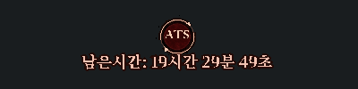

## 2026-11-12 — PSS 독립 연결 재활성화 / 게임 CTransport 유지

[**전체 src**](downloads/CTransport_Aden_FULL_SRC_20261112.zip) · [**DLL·C++·검사**](downloads/CTransport_CORE_20261112.zip) · [PSS 복구·적용 안내](reports/PSS_INDEPENDENT_RESTORE_20261112.md)

PSS 전용 포트·NIO2 그룹2개 스레드·만료 스레드1개를 복구하고 서버 시작 시 별도로 활성화합니다. 토큰 등록과 전용 채널 OPEN을 복구했으며 게임 연결의 설정창 명령을 사용하지 않습니다. 게임은 기존 CTransport.dll ABI3를 유지하고 PSS 기동/종료 실패와 분리합니다. 실제 게임 클라이언트·운영 DB 부하는 별도 검증 대상입니다.

---

## 2026-11-12 — CTransport ABI3: 종료 훅·사전 할당·원본 작업 분배

[**전체 src**](downloads/CTransport_Aden_FULL_SRC_20261112.zip) · [**DLL·C++·검사**](downloads/CTransport_CORE_20261112.zip) · [구현·근거·적용 안내](reports/CTRANSPORT_CORE_20261112.md)

종료 전 훅/활성 등록 해제, 연속 slab 사전 할당, 등록 스레드 소유권,100개 직접 실행+101번째 재게시,1,000개 단위 timer block과32-byte heap을 반영했습니다. 공유 RX/COW·128배치·50ms/200칸 휠도 유지합니다. 게임 접속과 PSS UI 연결 모두 같은 DLL을 필수 사용합니다. 기존 전송 엔진 선택/NIO2 경로는 제거했습니다. 실제 게임 클라이언트·운영 DB 부하는 별도 검증 대상입니다.

최종 ABI3 실제 Windows DLL·생산 FFM/게임 소켓·PSS·1,000개 timer 검사 통과: [실행 기록](https://github.com/choeyeonggeol16-sketch/1234/actions/runs/43246944182).

---

## 2026-11-12 — CTransport.dll 필수 코어 / 기존 전송 엔진 제거

[**전체 src**](downloads/CTransport_Aden_FULL_SRC_20261112.zip) · [**DLL·C++·검사**](downloads/CTransport_CORE_20261112.zip) · [구현·근거·적용 안내](reports/CTRANSPORT_CORE_20261112.md)

스레드별8K/16K 원형 풀, 공유 RX/COW,128배치, 작업 큐와50ms/200칸 타이머 휠을 구현했습니다. 게임 접속과 PSS UI 연결 모두 같은 DLL을 필수 사용합니다. 기존 전송 엔진 선택/NIO2 경로는 제거했습니다. 실제 게임 클라이언트·운영 DB 부하는 별도 검증 대상입니다.

실제 Windows Server2025/JDK21에서 배포 DLL·생산 FFM/게임 소켓·PSS 검사 통과: [실행 기록](https://github.com/choeyeonggeol16-sketch/1234/actions/runs/43234341462).

---

## 2026-11-12 — RKern CIO 명칭 정리 / 추가 복원 범위

[**전체 src**](downloads/RKern_Aden_CIO_CORE_FULL_SRC_20261112.zip) · [**RKern CIO DLL·C++·검사 자료**](downloads/RKern_CIO_CORE_20261112.zip) · [추가 복원 범위·원본 근거](reports/RKERN_CIO_CORE_RESTORE_SCOPE_20261112.md)

현재 DLL·source·version export·실행 옵션을 RKern으로 통일했습니다. `-Drkern.cio.transport=rkern`으로 선택,기존 옵션은 호환 별칭 유지.128배치와 I/O 동작 동일. 추가 pool/16KB/종료/타이머 후보는 원본 명령을 더 읽어 구분했고 아직 구현하지 않았습니다.실제 Windows/FFM/게임·부하는 미검증인 실험본입니다.

---

## 2026-11-12 — 새 NC 재구현 DLL: 최대128개 배치 완료 처리

[**최신 전체 src**](downloads/RKern_Aden_NC_IOCP_BATCH128_FULL_SRC_20261112.zip) · [**새 DLL/C++/테스트**](downloads/RKern_NC_IOCP_BATCH128_CORE_20261112.zip) · [구현·원본 근거·검증](reports/RKERN_NC_IOCP_BATCH128_20261112.md)

선택형 재구현의 worker를 GetQueuedCompletionStatusEx/최대128개로 확장했습니다.항목별 NTSTATUS,종료 토큰 재전달,참조 해제를 검사했습니다. ASan/UBSan/TSan fixture 및 Java1697개 컴파일·새DLL 해시 확인 통과.기존 HP-Socket 기본값과 `-Drkern.cio.transport=nc` 선택은 유지. **실제 Windows/FFM/게임·부하는 미검증**.DLL과src를 함께 적용합니다.

---

## 2026-11-12 — NC I/O 동작 재구현 코어 (선택형 실험본)

[**전체 src**](downloads/RKern_Aden_NC_IOCP_PORT_FULL_SRC_20261112.zip) · [**새 코어/DLL/self-test/소스**](downloads/RKern_NC_IOCP_NATIVE_CORE_20261112.zip) · [복원·구현·검증 보고서](reports/RKERN_NC_IOCP_PORT_20261112.md)

두 EXE의 객체 수명·8KB 버퍼·FIFO·완료 디스패치를 분석하고 독립 C++ IOCP 전송으로 재구현했습니다. 원본 NC 소스 추출본은 아닙니다. 기존 HP-Socket 기본값 유지, `-Drkern.cio.transport=nc`로 선택. x64 DLL 빌드·ASan/UBSan/TSan fixture·Java1697개 전체/기존 회귀 통과. **실제 Windows DLL/FFM/게임·부하는 미검증**.이전 모든 수정 포함,새 SQL 없음.

---

## 2026-11-12 — 물리 명중·AC 결함 수정 통합본

[**최신 전체 src 다운로드**](downloads/RKern_Aden_ALL_FIXES_HIT_AC_FULL_SRC_20261112.zip) · [수정·검증 보고서](reports/RKERN_HIT_AC_FIXED_20261112.md) · [적용 안내](patches/rkern_hit_ac_20261112/README.md)

새 명중 보고서와 대조하여 기본5~95% 제한, AC 역전, 저AC 외삽, signed AC, PC H 합산 오버플로를 보완했습니다. 이전 전체 수정 포함, 새 SQL 없음(기존 HPMP SQL 필수). Java1696개 전체 컴파일·기존/신규 회귀 통과. 저AC는 보수적 경계 제한이며 일본/한국 본섭 명중 공식 전체 복원·실게임 검증은 미완료입니다.

---

## 2026-11-12 — 중복 실행 정리 통합본

[**최신 전체 src 다운로드**](downloads/RKern_Aden_ALL_FIXES_DEDUP_FULL_SRC_20261112.zip) · [중복 수정·검증 보고서](reports/RKERN_DUPLICATE_LOGIC_FIXED_20261112.md) · [적용 안내](patches/rkern_dedup_20261112/README.md)

아인 중복 소모·PC방 보너스·비사냥 경험치 콜백·회복 시간 중복을 정리하고 아머 브레이크 순서를 보완했습니다. 이전 전체 수정 포함. 새 SQL 없음(기존 HP/MP SQL 필수). Java1,696개 전체 컴파일·기존/신규 회귀 통과. 실게임·운영 DB는 미검증.

---

## 2026-11-12 — 맨손·속성 저항 수정 통합본

[**최신 전체 src 다운로드**](downloads/RKern_Aden_ALL_FIXES_UNARMED_ELEMENT_FULL_SRC_20261112.zip) · [구현·중복 감사 보고서](reports/RKERN_UNARMED_ELEMENT_IMPLEMENTED_20261112.md) · [적용 안내](patches/rkern_unarmed_element_20261112/README.md)

맨손 피해/모션, NPC 폴다운 중복 저항 차감, 속성 상한·음수·구식 산술 보완. 이전 전체 수정 포함. 추가 SQL 없음(기존 HP/MP SQL 필수). Java1,696개 전체 컴파일·기존 회귀·추가 재현 검사 통과. Windows 실게임·운영 DB 미검증.

---

## 2026-11-12 — HP/MP 재점검 보완 통합본

[**최신 전체 src 다운로드**](downloads/RKern_Aden_ALL_FIXES_HPMP_RECHECK_FULL_SRC_20261112.zip) · [재점검 보고서](reports/RKERN_HPMP_RECHECK_20261112.md) · [적용 안내](patches/rkern_hpmp_recheck_20261112/README.md)

저장 잠금과 스탯 초기화 경로의 추가 문제 4건을 재현·보완했습니다. 이전 전체 수정 포함. 기존 HP/MP SQL은 필수이며 이미 적용했다면 추가 SQL은 없습니다. Java1,696개 전체 컴파일·기존 회귀·추가 재현 검사 통과. Windows 실게임·운영 MySQL은 미검증입니다.

---

## 2026-11-12 — Aden HP·MP 및 전체 수정 통합 소스

[**최신 전체 src 다운로드**](downloads/RKern_Aden_ALL_FIXES_HPMP_FULL_SRC_20261112.zip) · [**적용 전 필수 SQL**](database/RKern_HPMP_GROWTH_20261112.sql) · [구현·검증 안내](patches/rkern_hpmp_20261112/README.md)

순수 CON/WIS 보너스, HP/MP 실제 성장·표시, MP 자연회복, 순수45 무게 예외, 저장 가능한 성장 이력/레벨다운을 반영했습니다. 이전 물리·마법·IOCP·스레드풀 수정 포함. SQL 컬럼 추가 후 재빌드가 필요합니다. Java1,696개 전체 컴파일·7,200개 시트 평균 대조·관련 회귀 통과. Windows 실게임·운영 MySQL은 미검증입니다.

---

## 2026-11-11 — Aden 물리 피해·마법·네트워크 최신 통합 소스

[**최신 전체 src 다운로드**](downloads/RKern_Aden_IOCP_PHYSICAL_MAGIC_FULL_SRC_20261111.zip) · [수정·검증 내역](patches/rkern_physical_20261111/README.md) · [SHA-256](downloads/RKern_Aden_IOCP_PHYSICAL_MAGIC_FULL_SRC_20261111.zip.sha256)

물리 피해 검토 5항목(SOF, 고정 DR/버닝 순서, 퓨리 피해 방식, 크로우 확률 결합, 손상 무기 하한)을 반영했습니다. 더블브레이크·크래시·퓨리 발동 확률과 운영 설정은 유지합니다. 이전 마법중첩·마법데미지·IOCP·스레드풀 수정 포함. Java 1,695개 전체 타입 컴파일 및 관련 회귀 통과, Windows 실게임·실DB 미검증입니다.

---

## 2026-11-11 — Aden 마법중첩·마법데미지 최신 전체 소스

[**최신 전체 src 다운로드**](downloads/RKern_Aden_IOCP_THREADPOOL_MAGIC_FULL_SRC_20261111.zip) · [적용·구현·검증 내역](patches/rkern_magic_20261111/README.md) · [SHA-256](downloads/RKern_Aden_IOCP_THREADPOOL_MAGIC_FULL_SRC_20261111.zip.sha256)

기존 IOCP·스레드풀 수정 포함. PC→PC/NPC→PC 마법중첩을 피격자 기준 2초 고정 윈도우로 구현했고, 무기 발동 마법·키링크·반사는 제외합니다. 일반 마법의 검증 범위에 2016 MR/WIS·속성저항 후보식을 연결했습니다. 전체 Java 1,695개 타입 컴파일 및 수치·실제 PC 컨트롤러 회귀 통과. Windows 실게임·실DB는 미검증입니다.

---

## 2026-11-11 — Aden IOCP + 스레드풀 최신 전체 소스

[**최신 전체 src 다운로드**](downloads/RKern_Aden_IOCP_THREADPOOL_FIXED_FULL_SRC_20261111.zip) · [수정·적용·검증 안내](patches/rkern_threadpool_20261111/README.md) · [SHA-256](downloads/RKern_Aden_IOCP_THREADPOOL_FIXED_FULL_SRC_20261111.zip.sha256)

기존 네트워크 수정까지 포함한 통합본입니다. 종료 시 일반 작업 대기열 보존·완료 대기, GM 종료 훅 통합, 보스 11개 장시간 루프 분리, 전용 스레드 시작 제한, 확인하지 않던 예약 실패 전파를 반영했습니다. ZIP에는 src/만 있으며 Java 1,694개입니다. Java 21 회귀·전체 구문 파싱 통과; Windows 실게임·전체 서버 연결 빌드는 미검증입니다.

---

## 2026-11-11 — Aden IOCP 네트워크 최신 통합 소스

[**전체 src 다운로드**](downloads/RKern_Aden_IOCP_FIXED_FULL_SRC_20261111.zip) · [적용·구성 안내](patches/rkern_aden_n01_n07_20261111/README.md)

원본 전체 소스에 N01–N07 및 후속 두 수정까지 반영한 통합본입니다. 소스 1,695개(Java 1,694개), 수정 파일 11개를 포함하며 ZIP에는 src 폴더만 있습니다. 기존 native DLL·설정·라이브러리·DB와 함께 사용합니다. 회귀 검사 통과, Windows 실게임·전체 서버 연결 빌드 미검증입니다.

---

## 2026-11-11 — aden.zip 네트워크 코어 검토 보고서

[**상세 보고서 읽기**](reports/aden_network_review_20261111/REPORT_KO.md) · [보고서·재현 로그 다운로드](downloads/aden_network_review_20261111.zip) · [개선 목록 CSV](reports/aden_network_review_20261111/findings.csv)

Windows IOCP·Java 21 FFM·native codec·샤드 실행·버퍼 풀 구조를 검토하고 개선 우선순위 7개를 정리했습니다. 실행 중 패킷과 로그아웃 정리의 직렬화, 종료 전체 deadline을 우선 권고합니다. 수신 stash 데이터 손상 조건·await 즉시 반환·registry tombstone 누적은 선택한 실제 Java 클래스로 로컬 재현했습니다. DLL과 게임은 가짜 구현으로 대체한 검사이며 Windows 실게임·전체 서버 빌드·부하 성능은 미검증입니다.

보고서에는 코드 위치·영향·수정 방법·검증 계획이 있습니다. 원본 소스와 DLL은 보고서 묶음에 포함하지 않았습니다.

---

## 2026-11-11 — 기존 MS949 프로젝트용 src만 복구

[**MS949 src 폴더만 다운로드**](downloads/L1J_49027_ATS_V10_MS949_SRC_ONLY_20261111.zip)

UTF-8 소스를 MS949로 읽을 때 발생한 `SkillId` 한글 식별자 깨짐을 정상 원본으로 복구할 수 있는 ZIP입니다. ZIP에는 `src/`만 있으며 Java 971개와 기존 부속 파일 2개를 포함합니다. 기존 V9 서버 소스와 바이트 단위로 동일한 MS949/CP949 소스이며, V9 중단 수정과 ATS 서버 기능을 유지합니다. DLL·DB·프로젝트 설정은 ZIP에 포함하지 않았습니다.

기존 소스를 백업하고 `src/`를 반영한 뒤 IDE의 프로젝트·파일 인코딩을 **MS949/CP949**로 맞추고 Clean/Build하세요. V10에서 컨트롤러만 UTF-8로 지정했다면 그 파일 지정도 MS949로 맞춥니다. 외부 빌드는 소스 인코딩 `MS949`를 사용합니다. 서버 Java 971개 MS949 구문 파싱과 이동/ATS 회귀 검사를 통과했으며 전체 서버 의존성 연결 빌드는 미검증입니다.

---

## 2026-11-11 — ATS V10 원 안의 ATS 표시 / Java 한글 UTF-8 통일

[**V10 전체 소스·DLL 다운로드**](downloads/L1J_49027_ATS_V10_FULL_SRC_20261111.zip) · [클라이언트 UI만](downloads/L1J_49027_ATS_V10_CLIENT_UI_20261111.zip) · [적용·인코딩 안내](patches/ats_v10_utf8_inside_20261111/ATS_V10_APPLY_KO.md) · [오토헌트 컨트롤러](patches/ats_v10_utf8_inside_20261111/src/l1j/server/AutoHuntSystem/AutoHuntController.java)

참고 영상처럼 ATS 글자를 원 안에 고정하고 회전 화살표와 원 아래 남은 시간을 표시합니다. V9의 창 밖 클릭·포커스 상실 중단 수정은 유지합니다.

CP949였던 컨트롤러를 포함해 전체 Java 소스를 UTF-8로 맞췄습니다. **서버 Java 971개의 유니코드 내용은 V9와 동일**하며 한글 식별자·메시지·서버 로직을 유지합니다. Eclipse UTF-8 설정·`.editorconfig`·javac 옵션을 포함했습니다. 소스를 갱신할 때 전체 `src/`를 반영하고 **외부 Ant/Maven 빌드의 소스 인코딩도 UTF-8로 맞추세요.** 기존 프로젝트의 build.xml/pom.xml은 제공되지 않아 외부 빌드 파일은 직접 변경하지 못했습니다.

V9 서버 적용자는 HUD 수정에 DLL/배경만 교체하면 됩니다. V7/V8 서버는 V9 서버 수정도 반영하도록 소스 재빌드가 필요합니다. DB 변경은 없습니다.

동일 HUD의 Wine64 미리보기이며 한국어는 대체 글꼴입니다. PE32 빌드·971개 서버 Java UTF-8 구문 파싱·세션/ATS 회귀 검사를 통과했습니다. **전체 Java 서버 의존성 연결 빌드와 Windows Mega.bin 실게임은 미검증입니다.**

---

## 2026-11-11 — ATS V9 창 밖 클릭·포커스 중단 수정 / 작은 시간 표시

[**V9 서버 패치·DLL 다운로드**](downloads/L1J_49027_ATS_V9_PATCH_DLL_20261111.zip) · [전체 소스·DLL](downloads/L1J_49027_ATS_V9_FULL_SRC_20261111.zip) · [적용 안내](patches/ats_v9_focus_20261111/ATS_V9_APPLY_KO.md) · [검증 기록](patches/ats_v9_focus_20261111/validation/report-v9.json)

게임 밖 클릭과 포커스 상실을 수동 중단으로 처리하던 DLL 경로를 수정했습니다. 게임 안에서 직접 누르는 수동 중단은 유지합니다. 서버는 이동 패킷이 전혀 없고 원점이 같은 경로가 재시도 한도를 소진하면, 자사 상태를 유지하고 경로를 다시 계획합니다.

**DLL 교체와 서버 Java 2개 반영·재빌드가 함께 필요합니다.** V7 ATS DB와 잔액은 그대로 사용합니다. V6 이하에서 처음 설치한다면 전체 소스의 V7 서버/DB 안내부터 적용하세요.

참고 이미지처럼 링 아래에 ATS를 놓고, 그 아래 남은 시간을 별도 글자로 표시합니다. 기본 시간·분 표시, 시간 글씨 90%입니다. 실제 이용시간 잔액·차감 규칙은 바꾸지 않았습니다.

미리보기는 같은 HUD 소스를 Wine64에서 실행한 화면이며 한국어는 대체 글꼴입니다. PE32 빌드·이동/시간/클릭 분류 검사·Java 세션 회귀와 가짜 게임 함수를 연결한 실제 Win32 메시지 어댑터의 백그라운드 창 검사를 통과했습니다. **V9를 넣은 Windows Mega.bin 실게임과 전체 Java 서버 연결 빌드는 미검증입니다.**

---

## 2026-11-11 — ATS HUD 외형 개선 V8 (V7 서버 유지)

[**V8 클라이언트 UI 다운로드**](downloads/L1J_49027_ATS_V8_CLIENT_UI_20261111.zip) · [전체 소스·DLL](downloads/L1J_49027_ATS_V8_FULL_SRC_20261111.zip) · [적용 안내](patches/ats_v8_visual_20261111/ATS_V8_APPLY_KO.md)

참고 영상과 사용자 V7 영상을 비교해 겹친 테두리를 얇은 한 겹 링으로 정렬했습니다. ATS 문자는 고정한 채 작은 화살표 두 개가 돌고, 시간 문구는 밝은 살구색·굵은 서체로 바꿨습니다. 배경·문자·회전선을 분리해 작은 창에서의 표시를 다듬었습니다.

미리보기는 동일 렌더러를 Wine64에서 실행한 화면이며 한국어 글꼴은 대체 서체입니다. 실제 Windows 게임 V8 화면은 아직 확인하지 않았습니다.

**V7 서버 적용자는 서버 재빌드나 DB 수정 없이**, 게임 종료 후 클라이언트 ZIP의 `dinput.dll`과 `ats_bg.png`를 Mega.bin 옆에 복사하면 됩니다. 기존 `ats_hud.ini` 위치·크기 설정은 보존할 수 있습니다. 새 배경 파일에는 글자가 없으며 ATS 문자와 회전 화살표는 DLL이 그립니다.

32비트 빌드, 시간 상태 검사, 기존 이동 코어 10,000회 회귀 검사를 통과했습니다. 서버 Java·DB·제어 프로토콜·이동 코어는 V7과 동일합니다.

---

## 2026-11-11 — ATS 상태 HUD·이용시간·레벨·맵 제한 V7

[**V7 전체 소스·DLL 다운로드**](downloads/L1J_49027_ATS_V7_FULL_SRC_20261111.zip) · [**적용 안내**](patches/ats_v7_20261111/ATS_V7_APPLY_KO.md) · [소스 보기](patches/ats_v7_20261111) · [검증 결과](patches/ats_v7_20261111/validation/report-v7.json)

붉은 ATS 아이콘, 글자는 고정한 둘레 회전 효과, 초 단위 남은 시간 HUD를 추가했습니다. 자동사냥을 켠 동안만 차감하고 정지·사망·접속 종료 시 숨깁니다. 잔여 시간은 캐릭터별 DB에 저장하며, 레벨·허용 맵 조건은 시작할 때와 실행 중에 검사합니다.

**V7은 DLL만 교체하는 버전이 아닙니다.** 게임 DB에 `ATS_V7.sql`을 적용하고 서버 Java를 재빌드한 뒤, `dinput.dll`·`ats.png`·`ats_hud.ini`를 함께 복사하세요. 게임 없이 확인할 수 있는 `ATS_Preview.exe`도 포함했습니다.

기본값은 캐릭터 첫 이용 시 24시간 한 번 지급, 최소 1레벨, 레벨 상한·맵 제한 미지정입니다. 서버의 `config/autohunt_ats.properties`에서 지급량·레벨·맵을 설정합니다. 일일 자동 지급은 포함하지 않았습니다. 정상 정지 시 잔여 시간을 보존하며, 강제 종료·환급 실패 시 미사용 예약분 최대 약 10초가 추가 차감될 수 있습니다.

32비트 PE32 빌드, 기존 이동 코어 회귀, 시간·레벨·맵 경계, 실제 Netty 채널 메시지 및 H2 MySQL 모드의 JDBC 저장 검사를 통과했습니다. **전체 서버 의존성 링크·실제 MySQL·Windows 실게임 HUD와 플레이는 아직 검증하지 않았습니다.** 기존 V6 이동 코어와 네이티브 좌표/입력 어댑터는 유지했습니다.

---

## 2026-11-11 — 같은 타일의 클릭 대상 확인 V6 (V5 서버 유지)

[**V6 DLL 다운로드**](downloads/L1J_49027_ClickTarget_V6_Client_DLL_20261111.zip) · [**전체 소스·DLL**](downloads/L1J_49027_ClickTarget_V6_FULL_SRC_20261111.zip) · [적용·검증 안내](patches/nativestep_hover_20261111/README.md)

사용자 V5 로그의 중단 문구는 승인 확인 실패와 다른 목표 선택을 함께 표시했습니다. 원본 DOWN 함수에서 아이템 이름이 바닥 클릭을 가져가는 경우를 재현했습니다. V6는 승인된 같은 타일 안의 10개 지점에서 물체/이름 영역을 확인하고, DOWN 직전에 승인 유효성을 검사합니다. 종료 이유·목표 상태·밀리초 로그도 추가했습니다.

**현재 V5 서버는 유지하고 게임 종료 후 dinput.dll만 교체합니다.** DLL 표시는 `native-tile-input-v6-20261111`이며 서버 표시는 `step-v5 sprite-cadence`가 맞습니다. F9 보정은 필요 없습니다.

원본 후보 좌표 1,920개, 원본 이름 충돌 8개 재현/회피, 기존 상태 검사와 PE32 빌드를 통과했습니다. **이 검사는 통제된 원본 함수 재현이며, 사용자 중단의 모든 원인이나 Windows 실게임에서 V6의 해결 여부를 확정하지 않습니다.** 원본 실행 파일은 배포하지 않습니다.

---

## 2026-11-11 — 49027 걷기 간격·입력 대기 V5

[**V5 서버 패치·DLL**](downloads/L1J_49027_SpriteCadence_V5_PATCH_DLL_20261111.zip) · [**V5 전체 소스·DLL**](downloads/L1J_49027_SpriteCadence_V5_FULL_SRC_20261111.zip) · [적용·검증 안내](patches/nativestep_cadence_20261111/README.md)

V4의 기본 이동은 사용자 로그와 보고로 확인됐지만 걷기가 부자연스러웠습니다. 성공한 걸음의 고정 600ms 대기를 캐릭터의 원래 WALK 간격으로 바꾸고, AI의 중복 걷기 타이머를 제거했습니다. DLL은 원본 목표 선택 함수가 클릭을 받는 상태인지 확인한 뒤 입력합니다.

**서버 Java 3개를 함께 반영해 재빌드·재시작하고 V5 dinput.dll도 교체해야 합니다.** 서버 표시는 `step-v5 sprite-cadence`, DLL 표시는 `native-tile-input-v5-20261111`입니다. F9 보정은 필요 없습니다.

7종 서버 걷기 간격·승인/복구 회귀, Java 3개 구문 파싱, 원본 x86 좌표 192개·입력 대기 7개 사례와 PE32 빌드를 통과했습니다. **전체 서버 의존성 빌드와 Windows 실게임에서 V5의 이동·카메라 자연스러움은 미검증입니다.** 원본 Mega.bin은 배포하지 않습니다.

---

아래는 이전 버전의 작업 기록입니다.

## 2026-11-11 — Mega.bin 원본 함수 기반 입력 V4 (실게임 검증 대기)

[**V4 DLL 다운로드**](downloads/L1J_49027_MegaNative_V4_Client_DLL_20261111.zip) · [**V4 전체 소스**](downloads/L1J_49027_MegaNative_V4_FULL_SRC_20261111.zip) · [적용 안내](patches/nativestep_input_20261111/README.md) · [실행 파일 분석 근거](patches/nativestep_input_20261111/validation/mega-native-findings-v4.md)

사용자가 제공한 실제 Mega.bin의 좌표 변환·다음 타일·목표 해제 함수를 연결했습니다. 추정 발 위치 대신 원본 함수로 계산한 한 칸을 검증하고 게임 창 메시지로 입력합니다. OS 커서/버튼 주입과 발 위치 보정은 사용하지 않습니다. 서버와 원본 Mega.bin은 그대로입니다. DLL 표시는 `native-tile-input-v4-20261111`입니다.

원본 x86 코드의 192개 통제된 사례와 PE32 빌드·기존 코어 검사를 통과했습니다. **Windows 실게임 메시지 전달·연속 이동·카메라 추적은 미검증입니다.** 지원 해시와 코드가 일치하는 클라이언트에서만 입력합니다. 원본 실행 파일은 배포하지 않습니다.

---

아래 V1~V3는 실행 파일 확보 전의 실패한 수정 기록입니다.

> **V3 당시 상태: 적용 후에도 사용자가 `5번 요청 → 실제 1번` 방향 불일치를 보고했습니다. 해당 버전의 실게임 정상 동작은 확인되지 않았습니다.**
> 좌표·방향 추정만으로 만든 변경으로 문제가 해결되지 않았으므로, 실제 실행 중인 Mega.bin의 입력·좌표 변환 경로를 확인하기 전에는 추가 방향표 변경을 진행하지 않습니다. 아래 다운로드는 검증 중인 이전 작업 기록입니다.

## 2026-11-11 — 49027 입력 V3: 캐릭터 가로 중앙 기준점

[**V3 전체 소스·빌드된 DLL**](downloads/L1J_49027_CenteredAnchor_V3_FULL_SRC_20261111.zip) · [**V3 DLL만 받기**](downloads/L1J_49027_CenteredAnchor_V3_Client_DLL_20261111.zip) · [적용·검증 안내](patches/nativestep_input_20261111/README.md)

스크린샷의 가로 중앙 캐릭터와 저장된 발 기준 X=289가 맞지 않는 문제를 수정했습니다. 960×720 창에서는 X=480을 사용하고 보정한 발 Y=333을 유지합니다. 기존 INI를 보존하며 V2 방향표와 서버 Java·검사는 그대로입니다. 새 DLL 표시는 `centered-anchor-v3-20261111`입니다.

기준점 재현·입력 상태·10,000회 반복 ASan/UBSan 검사와 PE32 빌드를 통과했습니다. **실제 게임의 V3 이동·잔여 입력·카메라 추적은 아직 미검증입니다.**

---

## 2026-11-11 — 49027 입력 V2: 방향표·클릭 직전 커서 재정렬

[**V2 전체 소스·빌드된 DLL**](downloads/L1J_49027_ScreenHeading_V2_FULL_SRC_20261111.zip) · [**V2 DLL만 받기**](downloads/L1J_49027_ScreenHeading_V2_Client_DLL_20261111.zip) · [적용·검증 안내](patches/nativestep_input_20261111/README.md)

사용자 로그의 `7번 요청 → 실제 6번`과 `cursor changed before click` 중단을 바탕으로 수정했습니다. 기본 7번 클릭을 왼쪽 위로 바꾸고, 마지막 좌표 이동과 누름을 한 Windows 입력 묶음으로 보냅니다. 기존 발 위치 보정 파일은 재사용하며, 서버 Java와 방향 검사는 유지합니다. 새 DLL 로그 표시는 `screen-heading-v2-20261111`입니다.

C++ 코어 회귀(10,000회 반복·ASan/UBSan), 화면 방향표 및 가상 데스크톱 좌표 변환, PE32 빌드·export 검사를 통과했습니다. **전체 8방향과 실제 게임 이동·카메라 추적은 아직 미검증입니다.**

---

## 2026-11-11 — 49027 자동사냥 입력 준비·취소 및 발 위치 보정

[전체 소스·빌드된 DLL ZIP](downloads/L1J_49027_ConfirmedInput_AnchorCalibration_FULL_SRC_20261111.zip) · [DLL만 받기](downloads/L1J_49027_Client_DLL_20261111.zip) · [적용·검증 안내](patches/nativestep_input_20261111/README.md)

실제 마우스 누름 성공 시점부터 유지 시간을 계산하고, `CANCEL → 다음 방향` 처리 중 이동 명령이 유실되는 경로를 수정했습니다. 게임 내 정상 걷기 입력을 사용하며, 자동사냥을 끈 상태에서 캐릭터 발밑에 커서를 놓고 **Ctrl+Alt+F9로 기준점을 먼저 보정**해야 합니다. 해상도 변경 시 재보정합니다. 첨부 원본의 서버 Java 967개는 변경하지 않았습니다.

C++ 코어 10,000회 반복 및 지연·만료·취소 회귀검사(ASan/UBSan), Windows PE32 교차 빌드와 DirectInput 7개 export/ordinal 검사를 통과했습니다. **실제 Windows 게임 이동과 카메라 추적은 미검증입니다.** 이전 `dinput.dll`을 백업하고 적용하세요.

---

## 2026-11-04 — PSS 금지 텔만 거절 V10

[전체 소스 ZIP](https://github.com/choeyeonggeol16-sketch/1234/raw/refs/heads/main/downloads/PSS_V10_Teleport_Reject_Only_20261104_FULL_SRC.zip) · [V9 기준 패치](https://github.com/choeyeonggeol16-sketch/1234/raw/refs/heads/main/downloads/PSS_V10_Teleport_Reject_Only_20261104_PATCH.zip) · [설명](PSS_V10_TELEPORT_REJECT_ONLY_20261104.md)

금지된 텔레포트 때문에 PSS 전체를 중지하던 V9 처리를 제거했습니다. 텔만 거절하고 PSS 세션·mode·마감 시각을 유지하며 중지 통지를 보내지 않습니다. GM 맵 우회와 늦은 텔 완료 응답의 재이동 차단은 유지합니다. 사용자가 올린 인터서버 변경 3개 파일도 그대로입니다.

매니페스트 포함. 전체 Java 1,709개 컴파일, PSS 13개 그룹·1,040개 단언 및 텔레포트 48개 단언 통과. 클라이언트 내부의 반복 시도 판단 자체를 수정한 패치는 아닙니다.

## 2026-11-04 — 최신 첨부 팩 PSS 텔레포트 수정 V9

[전체 소스 ZIP](https://github.com/choeyeonggeol16-sketch/1234/raw/refs/heads/main/downloads/PSS_V9_LatestPack_Teleport_Fix_20261104_FULL_SRC.zip) · [첨부 팩 기준 Java 7개 패치](https://github.com/choeyeonggeol16-sketch/1234/raw/refs/heads/main/downloads/PSS_V9_LatestPack_Teleport_Fix_20261104_PATCH.zip) · [변경·검증·적용 안내](PSS_V9_LATESTPACK_TELEPORT_FIX_20261104.md)

기준은 RKern_PSS_V8_InterServer_Kind0to6_GM_AB_FULL_SRC_20261104.zip입니다. 새 인터서버 변경 3개 파일을 그대로 유지했습니다. PSS 접속의 GM 텔레포트 맵 우회와 늦은 완료 응답의 재이동을 차단하고, 금지 텔레포트 시 PSS 중지 통지를 한 번 보냅니다. 정상 사냥을 계속하는 클라이언트 AI를 구현한 변경은 아닙니다.

전체 Java 1,709개 컴파일, PSS 13개 그룹·994개 단언 및 텔레포트 48개 단언 통과. 매니페스트 포함. 실클라이언트 검증은 별도입니다.

## 2026-11-04 — PSS 빈 시작 요청 호환 V8

[전체 소스 ZIP](https://github.com/choeyeonggeol16-sketch/1234/raw/refs/heads/main/downloads/PSS_2019_Bodyless_Start_V8_20261104_FULL_SRC.zip) · [V7용 패치](https://github.com/choeyeonggeol16-sketch/1234/raw/refs/heads/main/downloads/PSS_2019_Bodyless_Start_V8_20261104_PATCH.zip) · [수정·검증 내역](PSS_2019_BODYLESS_START_V8_20261104.md)

실제 2019 클라이언트의 0바이트 2101 요청을 GM 시험 모드로 처리하도록 수정했습니다. 반복 요청은 기존 mode와 마감 시각을 유지합니다. 매니페스트 포함, 전체 Java 1,709개 컴파일과 12개 그룹·987개 단언 통과. 실제 승인 이후 클라이언트 사냥은 미검증입니다.

## 2026-11-04 — V7 MANIFEST 누락 보충

[누락 파일만 받기](https://github.com/choeyeonggeol16-sketch/1234/raw/refs/heads/main/downloads/PSS_2019_Manifest_Fix_20261104.zip)

Ant의 `src/META-INF/MANIFEST.MF does not exist` 오류를 보충합니다. 프로젝트 루트에 압축을 풀고 Ant를 다시 실행하세요. V7 전체 소스/패치 ZIP에도 파일을 추가했습니다. 현재 실제 실행 진입점인 `l1j.server.swing.chocco`를 사용하며, 기존 Java 1,709개 컴파일 결과로 JAR 생성과 main 메서드 존재를 확인했습니다. Java 소스·build.xml·lib 수정은 없습니다.

## 2026-11-04 — 2019 PSS 서버 연결 시험판 V7

[전체 소스 ZIP](https://github.com/choeyeonggeol16-sketch/1234/raw/refs/heads/main/downloads/PSS_2019_Server_Bridge_V7_20261104_FULL_SRC.zip) · [V6 기준 Java 6개 패치](https://github.com/choeyeonggeol16-sketch/1234/raw/refs/heads/main/downloads/PSS_2019_Server_Bridge_V7_20261104_PATCH.zip) · [적용 순서·로그 확인](PSS_2019_SERVER_BRIDGE_V7_20261104.md)

**GM 전용, 시작당 600초 시험 응답입니다.** 첨부 PSS버튼.exe/Pss2019.dll의 네이티브 클라이언트 요청에 2101→2102 시작, 2103→2104 중지, 2106→2107 시간 응답을 연결했습니다. 서버 자동사냥과 실행권을 원자적으로 구분하고, 접속/캐릭터 변경에서 정리합니다. PC 클래스는 변경하지 않았습니다.

전체 Java 1,709개 컴파일, PSS 11개 그룹·979개 단언, 실제 CIOClient로 300회 동시 실행권 경쟁 검증 통과. **실제 2019 게임 클라이언트의 설정창·전투 흐름·사냥은 미검증이며, 서버 자동사냥 엔진을 켜는 패치가 아닙니다.** PATCH는 V6 `a266fa0` 기준 Java 6개를 모두 적용합니다.

## 2026-11-04 — PC 스킬 효과 분리 V6

[전체 소스 ZIP](https://github.com/choeyeonggeol16-sketch/1234/raw/refs/heads/main/downloads/Pc_Skill_Effects_Refactor_V6_20261104_FULL_SRC.zip) · [V5 기준 Java 5개 패치](https://github.com/choeyeonggeol16-sketch/1234/raw/refs/heads/main/downloads/Pc_Skill_Effects_Refactor_V6_20261104_PATCH.zip) · [구조·검증·적용 안내](PC_SKILL_EFFECTS_REFACTOR_V6_20261104.md)

L1PcInstance의 스킬·버프 64개를 패시브·잠재력·혈맹·수배의 정적 모듈 4개로 분리했습니다. PC에는 기존 공개 API의 한 줄 연결을 남겼고 잠재력 31종의 패킷 조립을 공통화했습니다. PC 코드는 9,922줄에서 8,825줄로 줄었습니다.

전체 Java 1,707개 컴파일, 31,744개 효과 비교(잠재력 패킷 바이트 15,004개 상황 포함), PC 공개 API·필드·기타 멤버 보존 검사 통과. **PATCH는 V5 `95d0548` 기준이며 Java 5개를 모두 적용해야 합니다.** 캐릭터당 필드 구조와 기존 적용 순서는 유지합니다. 실게임 통합과 운영 성능은 별도 검증이 필요합니다.

## 2026-11-04 — 아이템 사용 리팩토링 V5

[전체 소스 ZIP](https://github.com/choeyeonggeol16-sketch/1234/raw/refs/heads/main/downloads/Item_Use_Refactor_V5_20261104_FULL_SRC.zip) · [V4 기준 Java 58개 패치](https://github.com/choeyeonggeol16-sketch/1234/raw/refs/heads/main/downloads/Item_Use_Refactor_V5_20261104_PATCH.zip) · [변경·검증·적용 안내](ITEM_USE_REFACTOR_V5_20261104.md)

학습 아이템 43종의 직업·레벨·선행 조건·중복 안내·소모 연결을 공통 규칙으로 합쳤습니다. 아이템별 검사 우선순위와 저장 후 효과 순서를 유지하고, 동일한 활성화/효과음을 공통화했습니다. 불필요한 import 875개도 정리했습니다.

전체 Java 1,703개 컴파일, V4와 44,032개 상황 실행 비교, 43개 저장 후 효과의 독립 구문 검사, 사용 단계 12개·트랜잭션 27개 검증 통과. **PATCH는 V4 `532c1ee` 기준입니다. V4 미적용 상태는 FULL_SRC를 사용하세요.** 실게임 통합과 운영 메모리 절감률은 별도 확인이 필요합니다.

## 2026-11-04 — 아이템 사용 리팩토링 V4

[전체 소스 ZIP](https://github.com/choeyeonggeol16-sketch/1234/raw/refs/heads/main/downloads/Item_Use_Refactor_V4_20261104_FULL_SRC.zip) · [Java 16개 패치 ZIP](https://github.com/choeyeonggeol16-sketch/1234/raw/refs/heads/main/downloads/Item_Use_Refactor_V4_20261104_PATCH.zip) · [변경·검증·적용 안내](ITEM_USE_REFACTOR_V4_20261104.md)

최근 첨부한 인터서버 PacketTrace 소스 기준입니다. 마법서 학습 6개 중복 구현을 통합하고 전투·학습 효과를 분리했습니다. 스턴 지속시간의 전역 변수 경합, 반복 CSV 분리·난수 객체 생성, 물약 데이터 구조와 XML 재로딩 실패 처리를 수정했습니다.

전체 Java 1,702개 컴파일, 마법서 사용 3,000개 비교, 지속시간 5,000개 비교·동시 접근 12,000회, 효과 본문·경로 검사와 사용 단계 12개·트랜잭션 27개 검증을 통과했습니다. **PATCH는 최근 첨부한 인터서버 ZIP 기준이며 Java 16개를 모두 적용하세요.** 실게임 검증과 운영 메모리 절감률 측정은 별도로 필요합니다.

## 2026-11-04 — class_id를 DB에서 직접 읽는 전체 SRC

[DB 직접 로딩 전체 SRC](https://github.com/choeyeonggeol16-sketch/1234/raw/refs/heads/main/downloads/NPC_ClassId_DB_Only_20261104_FULL_SRC.zip) · [Java 4개 패치](https://github.com/choeyeonggeol16-sketch/1234/raw/refs/heads/main/downloads/NPC_ClassId_DB_Only_20261104_PATCH.zip) · [적용 안내](NPC_CLASSID_DB_ONLY_SRC_20261104.md)

**설정 파일 없이 npc.class_id를 직접 읽는 소스입니다.** 전체 Java 1,691개 컴파일, 실제 NpcTable의 DB 로딩/옛 설정 무시 및 송신기·팩토리 3경로·15개 ID 조합 검사 통과. 소스 적용 후 전체 Clean/Rebuild·재시작하세요. DB 적용·복구 SQL과 대조표도 ZIP의 database 폴더에 포함했습니다. 실제 DB 적용·MySQL/Windows 게임 화면 통합은 미실행입니다.

---

## 2026-11-04 — 몬스터북 대상 NPC class_id 일괄 대조

[적용 SQL·대조표 ZIP](https://github.com/choeyeonggeol16-sketch/1234/raw/refs/heads/main/downloads/Monsterbook_NPC_ClassId_Mapping_20261104.zip) · [상세 내역](NPC_BOOK_CLASSID_MAPPING_20261104.md)

첨부 net.sql의 몬스터북 고유 NPC 612종만 대조했습니다. 현재 이미지 기준 385종 확정, 227종은 다중 후보/누락으로 검토표에 분리했습니다. 실제 이미지가 새 팩과 같은 경우도 포함해 검증된 706개 번호·이미지 조합을 적용 SQL에 넣었습니다. NPC 번호·이미지·능력치는 유지하고 class_id만 갱신하며, 어둠의 흑기사 16853→14606을 반영합니다. DB 값 사용용 설정 파일과 적용 전 값 백업/되돌리기 SQL을 제공합니다. **실행 DB 적용은 아직 하지 않았으며, MySQL 통합은 미실행입니다.**

---

## 2026-11-04 — 어둠의 흑기사 class_id 표시 테스트

[테스트 전체 소스](https://github.com/choeyeonggeol16-sketch/1234/raw/refs/heads/main/downloads/NPC_ClassId_Outline_Test_20261104_FULL_SRC.zip) · [Java 5개·설정 패치](https://github.com/choeyeonggeol16-sketch/1234/raw/refs/heads/main/downloads/NPC_ClassId_Outline_Test_20261104_PATCH.zip) · [적용·검증 안내](NPC_CLASSID_OUTLINE_TEST_20261104.md)

이번 첨부 src.zip을 기준으로 몬스터 종류 ID를 기존 등장 패킷 39번 필드에 연결했습니다. **7310054 → 10030은 사용자 제시 후보값이며 실제 19205 화면 표시는 미검증입니다.** DB 변경 없이 실행 폴더의 `config/npc_class_id.properties`로 테스트합니다. 전체 Java 1,692개 컴파일과 실제 송신기/팩토리 세 경로·15개 ID 조합 검사를 통과했습니다. 적용 후 전체 Clean/Rebuild·재시작하고 진행 중인 주간 카드 대상으로 확인하세요. 설정 0으로 끄고 재시작하면 비교할 수 있습니다.

---

## 2026-11-04 — 첨부 DB의 테이블 기준 소스 정리

[전체 소스 ZIP](https://github.com/choeyeonggeol16-sketch/1234/raw/refs/heads/main/downloads/DB_Table_Cleanup_20261104_FULL_SRC.zip) · [수정·삭제 패치 ZIP](https://github.com/choeyeonggeol16-sketch/1234/raw/refs/heads/main/downloads/DB_Table_Cleanup_20261104_PATCH.zip) · [변경·검증·적용 안내](DB_TABLE_CLEANUP_20261104.md)

첨부 DB의 테이블 252개와 비교해 없는 테이블 32종의 SQL·로더·관련 호출을 정리했습니다. 운영 Java 39개 수정·32개 삭제, 전체 1,691개 컴파일과 아이템 사용 12개·거래 27개 회귀검사 통과. 정적 SQL과 동적 테이블 계열 검사에서 없는 참조 0건입니다. DB 덤프와 플레이어 데이터는 포함하지 않았습니다.

**FULL_SRC는 기존 src를 백업 후 교체하세요. PATCH는 63aca89 기준이며 deleted_files.txt의 32개 파일 삭제도 필수입니다.** JDK 21 / UTF-8 / `--enable-preview`로 전체 Clean/Rebuild 후 재시작하세요. 실제 게임 클라이언트·운영 DB 기동 검사는 미실행입니다.

---

## 2026-11-04 — 서버 버전 핸드셰이크 중복·거절 종료 정리

[전체 소스 ZIP](https://github.com/choeyeonggeol16-sketch/1234/raw/refs/heads/main/downloads/Server_Version_Handshake_Cleanup_20261104_FULL_SRC.zip) · [Java 3개 패치 ZIP](https://github.com/choeyeonggeol16-sketch/1234/raw/refs/heads/main/downloads/Server_Version_Handshake_Cleanup_20261104_PATCH.zip) · [변경·검증·적용 안내](SERVER_VERSION_HANDSHAKE_CLEANUP_20261104.md)

`SC_ServerVersionInfo`의 중복 직렬화·전달 래퍼를 제거했습니다. 거절마다 만들던 스레드풀 타이머를 없애고 기존 소켓 데드라인 작업을 재사용합니다. 신규 요청은 차단하고, 3초 최소 유예와 기존 송신 완료를 기다린 뒤 닫습니다. 느린 송신의 30초 제한과 일반 graceful close도 유지합니다.

핸드셰이크 128건 바이트 비교, 종료 계약 16개 그룹·100회 경쟁 검사, 실제 localhost TCP 응답→3초 유예→EOF, 다른 62종 프로토콜 회귀와 전체 Java 1,723개 컴파일 통과. 실제 게임 클라이언트·운영 DB·Windows IOCP 통합은 미검증입니다. **PATCH는 9e633d7 기준이며 Java 3개 모두 적용 후 JDK 21 / UTF-8 / `--enable-preview`로 전체 Clean/Rebuild·재시작하세요.**

---

## 2026-11-04 — 프로토콜 직접 송신·임시 패킷 객체 절감

[전체 소스 ZIP](https://github.com/choeyeonggeol16-sketch/1234/raw/refs/heads/main/downloads/Protocol_Direct_Send_Refactor_20261104_FULL_SRC.zip) · [Java 115개 패치 ZIP](https://github.com/choeyeonggeol16-sketch/1234/raw/refs/heads/main/downloads/Protocol_Direct_Send_Refactor_20261104_PATCH.zip) · [변경·검증·적용 안내](PROTOCOL_DIRECT_SEND_REFACTOR_20261104.md)

프로토콜 63종에 필드 직접쓰기 API를 추가하고 실제 버프·스탯·슬롯·펫·월드·파티·제작·도감 송신을 연결했습니다. 인벤토리/창고의 패킷·아이템 정보·청크 리스트 래퍼와 매번 만드는 Raw 전송 래퍼를 줄였습니다. 프로토콜 ID·선택 필드·0/false·MS949·중첩 길이는 유지하며, 보관 중인 출석/랭킹 데이터와 호환 빌더는 남겼습니다.

바이트 비교 7,043건, 프레임 계약 44개 단언, 아이템 사용 12건·거래 27건·장비 14건, 전체 Java 1,723개 컴파일 통과. 버프 격리 측정은 72→0 B/회이며 운영 서버 전체 절감률은 아닙니다. 실제 클라이언트·운영 DB/Windows IOCP 통합은 미검증입니다. **PATCH는 공개 아이템 V3 기준이며 Java 115개 모두 적용 후 JDK 21 / UTF-8 / `--enable-preview`로 Clean/Rebuild·재시작하세요.**

---

## 2026-11-04 — LC 클라이언트 초기 실행 진단 도구

[진단 ZIP 다운로드](https://github.com/choeyeonggeol16-sketch/1234/raw/refs/heads/main/downloads/LC_First_Check_20261104.zip) · [사용법](LC_FIRST_CHECK_20261104.md)

Windows에서 도구를 실행한 뒤 120초 안에 퍼플로 게임을 실행하세요. LC.exe 버전·해시, 로딩 DLL 메타데이터, TCP 접속 주소/포트와 클라이언트 폴더의 파일 이름·크기를 바탕화면 ZIP으로 수집합니다. 접속 호환성 분석의 첫 단계이며 Windows 실행 검증은 아직 하지 않았습니다.

---

## 2026-11-04 — 아이템 사용 처리 리팩토링 V3

[전체 소스 ZIP](https://github.com/choeyeonggeol16-sketch/1234/raw/refs/heads/main/downloads/Item_Use_Refactor_V3_20261104_FULL_SRC.zip) · [누적 패치 ZIP](https://github.com/choeyeonggeol16-sketch/1234/raw/refs/heads/main/downloads/Item_Use_Refactor_V3_20261104_PATCH.zip) · [구조·검증·적용 안내](ITEM_USE_REFACTOR_V3_20261104.md)

4,768줄에 몰린 아이템 사용 흐름을 대상 해석·조건 검사·선행 처리·효과 분기·정상 후처리로 분리했습니다. 진행 순서는 35줄 서비스에서 읽을 수 있고, 효과 코드는 종류별 10개 모듈과 기존 함수에 남겼습니다. 확장 시스템 우선순위, 204개 분기의 실행 코드·게임 문자열·조기 종료 차이를 보존했습니다. 소모/예약 공통부 V2와 기존 NPC·자동사냥 수정도 포함합니다.

대상 해석 51,240개 입력 비교, 사용 흐름 12건·트랜잭션 27건·장비 14건, 전체 Java 1,723개 컴파일 통과. 실제 클라이언트·운영 DB의 전체 아이템 사용 및 운영 성능은 미검증입니다. **PATCH는 Java 45개(신규 21개 포함)를 모두 적용하고 JDK 21 / UTF-8 / `--enable-preview`로 Clean/Rebuild·재시작하세요.**

---

## 2026-11-03 — 자동사냥 타깃 안정화·NPC 예약 길막 대기 수정

[전체 소스 ZIP](https://github.com/choeyeonggeol16-sketch/1234/raw/refs/heads/main/downloads/Target_Stability_Chase_Pause_Fix_20261103_FULL_SRC.zip) · [Java 4개 패치](https://github.com/choeyeonggeol16-sketch/1234/raw/refs/heads/main/downloads/Target_Stability_Chase_Pause_Fix_20261103_PATCH.zip) · [적용·검증 안내](TARGET_STABILITY_CHASE_PAUSE_FIX_20261103.md)

진행 중인 자동사냥 타깃을 유지하고, 실제 길막의 전환 대상을 좁혀 빈번한 교체를 억제했습니다. NPC는 예약 길막이 우회 탐색을 건너뛰던 문제와, 막힌 예약 경로에 300ms씩 기다리던 문제를 수정했습니다. 열린 다른 경로는 같은 틱에 재탐색하며 평상시 랜덤워크 주기는 유지합니다.

자동사냥 30건·NPC 경로 11건 및 관련 검사 스크립트 6개, 전체 Java 1,702개 컴파일 통과. 실제 클라이언트·운영 부하는 미검증입니다. **패치 4개 파일 모두 적용 후 JDK 21 / UTF-8 / `--enable-preview`로 Clean/Rebuild·재시작하세요.** 직전 8개 파일 추적 복구 패치 미적용 시 FULL_SRC를 기준으로 병합하세요.

---

## 2026-11-03 — 자동사냥 타깃 왕복·정지 / NPC 길막 추적 복구

- [전체 수정 소스 ZIP](https://github.com/choeyeonggeol16-sketch/1234/raw/refs/heads/main/downloads/Chase_Recovery_Fix_20261103_FULL_SRC.zip)
- [변경 Java 8개 패치 ZIP](https://github.com/choeyeonggeol16-sketch/1234/raw/refs/heads/main/downloads/Chase_Recovery_Fix_20261103_PATCH.zip)
- [원인·검증·적용 안내](CHASE_RECOVERY_FIX_20261103.md)

자동사냥 시작 때 이미 보이는 몬스터를 후보에 넣고, 뒤 몹 추적 중 공격 가능한 앞 몹을 우선하도록 수정했습니다. 막힌 대상의 즉시 재선택을 보류하고 실제 좌표의 정지·짧은 왕복을 감지해 THINK로 복구합니다. NPC는 근접/원거리의 몸체 충돌과 경로 실패에도 기존 우회 탐색을 연결해 앞 몹이 살아 있는 동안 열린 옆길로 접근합니다. 우회할 공간이 없는 한 칸 통로에서는 기존 충돌을 지킵니다.

자동사냥 새 회귀 24건·NPC 새 회귀 10건, 기존 검사를 포함한 17개 테스트 스크립트와 전체 Java 1,702개 파일 컴파일을 통과했습니다. 실제 DB·클라이언트 장면과 운영 부하는 미검증입니다. **패치의 신규 클래스 포함 Java 8개를 모두 적용하고 JDK 21 / UTF-8 / `--enable-preview`로 Clean/Rebuild·재시작하세요.** 전체 소스는 이전 NPC·스프라이트 수정도 포함하는 공개 main 기준입니다.

---

## 2026-11-03 — 변신/스프라이트 액션 배열 메모리 절감

- [한 파일 패치 ZIP](https://github.com/choeyeonggeol16-sketch/1234/raw/refs/heads/main/downloads/Sprite_Action_Memory_Fix_20261103_PATCH.zip)
- [기존 NPC 수정 포함 전체 소스](https://github.com/choeyeonggeol16-sketch/1234/raw/refs/heads/main/downloads/Sprite_Action_Memory_Fix_20261103_FULL_SRC.zip)
- [실측·검증·적용 안내](SPRITE_ACTION_MEMORY_FIX_20261103.md)

`SpriteInformation.java`의 스프라이트별 256칸 고정 배열을 실제 최고 액션 번호까지만 할당하도록 수정했습니다. 비어 있는 테이블은 공유하고, 조회는 직접 인덱싱 O(1)·추가 할당 없이 유지합니다. 프레임 계산과 변신별 액션/레벨별 속도 코드는 유지합니다.

실제 Java 배열 크기 측정에서 0/1/8 액션을 가진 스프라이트 1만 개의 배열 점유는 10.4MB → 0.56MB, 최고 ID 99인 경우 4.16MB였습니다. 서버 전체 힙 절감률이 아니며 실제 DB 분포에 따라 달라집니다. 회귀 8개 그룹·조회 100만 회 추가 할당 0바이트·전체 Java 1,701개 타입 컴파일을 확인했습니다. 실제 서버 데이터/클라이언트 검증은 미실행입니다. **패치의 SpriteInformation.java를 교체하고 JDK 21 / UTF-8 / `--enable-preview`로 재빌드·재시작하세요.**

---

## 2026-11-03 — NPC 추적 중 800ms 강제 멈춤 제거

- [한 파일 패치 ZIP](https://github.com/choeyeonggeol16-sketch/1234/raw/refs/heads/main/downloads/NPC_Chase_Cadence_Fix_20261103_PATCH.zip)
- [직전 타깃 전환 수정 포함 전체 소스](https://github.com/choeyeonggeol16-sketch/1234/raw/refs/heads/main/downloads/NPC_Chase_Cadence_Fix_20261103_FULL_SRC.zip)
- [원인·검증·적용 안내](NPC_CHASE_CADENCE_FIX_20261103.md)

`SetMoving.java`에서 한 칸 이동 성공 후 정상 보행 간격을 최소 800ms로 덮어쓰던 처리를 제거했습니다. ThreadLocal 경로 탐색기나 NPC ID 캐시 슬롯이 바뀌면 최초 표시가 다시 설정되어 같은 타깃 추적 중에도 멈칫할 수 있었습니다. 이제 표시는 소진하되 정상 보행 간격을 유지합니다. 길막/경로 실패의 대기와 타깃·어그로 판정은 유지하며, 실제 관찰된 모든 멈춤의 유일한 원인으로 확정한 것은 아닙니다.

전체 Java 1,701개 타입 컴파일을 통과했습니다. 실제 서버/클라이언트 장면은 미검증입니다. **기존 소스에 패치의 SetMoving.java를 교체하고 JDK 21 / UTF-8 / `--enable-preview`로 Clean/Rebuild하세요.**

---

## 2026-11-03 — NPC 공격 중 새 공격자로 타깃 전환 수정

- [수정된 전체 소스 ZIP](https://github.com/choeyeonggeol16-sketch/1234/raw/refs/heads/main/downloads/NPC_Attack_Retarget_Fix_20261103_FULL_SRC.zip)
- [한 파일 패치 ZIP](https://github.com/choeyeonggeol16-sketch/1234/raw/refs/heads/main/downloads/NPC_Attack_Retarget_Fix_20261103_PATCH.zip)
- [원인·검증·적용 안내](NPC_ATTACK_RETARGET_FIX_20261103.md)

A를 공격하는 NPC를 B가 때려 B의 공격 우선순위가 더 높아져도 A만 계속 공격하는 누락을 수정했습니다. 새 타깃의 예약·적용 처리가 추적 3종에만 있고 `ATTACK`에 빠져 있었습니다. `AiRuntime.java` 한 파일에서 공통 판정을 사용하도록 수정해 정상 CIO 공격 간격이 끝나는 시점에 새 대상을 적용합니다. 기존 어그로 계산과 시전/도주/대상 유효성 검사는 유지합니다.

실제 욕구 큐·피격 처리·CIO 사전 검사·공격 메서드를 연결한 새 회귀 15건, 기존 NPC·AI 검사 스크립트 11개, 전체 Java 1,701개 타입 컴파일을 통과했습니다. 게임·월드·스케줄러 경계는 테스트 대체 객체를 사용했으며 실제 클라이언트 통합은 미검증입니다. **패치의 AiRuntime.java를 교체하고 JDK 21 / UTF-8 / `--enable-preview`로 Clean/Rebuild하세요.** 전체 소스는 직전 공개 main 기준이며, 미게시 아이템 리팩토링 V2 전체는 포함하지 않습니다.

---

## 2026-11-03 — CacheD 전송 대기 중 장비 슬롯 교체 오류 수정

- [수정된 전체 소스 ZIP](https://github.com/choeyeonggeol16-sketch/1234/raw/refs/heads/main/downloads/CacheD_EquipSwap_Fix_20261103_FULL_SRC.zip)
- [변경 파일 4개 패치 ZIP](https://github.com/choeyeonggeol16-sketch/1234/raw/refs/heads/main/downloads/CacheD_EquipSwap_Fix_20261103_PATCH.zip)
- [적용·검증 안내](CacheD_EQUIP_SWAP_FIX_20261103.md)

사용자가 첨부한 V6 AlternateEntrance 전체 소스 기준입니다. CacheD 전송 대기 중 슬롯 교체가 장비·능력치를 먼저 변경한 뒤 `Item mutation refused while CacheD transfer pending` 예외를 던지는 문제를 재현했습니다. 기존 전송 게이트를 교체 시작 전에 예약하고, 대기 중에는 변경 없이 재시도 안내를 보내며 성공 슬롯 패킷은 교체 완료 후 보냅니다. NPC AI 소스와 DB 스키마는 변경하지 않았습니다.

실제 수정 메서드와 전체 SlotChangeManager를 사용하는 회귀 14개, 기존 NPC·AI 대표 검사, Java 1,701개 구문 분석을 통과했습니다. 게임 의존성은 테스트 대체 객체를 사용했으며, 전체 서버 타입 컴파일·DB·클라이언트 통합은 미검증입니다. **패치의 Java 파일 4개를 모두 교체하고 JDK 21 / UTF-8로 Clean/Rebuild하세요.**

---

## 2026-11-03 — NPC 액션 방어 검증 패치 (호환성 제한 있음)

- [UTF-8 전체 소스](https://raw.githubusercontent.com/choeyeonggeol16-sketch/1234/main/downloads/NPC_HTML_Action_Guard_20261103_UTF8_FULL_SRC.zip)
- [UTF-8 패치](https://raw.githubusercontent.com/choeyeonggeol16-sketch/1234/main/downloads/NPC_HTML_Action_Guard_20261103_UTF8_PATCH.zip)
- [검증·적용 제한 상세](NPC_HTML_ACTION_GUARD_20261103.md)

이번 사용자 src.zip 기준 NPC 대화·대상·맵·거리·만료 검사, 일회성 서버 발급 변신 메뉴, 귀걸이/목걸이 보유 중 재지급 방어를 추가했습니다. 실제 helper/XML dispatch 25건과 실제 지급 메서드 추출 회귀를 통과했습니다. 게임 의존성은 테스트 대체 클래스를 사용했고 전체 게임/DB 기동은 미검증입니다.

**호환성 제한:** NpcId가 없는 첨부 XML 액션 254개는 담당 NPC를 지정하기 전까지 차단됩니다. 유료 NPC 변신은 허용 NPC 번호를 설정하기 전까지 잠깁니다. 정상 기능 제한을 확인한 뒤 검증 서버에서 적용하세요. 전체 HTML 명령 정책이나 창고 이동 후 재지급까지 완전히 해결한 패치가 아닙니다. 상세 문서와 ZIP 안의 CSV를 먼저 확인하세요. 모든 Java 소스는 UTF-8입니다.

---

## V3 UTF-8 — 한글 소스 인코딩 통일본

- [UTF-8 전체 소스 ZIP](https://raw.githubusercontent.com/choeyeonggeol16-sketch/1234/main/downloads/Netty42_Monster_Burst_Fix_V3_UTF8_FULL_SRC.zip)
- [GameServer.java UTF-8 파일](https://raw.githubusercontent.com/choeyeonggeol16-sketch/1234/main/downloads/GameServer_UTF8/GameServer.java)

기존 V3의 한글 Java 파일 533개는 MS949(CP949)였습니다. 한글 내용을 바꾸지 않고 UTF-8로 무손실 변환했습니다. 나머지 ASCII 파일은 그대로이며 전체 Java 970개 구문 분석을 통과했습니다. 전체 소스를 사용하면 프로젝트와 빌드 인코딩을 UTF-8로 설정하고 Clean/Rebuild하세요. GameServer.java만 교체하면 해당 파일의 인코딩만 UTF-8로 설정하고 다른 MS949 파일의 프로젝트 설정은 유지하세요. 전체 게임 타입 컴파일·기동 검증은 아닙니다. 콘솔 출력 인코딩이나 DB의 이미 손상된 문자 문제를 고친다는 의미는 아닙니다.

---

## 2026-11-03 — V3: 사용하지 않는 광고 서버 비활성화

- [V3 전체 소스 다운로드](https://raw.githubusercontent.com/choeyeonggeol16-sketch/1234/main/downloads/Netty42_Monster_Burst_Fix_V3_20261103_FULL_SRC.zip)
- [V3 패치 다운로드](https://raw.githubusercontent.com/choeyeonggeol16-sketch/1234/main/downloads/Netty42_Monster_Burst_Fix_V3_20261103_PATCH.zip)

사용하지 않는 광고 서버의 초기화·종료 호출을 GameServer에서 제거했습니다. V2 적용자는 GameServer.java만 교체하고 재빌드하세요. 게임 Netty 송신 설정은 유지합니다. 전체 소스 참조 검사와 Java 구문 분석 통과, 전체 게임/DB 기동은 별도 검증이 필요합니다.

---

## 2026-11-03 — V2: 광고 서버 기동 오류 수정 포함

- [V2 전체 소스 다운로드](https://raw.githubusercontent.com/choeyeonggeol16-sketch/1234/main/downloads/Netty42_Monster_Burst_Fix_V2_20261103_FULL_SRC.zip)
- [V2 패치 다운로드](https://raw.githubusercontent.com/choeyeonggeol16-sketch/1234/main/downloads/Netty42_Monster_Burst_Fix_V2_20261103_PATCH.zip)

이전 몬스터 순간 송신 수정 후 `AdCheckManager.init`에서 발생한 `globalOutboundBytes must be in 2097152..17179869184` 오류를 수정했습니다. 광고 리스너에 별도 세션 예산 512KiB/512개를 명시합니다. 게임 세션 2MiB/8192개는 유지합니다. 이전 수정본 사용자는 AdCheckManager.java를 교체하고 재빌드하면 됩니다. 실제 광고 서버 초기화·LE32 TCP 요청·연결 정리 회귀를 통과했으며 게임 DB 통합은 별도입니다. ZIP 내부 적용 안내를 확인하세요.

---

## 2026-11-03 — Netty 몬스터 대량 생성 송신 제한 수정

- [수정 전체 소스 ZIP 다운로드](https://github.com/choeyeonggeol16-sketch/1234/raw/refs/heads/main/downloads/Netty42_Monster_Burst_Fix_20261103_FULL_SRC.zip)
- [교체 파일 패치 ZIP 다운로드](https://github.com/choeyeonggeol16-sketch/1234/raw/refs/heads/main/downloads/Netty42_Monster_Burst_Fix_20261103_PATCH.zip)
- [전체 소스 SHA-256](downloads/Netty42_Monster_Burst_Fix_20261103_FULL_SRC.zip.sha256) · [패치 SHA-256](downloads/Netty42_Monster_Burst_Fix_20261103_PATCH.zip.sha256)

사용자가 제공한 `Netty42_Mailbox_Progress_ReadResume_20261103_FULL_SRC.zip` 기준입니다. 기존 송신 한도 512개/512KiB에서 정상 순간 송신도 연결 종료되는 문제를 재현해 기본값을 8,192개/2MiB로 조정하고 제한 원인 로그를 추가했습니다. 실제 Netty TCP 6,000개 패킷 전달·입력 진행·동시 송신·예산 반환 등 6종 검사를 통과했습니다. 실제 게임 AI/DB 대량 생성 부하는 미재현이며, 먹통의 유일한 원인으로 확정하지 않습니다. 아래 이전 통합본과 기준 소스가 다릅니다.

**적용:** ZIP 내부 `APPLY_MONSTER_BURST_FIX_KO.md`를 확인하고 JDK 21로 재빌드하세요. 기존 `config/network.properties`에 설정이 있다면 다른 항목은 유지하고 `outboundPackets=8192`, `outboundBytes=2097152`로 변경해야 합니다. 테스트 코드와 로그도 ZIP에 포함했습니다.

---

**최신 전체 소스 통합본 — 2026-11-02**

**[전체 src 970개 + Ant 빌드 설정 다운로드](https://github.com/choeyeonggeol16-sketch/1234/raw/refs/heads/main/downloads/RKern_Netty_4.2.19_Final_ALL_SRC_970_20261102.zip)**

지금까지 수정한 내용을 모두 합친 전체 소스입니다. Java 파일 970개를 모두 포함합니다. 기존 프로젝트의 src를 백업한 뒤 ZIP 안의 src 전체와 build.xml로 교체하고, 기존 비-Netty lib 및 게임 데이터를 보존하세요. 전체 Ant 컴파일과 JAR 생성 성공: 오류 0, warning 0. 사용자 Eclipse의 실제 호환 오류 및 GUI/DB 기동은 미재현입니다.

아래는 이전 통합본과 부분 수정 기록입니다.

**2026-11-02 — Netty 4.2.19.Final 네트워크 수정본**

[XML helper의 SAXException 명시 참조 수정 누적 패치](https://github.com/choeyeonggeol16-sketch/1234/raw/refs/heads/main/downloads/RKern_Netty42_SAX_Reference_Fix_20261102.zip) — private 메서드의 throws를 Exception으로 통일하고 예외 전파 유지. 전체 970개 컴파일 및 실제 XML 정상/오류 입력 검사 통과. 사용자 Eclipse 오류 자체는 미재현.

[삭제 예정 생성자 경고 45곳 수정 패치](https://github.com/choeyeonggeol16-sketch/1234/raw/refs/heads/main/downloads/RKern_Netty42_Warnings_Fix_20261102.zip) — Java 26개 파일과 Ant 빌드 파일. 서버 970개 전체를 `-Xlint:removal -Werror`로 컴파일하고 JAR 생성 성공: 오류 0, warning 0. 일반 deprecated API 안내 Note는 남아 있습니다.

[Ant build.xml 수정본 다운로드](https://github.com/choeyeonggeol16-sketch/1234/raw/refs/heads/main/downloads/Netty42_Ant_Build_Fix_20261102.zip) — Netty/JAXB 빌드 클래스패스 수정. 실제 서버 Java 970개 전체 컴파일 및 JAR 생성 성공(오류 0, 경고 45). GUI/DB 기동은 미검증.

[Netty JAR 5개·Windows 실행 예제 다운로드](https://github.com/choeyeonggeol16-sketch/1234/raw/refs/heads/main/downloads/Netty_4.2.19_Final_libs.zip)

**[전체 수정 소스 ZIP 다운로드](https://github.com/choeyeonggeol16-sketch/1234/raw/refs/heads/main/downloads/RKern_Netty_4.2.19_Final_Full_Source_20261102.zip)** · [검증 보고서](RKern_NETTY42_20261102_VALIDATION.md) · [SHA-256](downloads/RKern_Netty_4.2.19_Final_Full_Source_20261102.zip.sha256)

마지막에 업로드한 src.zip 기준으로 자체 NIO를 Netty 4.2.19.Final로 교체했습니다. JDK 21이 필요합니다. 전체 수정 소스, Netty JAR 5개, 설정, 재현 테스트와 로그를 포함합니다. 실제 TCP 동시 연결 1,000개·암호화 요청/응답 20,000회와 18개 네트워크 회귀 검사를 통과했습니다. 원본 게임/DB 의존성이 없어 전체 게임 서버 빌드·기동 및 실제 게임 동접은 미검증입니다.

---

# RKern FIFO/group·batch/READ 패치 재시험 — 2026-10-28

[최신 재시험 보고서](RKern_P0_P2_RETEST_REPORT_20261028.md) · [코드·원시 결과·회귀 시험 ZIP 다운로드](https://github.com/choeyeonggeol16-sketch/1234/raw/refs/heads/main/downloads/RKern_P0_P2_retest_evidence_20261028.zip)

직전 업로드 대비 기본 작은 묶음 +50.5%, 1,024연결 +30.1%, 4KiB 송신 +14.2%. FIFO 오류 재현 조건은 통과했습니다. 별도 batch 호출은 Netty epoll 처리량과 동률권이지만 실제 게임 호출 연결은 아직 없고, 4KiB p99 및 임시 SEND 버퍼 회귀가 남았습니다. 프로파일 없는 성능 실행 72회, 정합성 실행, 실패 단언과 정제 프로파일 근거를 포함합니다. 업로드 소스를 추가 수정하지 않은 검증 자료이며 전체 서버 배포 ZIP은 아닙니다.

# RKern 네트워크 재비교 — 2026-10-28

[Netty epoll을 넘기 위한 구현 지침](RKern_NETTY_EPOLL_IMPLEMENTATION_PLAN_20261028.md) · [추가 진단 근거 ZIP](downloads/RKern_netty_epoll_plan_evidence_20261028.zip)

후속 진단에서 owner SEND의 순서 우회, READ 완료의 간접 executor 경로, batch self-pending fallback을 확인했습니다. 수정 위치·순서·유지 조건·합격 시험과 승리 목표를 정리했습니다. 진단 ZIP은 배포용 패치가 아닙니다.

[업로드한 개선 코어와 Netty epoll 비교 보고서](RKern_NETTY_EPOLL_REBENCH_20261028.md) · [재현 코드·원시 결과 ZIP](downloads/RKern_netty_epoll_rebench_20261028.zip)

이전 v5·새 업로드·Netty epoll을 같은 환경에서 다시 측정했습니다. 유효 성능 실행 54회와 별도 고부하 정합성 오류 기록을 포함합니다. 업로드 소스는 수정하지 않았으며 기본 설정과 보완 설정의 결과를 구분했습니다.

# RKern 최신 수정본 v5 — NPC AI 최신 소스 + 네트워크 개선

**[전체 소스 v5 ZIP 다운로드](https://github.com/choeyeonggeol16-sketch/1234/raw/refs/heads/main/downloads/RKern_full_src_NPC_AI_network_v5_20261027.zip)**

[수정·검증 보고서](RKern_NPC_AI_NETWORK_v5_REPORT.md)

[L2NPC.exe와 현재 NPC AI 비교 분석](L2NPC_AI_COMPARISON.md) — Desire 핵심 대응, 실제 호출 경로, 원본과 다른 스킬·배회·파라미터 처리 및 검증 범위.

[RKern v5 vs Netty 실제 TCP 비교](RKern_NETTY_BENCHMARK_REPORT.md) — 동일 CPU·패킷·암호화로 NIO/epoll 비교, 54회 성능 측정 및 재현 자료. NPC·게임 소스 변경 없음.

[네트워크 프로파일링·수정 작업 지침](RKern_NETWORK_PROFILE_GUIDE.md) — 소형 패킷의 pool/등록 비용, 4KiB 암호화 비용, p99 추가 계측과 단계별 수정·검증 순서.

새로 업로드한 NPC AI 소스 기준입니다. 짧은 액션의 임시 SEND 버퍼 대여·반환을 줄이고 v4 수신 정리를 병합했습니다. NPC AI 본체를 보존했으며, 원본의 구·신 desire 타입 충돌 11개는 호환 위임으로 해결했습니다. 전체 Java 1,670개 컴파일과 네트워크 회귀·실제 로컬 TCP 검사를 통과했습니다. DB 추가 변경은 없습니다.

이하 이전 v4/v3 기록입니다.

# RKern v4 기록 — 네트워크 경로 정리

**[전체 소스 v4 ZIP 다운로드](https://github.com/choeyeonggeol16-sketch/1234/raw/refs/heads/main/downloads/RKern_full_source_v4_network.zip)**

[네트워크 수정·검증 보고서](RKern_v4_NETWORK_REPORT.md)

v3 기준 네트워크 수신 파일 1개를 49줄 줄였습니다. 전체 컴파일, 제어 I/O 회귀 238개, 실제 로컬 TCP 검증을 통과했습니다. 합성 측정에서 처리량 향상은 확인되지 않았습니다. v3의 경제/로그인 수정과 기존 SQL 3개를 포함하며 추가 DB 변경은 없습니다.

이하 v3의 DB 적용 안내와 기존 검증 기록입니다.

# RKern v3 기록

**[전체 소스 v3 ZIP 다운로드](https://github.com/choeyeonggeol16-sketch/1234/raw/refs/heads/main/downloads/RKern_full_source_v3.zip)**

[수정·검증 보고서](RKern_v3_REPORT.md)

## DB 보완 SQL 3개

원본 net.sql을 가져온 DB를 백업하고 서버를 내린 뒤 다음 순서로 실행합니다. 계정·캐릭터·아이템 데이터를 초기화하지 않습니다.

1. [거래 영수증 테이블](database/CacheD_transaction_receipts_migration.sql)
2. [경매 미지급 정산금 테이블](database/CacheD_economy_credit_migration.sql)
3. [관련 테이블 InnoDB 변환](database/CacheD_economy_tables_migration.sql)

SQL 3개는 v3 소스 ZIP의 database/에도 들어 있습니다. 새 DB라면 먼저 net DB를 만들고 사용자가 가진 원본 net.sql을 임포트해야 합니다. 이 SQL 3개는 기존 게임 DB 보완용입니다.

## 이번 수정

- COMMIT 후 인덱스·콜백 실패를 확정 롤백과 구분해 양쪽 FIFO/아이템 게이트를 격리합니다.
- 로그인·캐릭터 생성·경매의 게임 상태 반영을 기존 CIO 소유 실행 경계로 전달합니다.
- 전체 Java1,657개 컴파일, 분리 회귀14종, 실제 MySQL5.7.18의149개 단언을 통과했습니다.
- 받은 DB의 대상19개 테이블11,903행을 보존하며 SQL3개 적용을 확인했고, 실제 DB 강제 종료/재시작 복구도 통과했습니다.
- 실제 게임 서버·클라이언트 전체 통합은 미실행이며 이전의 미해결 경로/기능 제한은 보고서를 확인하세요.

원본 net 덤프와 플레이어 데이터는 GitHub에 게시하지 않았습니다. 이전 v2 ZIP/보고서는 역사적 기록이며, 위 v3가 이번 피드백 수정본입니다.
