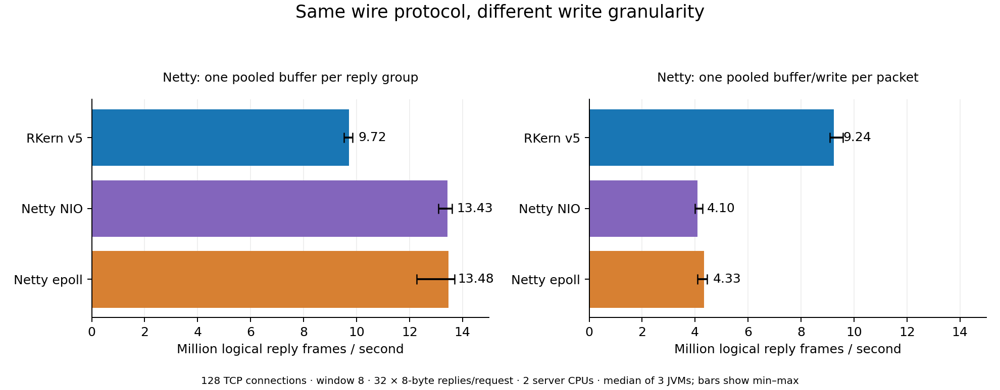

# RKern v5와 Netty 실제 TCP 비교

분석·실험일: 2026-10-27. **NPC·게임 코드·DB·기존 배포 ZIP은 수정하지 않았다.** 기존 네트워크 소스를 그대로 컴파일한 별도 실험이다.

## 측정으로 확인한 판단

**형 코어의 짧은 액션 묶음 경로는 Netty의 패킷별 write 구현보다 빨랐다. Netty에도 응답을 하나의 버퍼로 묶는 구현을 적용하면 Netty가 더 빨랐다.** 따라서 코어 이름만으로 일률적인 순위를 매기는 것은 이 측정 결과와 맞지 않는다.

- 128연결·요청당 32개 작은 액션 응답에서 RKern은 패킷별 write를 사용하는 Netty epoll보다 약 **2.13배** 많은 응답을 처리했다.
- 같은 wire 응답을 하나의 버퍼로 인코딩한 Netty epoll은 해당 비교의 RKern보다 처리량이 약 **38.7%** 높았다.
- 1,024개 활성 연결의 작은 왕복 요청에서는 Netty가 더 높은 처리량을 보였다.
- 4KiB 송신 중심 부하에서는 처리량 범위가 겹쳤다. 이때 p99 응답 지연은 RKern **20.94ms**, Netty epoll **3.16ms**로 차이가 컸다.

이 결론은 아래 Linux·프로토콜·부하에 한정된다. 실서버 게임 전체나 Windows IOCP 성능의 순위가 아니다.

## 같은 조건으로 맞춘 항목

| 항목 | 설정 |
|---|---|
| 실행 환경 | Linux 6.18.55 x86_64 / AMD EPYC 9V74 VM / cgroup CPU 예산 4개 |
| JVM | OpenJDK 21.0.12.1, G1, Xms/Xmx 256MiB, MaxDirectMemorySize 512MiB, ActiveProcessorCount=2 |
| 서버 / 클라이언트 CPU | 서버 0,1 / 별도 공통 클라이언트 2,3에 고정 |
| 서버 I/O 워커 | 양쪽 2개. 각 코어의 accept 스레드는 별도로 존재하며 같은 서버 CPU 예산 안에서 실행 |
| TCP | 실제 127.0.0.1 루프백, TCP_NODELAY, 초기 수신 할당 4KiB |
| RKern | v5의 실제 CIOUserSocket, CIOServer, CIOFrame, CIOBufferPool, CIOSlotPool 등 10개 파일을 바이트 그대로 사용 |
| Netty | Maven Central의 4.1.139.Final, NIO와 Linux native epoll, pooled direct ByteBuf |
| 암호화 / 버퍼 뷰 | 양쪽 서버에 같은 실제 Cryptor·ReadBuffer·WriteBuffer 사용 |
| 공통 게임 경계 | opcode·크기·요청 순서를 검사하는 최소 핸들러. 로그인·NPC·게임 규칙·DB·운영 패킷 속도 제한은 분리 |
| 반복 | 매번 새 서버·클라이언트 JVM, 5초 워밍업 후 5초 측정, 각 조건 3회 |
| 실행 순서 | 1회 RKern→NIO→epoll, 2회 NIO→epoll→RKern, 3회 epoll→RKern→NIO |

Netty에는 이 게임 프로토콜을 처리하는 작은 adapter를 작성했다. 배포 게임 서버 전체를 Netty로 전환해 비교한 것이 아니다. 원본 코어와 일반 라이브러리의 책임 범위가 다르므로 adapter 소스와 두 가지 전송 방식을 모두 공개한다.

## 결과 1: 작은 액션 패킷 32개 응답

128개 TCP 연결, 연결당 최대 8개 요청 진행. 요청의 평문은 32바이트이고, 응답은 8바이트 wire 프레임 32개다. **논리 응답 패킷 수이며 TCP 세그먼트 수나 NIC packets/s가 아니다.**

### Netty도 하나의 응답 버퍼로 묶을 때

RKern은 실제 tryWriteAction API를 32회 호출해 내부 packing을 사용한다. Netty adapter는 동일한 프레임 32개를 하나의 pooled direct ByteBuf에 인코딩하고 요청당 한 번 writeAndFlush한다. 각 논리 패킷의 헤더·암호화 경계와 순서는 유지한다.

| 코어 / 전송 방식 | 요청/초 | 논리 응답 패킷/초 | p50 (ms) | p99 (ms) |
|---|---:|---:|---:|---:|
| RKern v5 | 303,715 | 9,718,877 | 2.296 | 13.345 |
| Netty NIO / 묶음 버퍼 | 419,798 | 13,433,546 | 2.386 | 5.431 |
| Netty epoll / 묶음 버퍼 | 421,297 | 13,481,508 | 2.431 | 4.719 |

### Netty가 패킷마다 write할 때

Netty adapter가 각 프레임마다 pooled direct ByteBuf와 ctx.write를 사용하고, 32개를 게시한 뒤 한 번 flush한다. 패킷마다 flush하도록 불리하게 만든 비교가 아니다. RKern은 위와 같은 API와 원본 코어를 사용했다.

| 코어 / 전송 방식 | 요청/초 | 논리 응답 패킷/초 | p50 (ms) | p99 (ms) |
|---|---:|---:|---:|---:|
| RKern v5 | 288,625 | 9,235,997 | 2.634 | 13.197 |
| Netty NIO / 패킷별 write | 128,115 | 4,099,665 | 7.504 | 12.845 |
| Netty epoll / 패킷별 write | 135,314 | 4,330,047 | 7.598 | 11.723 |

두 표의 RKern 수치가 조금 다른 것은 별도 시점의 3회 측정이기 때문이다. 각각의 표 안에서 교차 실행한 기준값을 사용했으며, 유리한 RKern 실행 하나를 골라 조합하지 않았다.

이 차이는 형 코어가 작은 액션을 객체·임시 전송 버퍼 작업을 줄여 묶는 경로에서 장점이 있다는 근거다. Netty도 버퍼 단위로 묶으면 그 관리 비용을 줄일 수 있다. 실제 CPU 병목 위치를 프로파일링해서 정량적으로 분해한 결과는 아니다.

## 결과 2: 1,024개 활성 연결

32바이트 평문 요청당 8바이트 액션 응답 하나, 연결당 진행 중 요청 하나. 같은 클라이언트 구현을 사용했다.

| 코어 / 전송 방식 | 요청/초 | 논리 응답 패킷/초 | p50 (ms) | p99 (ms) |
|---|---:|---:|---:|---:|
| RKern v5 | 250,075 | 250,075 | 3.852 | 9.257 |
| Netty NIO / 묶음 버퍼 | 293,864 | 293,864 | 3.391 | 8.286 |
| Netty epoll / 묶음 버퍼 | 332,815 | 332,815 | 2.937 | 7.127 |

이 부하에서는 Netty의 처리량이 더 높았다. 일부 Netty 실행은 클라이언트 CPU도 상한에 가까워졌으므로 이 값은 환경에서 관찰한 왕복 처리량이다. 최대 서버 수용량으로 환산하지 않는다. 1,024개 활성 연결 실험이며 1만 명 게임 동접 실험이 아니다.

## 결과 3: 4KiB 송신 중심 부하

64개 연결, 연결당 최대 4개 진행 요청. 요청 평문 32바이트, 응답 평문 4096바이트(헤더 포함 wire 4098바이트). 요청 생성 비용을 낮춰 양쪽 서버의 I/O 워커 CPU가 약 2개 예산을 사용하도록 한 보완 실험이다. 응답은 하나이므로 Netty의 패킷별/묶음 분기는 동일하다.

| 코어 / 전송 방식 | 요청/초 | 논리 응답 패킷/초 | p50 (ms) | p99 (ms) |
|---|---:|---:|---:|---:|
| RKern v5 | 141,523 | 141,523 | 1.268 | 20.939 |
| Netty NIO | 148,756 | 148,756 | 1.645 | 3.932 |
| Netty epoll | 144,687 | 144,687 | 1.911 | 3.162 |

3회 처리량 범위는 RKern 140,745~145,830, Netty epoll 140,525~152,106 요청/초다. 범위가 겹쳐 작은 중앙값 차이만으로 처리량 우열을 확정하지 않는다.

반면 p99 차이는 3회 모두 같은 방향이었다. RKern은 p50이 낮으면서 p99가 크게 늘었고, Netty는 p99 증가가 작았다. 해당 포화 부하에서 느린 응답 일부가 오래 대기하는 현상이 관찰된 것이다. 원인이 특정 락·READ 루프·완료 콜백이라고 확정하려면 별도의 프로파일링이 필요하다.

## 단일 연결 지연과 큰 왕복 패킷

단일 연결·진행 중 요청 하나의 작은 패킷 왕복:

| 코어 / 전송 방식 | 요청/초 | 논리 응답 패킷/초 | p50 (ms) | p99 (ms) |
|---|---:|---:|---:|---:|
| RKern v5 | 31,742 | 31,742 | 0.028 | 0.093 |
| Netty NIO / 묶음 버퍼 | 39,803 | 39,803 | 0.023 | 0.090 |
| Netty epoll / 묶음 버퍼 | 40,911 | 40,911 | 0.019 | 0.087 |

별도로 요청·응답을 모두 4KiB로 한 실험도 수행했다. 해당 시나리오에서는 공통 클라이언트가 약 2개 CPU 예산을 모두 사용했고 서버는 약 1.4~1.6개를 사용했다. 중앙값은 RKern 92,641 / Netty NIO 99,230 / epoll 99,943 요청/초였지만, **서버 최대 처리량의 승패를 판단하는 데 사용하지 않았다.** 원시 결과는 재현 자료에 그대로 보존했다.

## 숫자를 읽는 기준

- 처리량·지연 표는 각 조건의 독립 JVM 3회 결과의 중앙값이다. p99도 실행별 p99 세 값의 중앙값이며 전체 실행을 합친 p99가 아니다. 원시 결과에는 최소·최대와 각 실행값이 들어 있다.
- 고정 연결 수·고정 in-flight window를 가진 closed-loop 부하다. 더 빠른 서버에서는 실제 요청 발생률도 올라간다. 동일 offered packets/s를 강제로 유지한 open-loop 시험이나 coordinated omission 보정은 하지 않았다.
- 지연은 클라이언트 요청 enqueue부터 마지막 응답 수신까지이며 클라이언트 내부 대기도 포함한다. WAN RTT나 실제 게임 명령 지연과 동일하지 않다.
- 메모리도 기록했다. 예를 들어 묶음 전송 부하의 JVM RSS 스냅샷 중앙값은 RKern 약 83MiB, Netty epoll 약 229MiB였다. 5초 측정 후 전체 JVM 스냅샷이며 live 객체·장기 정상 상태 메모리나 모든 부하의 차이로 해석하지 않는다.
- GC·JIT·OS provider·루프백·가상화·4 CPU 예산의 영향을 포함한다. Windows, 실제 NIC, 장시간 부하, 느린 수신자·재접속·다중 외부 생산자는 이번 성능 비교 범위 밖이다.

## 정확성·재현 자료

- 실제 TCP 정확성 실행 **15회**, 성능 실행 **54회** 완료.
- 모든 실행이 정상 종료했으며 확인한 SEND 거절·adapter 실패는 0, stderr 오류 로그도 없었다.
- 정확성 실행은 큰 응답의 모든 payload 바이트를 검사했다. 성능 실행은 공통 클라이언트 비용을 낮추기 위해 헤더·순서·액션 값·큰 응답의 마지막 바이트를 검사했다. 같은 원본 암호화 구현을 사용한 부분과 독립 클라이언트 입력 인코더를 구분해 소스에 명시했다.
- [재현용 코드·원시 결과 ZIP](downloads/RKern_vs_Netty_benchmark_20261027.zip): 코어 원본 10개, 최소 game boundary, Netty adapter·공통 TCP 클라이언트, dependency 버전/해시, 모든 실행 명령·로그·CPU/GC/메모리·히스토그램 요약을 포함한다.
- NPC 코드·플레이어 DB·원본 EXE는 포함하지 않는다.

형 코어에서 확인된 강점은 작은 액션을 효율적으로 묶는 전송 경로다. 이번 조건에서 드러난 보완 대상은 다수 활성 연결 처리량과 부하가 찼을 때의 긴 지연이다. Netty로 교체하면 모든 경로가 자동으로 빨라진다는 결론은 이 결과로 낼 수 없다.

재현 ZIP SHA-256: `7ba34319a58e82a1711bfef9167235b0d6361cb5bdb4d77c69ff555813c9a9f0`
