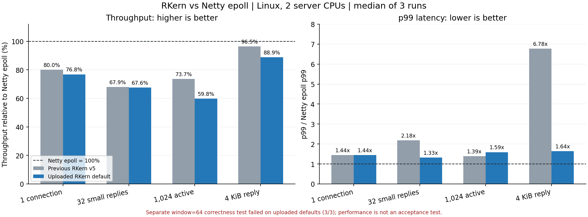

# 개선된 RKern과 Netty epoll 재비교

측정일: 2026-10-28 한국 시간. 업로드한 `RKern_SRC_20261028_NPC_latest_Network_optimized.zip`을 기준으로 실제 TCP 비교를 수행했다. **업로드 소스·NPC·DB·기존 배포 ZIP은 수정하지 않았다.**

**작은 묶음과 4KiB 응답의 p99 지연은 Netty에 가까워졌다. 처리량 격차는 줄지 않았고, 1,024개 활성 연결에서는 회귀가 관찰됐다.** 별도의 고부하 정합성 시험에서는 새 기본 설정의 응답 순번 불일치가 3회 모두 재현됐다.

## 같은 시점에 다시 돌린 처리량

예전 날짜의 수치와 새 수치를 직접 나누지 않고, v5·업로드 버전·Netty epoll을 오늘 같은 환경에서 교차 실행했다. 표는 독립 JVM 3회 중앙값이다.

| 부하 | 이전 v5 요청/초 | 업로드 기본값 요청/초 | Netty epoll 요청/초 | Netty=100%일 때 v5 → 새 버전 |
| --- | ---: | ---: | ---: | ---: |
| 1연결, 요청 1개씩 | 30,901 | 29,690 | 38,649 | 80.0% → 76.8% |
| 128연결, 요청마다 작은 응답 32개 | 260,346 | 259,250 | 383,433 | 67.9% → 67.6% |
| 1,024연결, 요청마다 작은 응답 1개 | 243,817 | 197,867 | 331,047 | 73.7% → 59.8% |
| 64연결, 요청마다 4KiB 응답 1개 | 142,556 | 131,343 | 147,780 | 96.5% → 88.9% |

작은 응답 32개 부하에서 논리 응답 처리량은 v5 **833만/초**, 업로드 버전 **830만/초**, Netty **1,227만/초**다. TCP 세그먼트 수나 NIC packets/s가 아니다.

- 작은 묶음의 처리량 차이는 v5 대비 -0.4%이며 실행 범위가 겹친다. 이 측정에서는 비슷한 수준이다.
- 1,024개 활성 연결에서는 -18.8%였다. v5 범위 236,595~256,214와 새 버전 174,495~212,446 요청/초가 겹치지 않았다.
- 4KiB 응답은 중앙값 -7.9%였다. v5 범위 130,983~144,730과 새 버전 126,014~131,479가 일부 겹친다. 작은 중앙값 차이만으로 보편적인 속도 순위를 확정하지 않는다.
- 단일 연결은 새 버전의 범위가 26,132~37,265로 넓고 v5와 겹친다. 중앙값만으로 고정적인 3.9% 회귀라고 단정하지 않는다.

## p99 지연은 줄어든 항목이 있다

클라이언트 요청 enqueue부터 마지막 응답 수신까지다. 클라이언트 내부 대기를 포함하며 WAN RTT가 아니다.

| 부하 | v5 p99 | 업로드 기본값 p99 | Netty epoll p99 |
| --- | ---: | ---: | ---: |
| 1연결 | 0.117 ms | 0.117 ms | 0.081 ms |
| 작은 응답 32개 | 13.779 ms | 8.360 ms | 6.308 ms |
| 1,024개 활성 연결 | 9.183 ms | 10.543 ms | 6.627 ms |
| 4KiB 응답 | 21.283 ms | 5.157 ms | 3.140 ms |

작은 묶음은 v5 대비 약 **39.3%**, 4KiB 응답은 약 **75.8%** 줄었다. 두 부하 모두 세 반복에서 같은 방향이었다. 4KiB에서는 Netty 대비 p99 비율이 약 6.78배에서 1.64배로 줄었다. 반면 1,024개 활성 연결 p99는 약 14.8% 늘었다.



## 고부하 정합성 실패: 기본 설정 적용 전에 해결해야 한다

16개 연결, 연결당 진행 요청 64개, 32바이트 요청당 6바이트 응답 1개를 사용하는 별도 TCP 시험이다. READ 프레임 예산의 기본값 32를 넘는 요청 묶음을 발생시킨다. 짧은 실행으로 출력 바이트·순서를 검사했으며 성능 점수로 사용하지 않았다.

| 대상 | 정합성 결과 |
| --- | --- |
| 업로드 기본 설정 | 독립 JVM 3회 모두 응답 순번 불일치 |
| 이전 v5 | 같은 조건의 대조 시험 1회 통과 |
| Netty epoll | 같은 조건의 대조 시험 1회 통과 |
| 업로드 + `-Dcio.readFrameBudget=0` | 같은 조건의 대조 시험 1회 통과 |

재현된 오류 예:

```text
response seq expected=9796 actual=9801
response seq expected=1326 actual=1333
response seq expected=9505 actual=9508
```

기본 성능 부하에서는 실행 36회 모두 순서 검사를 통과했지만 이 추가 부하에서는 실패했다. 두 사실을 함께 보존한다. 실패 실행의 처리량을 유효 점수에 포함하지 않았다. 첫 실행의 상위 runner 오류는 timeout이지만 원래 client stderr에 순번 오류가 있으며, 후속 실행은 client 오류를 즉시 감지하도록 runner를 개선했다.

`cio.readFrameBudget=0`은 프레임 예산뿐 아니라 CIOServer의 executor/channel-group 구성도 기존 방식으로 바꾼다. 따라서 단순히 숫자 32만의 문제라고 확정할 수 없다. READ continuation과 그룹 변경 경계가 추가 조사 대상이며 정확한 race 원인은 아직 특정하지 않았다. 설정을 끈 대조 시험 통과는 버그 수정이나 운영 안전성 입증이 아니다. 소스 수정은 수행하지 않았다.

## 보완 비교: READ 설정과 batch API

기본 시험과 별도 시간대에 새로 교차 실행한 보완 결과다. 아래 표 내부의 대조군끼리 비교하며 기본 표 수치와 섞지 않는다. 각 3회 중앙값이다.

### 1,024개 활성 연결

| 설정 | 요청/초 | 서버 CPU μs/요청 | p99 |
| --- | ---: | ---: | ---: |
| 업로드 기본값 | 196,688 | 9.91 | 10.666 ms |
| 업로드 + READ 설정 0 | 226,273 | 8.76 | 10.076 ms |
| Netty epoll | 302,235 | 6.44 | 7.852 ms |

READ 설정 0은 기본값보다 중앙값 처리량이 약 **15.0%** 높았다. 세 대응 반복 모두 같은 방향이었다. 이 결과는 현재 READ 제한/Executor 구성 묶음이 해당 부하에서 비용을 추가하고 있다는 근거다. 예산 제한 자체와 executor 토폴로지의 비용을 각각 분리한 결과는 아니다.

### 작은 응답 32개에 batch API를 직접 호출

업로드 소스 전체 검색에서 `tryWriteActionBatch()`는 정의만 있고 실제 게임 호출부는 없었다. 기본 측정은 연결된 `tryWriteAction()` 경로를 그대로 사용했다. 이 보완 시험에서만 테스트 핸들러가 새 API를 호출하도록 했다. 연결마다 배열을 재사용하되 요청별 object ID 배열 채우기 비용도 측정에 포함했다.

| 호출 방식 | 요청/초 | 서버 CPU μs/요청 | p99 |
| --- | ---: | ---: | ---: |
| 업로드 기본 single API 32회 | 250,070 | 7.96 | 9.191 ms |
| 업로드 batch API 1회 | 235,312 | 8.46 | 10.912 ms |
| Netty epoll 묶음 버퍼 | 381,402 | 5.17 | 4.403 ms |

batch 호출은 중앙값 -5.9%였고 세 대응 반복 모두 처리량이 낮았다. 실행 범위가 겹치며 Netty 등의 변동도 컸으므로 정확한 일반 회귀율로 단정하지 않는다. 이 하네스에서는 추가 이득을 확인하지 못했다. fast path 적중률과 fallback 비용을 별도 계측하지 않았으므로 원인을 특정하지 않는다. API 추가만으로 실제 게임 경로가 빨라졌다고 판단할 수 없다.

## 비교 조건과 범위

- Linux 6.18.55 x86_64, AMD EPYC 9V74 VM, cgroup CPU 예산 4개. 서버 CPU 0,1 / 공통 클라이언트 CPU 2,3 고정.
- OpenJDK 21.0.12.1, G1, Xms/Xmx 256MiB, direct memory cap 512MiB, ActiveProcessorCount=2.
- 완료 워커 설정 2개. 각 구현의 accept/poller 구조를 그대로 유지하며 전체 서버 스레드가 같은 CPU 2개 한도를 공유한다. 새 CIOServer의 withThreadPool 구성과 v5의 fixed group 구성은 서로 다르다.
- Netty 4.1.139.Final native epoll, pooled direct ByteBuf. 요청당 응답 32개는 한 버퍼에 인코딩하고 한 번 writeAndFlush한다. 앞선 비교의 묶음 전송 구현을 유지했다.
- 서버측 새 RKern과 Netty는 **동일한 업로드 Cryptor**를 사용하며 컴파일된 class의 SHA-256 일치도 확인했다. ReadBuffer/WriteBuffer는 v5와 업로드가 같다.
- 이전 v5는 자신의 원래 암호화를 사용한다. 따라서 v5→새 버전은 코어와 암호화 변경을 함께 포함한 버전 비교이며, 순수 transport만의 분해 실험은 아니다.
- 공통 클라이언트는 모든 실행에서 기존 v5 구현·암호화를 고정했다. 새 암호화가 클라이언트까지 빨라져 서버 점수에 섞이는 것을 방지했다.
- 실제 루프백 TCP, TCP_NODELAY, 초기 수신 버퍼 4KiB. 게임/NPC/DB는 실행하지 않고 동일한 최소 opcode·길이·순번 핸들러를 사용했다.
- v5/업로드 각각 실제 transport·buffer·cipher 등 Java 10개를 수정 없이 컴파일했다. 업로드의 CIOServer에서 제거된 accessor 검사만 테스트 하네스에서 빼고, native poller thread 목록을 CPU 구간 밖에서 기록했다.
- 기본 성능 36회 + 보완 18회 = **유효 성능 실행 54회**. 모두 정상 종료, 확인한 송신 거절 및 adapter 실패 0. 기본 측정 요청 약 3,309만 건, 보완 약 2,420만 건이다.
- 각 실행은 새 JVM, 워밍업 5초·측정 5초, 3회 교차 순서. p99도 실행별 p99의 중앙값이며 합친 히스토그램의 p99가 아니다.
- 네트워크 정합성 실패 3회는 별도 로그로 포함한다. 큰 응답 전체 바이트는 smoke에서 검사하고, 성능 측정은 크기·순번·마지막 바이트를 검사한다. 작은 액션 응답은 opcode·순번·action 값 전체를 확인한다.
- 고정 연결 수와 window의 closed-loop 부하다. 일부 Netty 다중 연결 실행은 클라이언트 CPU 한도에 가까웠다. 관찰한 처리량이며 최대 서버 수용량으로 환산하지 않는다.
- 1,024개 활성 TCP 연결 시험은 게임 동접 1만 명 시험이 아니다. Windows IOCP, 실제 NIC/WAN, 느린 수신자, 장시간 게임 전체 부하는 미측정이다.

## 재현 자료

- [코드·원시 결과 ZIP](downloads/RKern_netty_epoll_rebench_20261028.zip)
- ZIP에는 두 버전의 실제 코어 10개씩, 서버 adapter, 고정 클라이언트, 최소 게임 경계, dependency 버전·해시, 모든 측정 명령·로그·결과와 정합성 실패 기록이 있다. NPC·플레이어 DB·원본 EXE는 포함하지 않는다.
- Linux/JDK 21에서 `python3 build.py --fetch-deps`로 고정된 dependency를 검증하고 컴파일한다. `run.py`의 명령과 각 raw.json의 server/client command로 재현할 수 있다.
- 배포용 재현 코드로 다시 빌드한 v5/업로드 class 각 36개가 측정에 사용한 class와 SHA-256까지 같았다. 고정 클라이언트의 주요 class도 동일했다. 재현 패키지의 Netty 4KiB 전체 바이트 검사와 batch 응답 순서 검사도 통과했다. 이 짧은 재현 검사의 속도는 성능 표에 합치지 않았다.

입력 ZIP SHA-256: `7dac9373d456a1956e67d88215294ad581541378399023fc7dfe92846e659500`
