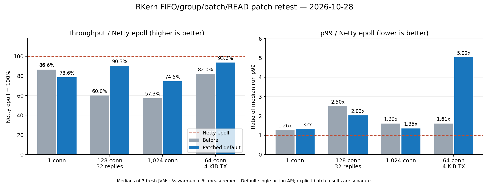

# RKern P0 FIFO / P1 group·batch / P2 READ 재시험

측정일: 2026-10-28 한국 시간. **직전 업로드 대비 기본 경로의 작은 응답 묶음 +50.5%, 다중 연결 +30.1%, 4KiB 송신 +14.2%를 확인했다. 이전에 실패한 FIFO 재현 조건도 통과했다.** Netty epoll과의 처리량 차이는 크게 줄었다. 다만 4KiB의 긴 지연은 악화됐고, 전체 부하에서 Netty를 이겼다고 판정할 결과는 아니다.

이번 업로드는 `CIOUserSocket.java`, `CIOServer.java` 두 파일만 든 패치다. 직전 전체 업로드 `RKern_SRC_20261028_NPC_latest_Network_optimized.zip`에 이 두 파일만 덮어 검증했다. 나머지 파일과 Cryptor는 직전 업로드 그대로다. 업로드 소스를 추가 수정하지 않았다.

## 1. 같은 환경에서 재측정한 기본 성능

각 셀은 새 JVM 3회, 워밍업 5초·측정 5초의 중앙값이다. 옛 보고서의 수치와 새 수치를 직접 비교하지 않고, 직전 버전·이번 패치·Netty를 이번 실행에서 교차 측정했다. 기본 경로는 게임에서 현재 호출되는 단건 액션 API를 사용한다.

| 부하 | 직전 버전 요청/초 | 이번 패치 요청/초 | Netty epoll 요청/초 | 직전 대비 | Netty=100% |
| --- | ---: | ---: | ---: | ---: | ---: |
| 1연결·window 1 | 34,521 | **31,331** | 39,879 | -9.2% | 78.6% |
| 128연결·작은 응답 32개 | 236,922 | **356,652** | 394,841 | +50.5% | 90.3% |
| 1,024연결·작은 응답 1개 | 188,422 | **245,163** | 328,931 | +30.1% | 74.5% |
| 64연결·4KiB 응답 | 130,590 | **149,084** | 159,254 | +14.2% | 93.6% |

작은 묶음의 Netty 대비 처리량은 **60.0% → 90.3%**, 1,024연결은 **57.3% → 74.5%**, 4KiB 응답은 **82.0% → 93.6%**로 올라왔다. 작은 묶음의 논리 응답 처리량은 이번 패치 약 **1,141만/초**, Netty 약 **1,263만/초**다. TCP 세그먼트 수나 NIC packets/s가 아니다.

단일 연결은 중앙값 -9.2%지만 실행 범위가 겹치고 CPU가 포화되지 않았다. 고정적인 9.2% 회귀나 최대 처리 용량 차이라고 단정하지 않는다. 작은 묶음·다중 연결·4KiB는 세 대응 반복 모두 직전보다 처리량이 높았다. 별도로 재측정한 옛 v5는 작은 묶음 286,278, 다중 연결 238,028, 4KiB 144,778 요청/초다. 이번 패치는 직전 버전의 다중 연결 손실을 대부분 회복했고, 작은 묶음은 v5도 넘어섰다.

| 부하 | 직전 실행 범위 | 이번 실행 범위 | Netty 실행 범위 |
| --- | ---: | ---: | ---: |
| 1연결·window 1 | 30,151~34,990 | 29,875~32,026 | 38,782~44,197 |
| 128연결·작은 응답 32개 | 232,880~249,772 | 356,432~369,682 | 365,936~419,300 |
| 1,024연결·작은 응답 1개 | 186,667~222,834 | 244,869~256,744 | 270,614~356,500 |
| 64연결·4KiB 응답 | 123,769~130,827 | 143,713~150,382 | 154,736~161,137 |

## 2. 처리량과 함께 봐야 할 p99 지연

클라이언트의 요청 enqueue부터 해당 요청의 마지막 응답 수신까지다. 내부 대기를 포함하며 인터넷 RTT가 아니다. 각 실행 p99의 중앙값이다.

| 부하 | 직전 p99 | 이번 p99 | Netty p99 |
| --- | ---: | ---: | ---: |
| 1연결·window 1 | 0.099 ms | 0.104 ms | 0.079 ms |
| 128연결·작은 응답 32개 | 11.379 ms | 9.224 ms | 4.555 ms |
| 1,024연결·작은 응답 1개 | 11.141 ms | 9.429 ms | 6.963 ms |
| 64연결·4KiB 응답 | 5.124 ms | 15.991 ms | 3.183 ms |

**4KiB는 처리량이 증가했지만 p99가 5.124 → 15.991ms로 늘었다.** 이번 세 실행의 p99는 약 6.324~22.413ms로 흔들렸다. fixed group 복귀는 처리량에 도움이 됐지만 긴 지연까지 해결한 변경은 아니다. 작은 묶음도 Netty보다 p99가 약 두 배다.

서버 CPU 비용도 줄었다. 다음 값은 서버 프로세스 전체 CPU μs/완료 요청이며, 서버와 클라이언트 CPU를 합산한 값이 아니다.

| 부하 | 직전 CPU μs/요청 | 이번 CPU μs/요청 | Netty CPU μs/요청 |
| --- | ---: | ---: | ---: |
| 1연결·window 1 | 16.10 | 20.87 | 12.08 |
| 128연결·작은 응답 32개 | 8.31 | 5.57 | 5.05 |
| 1,024연결·작은 응답 1개 | 10.29 | 8.03 | 5.86 |
| 64연결·4KiB 응답 | 14.98 | 13.21 | 12.44 |

## 3. P0 FIFO 수정은 재현 시험을 통과했다

이전 오류 조건인 16연결·연결당 진행 요청 64개·32바이트 요청/6바이트 응답을 다시 사용했다.

| 조건 | 결과 |
| --- | --- |
| 직전 기본값 대조군 | 이번에도 순번 불일치: expected=9980, actual=9982 |
| 이번 기본 fixed / READ budget 0 | 원래 재현 조건 4/4 통과 |
| 이번 pooled / READ budget 32 | 원래 재현 조건 4/4 통과 |
| 이번 pooled / READ budget 1 | 원래 재현 조건 1/1 통과 |
| 진행 요청 256개로 확대 | fixed 및 pooled budget 8/32/256 각 1회, 모두 통과 |

이 13회와 별도의 burst/4KiB 전체 바이트 검사 5회를 합쳐 **정합성용 실제 TCP 실행 18회 통과**, 직전 버전 대조군 1회 실패다. 짧은 검사의 속도는 성능 점수에 넣지 않았다. 기본 성능 54회·설정 대조 18회·별도 프로파일 실행 5회도 정상 종료했고, 확인한 송신 거절과 adapter 실패는 0이었다.

소스에서도 수정 의도를 확인했다. 일반 encoder는 owner라도 FIFO ticket을 예약한다. 이미 완성한 액션만 `canInlineActionLocked()`에서 현재 owner·pending 1·ticket/head 일치·앞선 reservation/staged 없음 조건을 확인해 inline한다. 과거처럼 owner라는 이유만으로 앞선 미완성 encoder를 넘지 않는다. 이는 이번 재현 결과와 일치하지만 모든 운영 경쟁 조건을 증명한 것은 아니다.

제어 가능한 READ/WRITE 회귀, 부분 WRITE, close, encoder 선점, 독립 암호문 기준, batch 크기 0/1/2/31/32/128/257/1024/2100, 동시 producer를 검사했다. 보고된 통과 단언은 **3,296개**다. 동시 SEND 24,000개와 slot 생명주기 80,000회 검사도 포함한다.

**기존 회귀 중 자원 사용 단언 1개는 실패했다.** `ActionBatchRegression action`의 `no temporary third SEND buffer`다. v5의 queued-tail 조건에서는 SEND backing 32KiB를 기대하지만 이번 패치는 48KiB가 잡힌다. 해당 조건의 평문/암호문, 부분 WRITE, 배출 순서는 별도 검사를 통해 통과했다. 따라서 현재 증거는 데이터 오류가 아니라 임시 SEND lease가 남은 성능 회귀다. 실패 로그도 증거 ZIP에 그대로 넣었다. 일반 회귀의 `injected handler failure` 경고는 의도적으로 발생시킨 거절 처리 시험이다.

## 4. 새 batch API는 실제로 좋아졌다 — 게임 호출 연결은 아직 필요하다

같은 기본 성능 실행 묶음 안에서 테스트 핸들러만 단건 API 32회 대신 batch API 1회를 사용했다. 배열 재사용 및 요청별 값 채우기 비용을 포함한다.

| 작은 응답 32개 경로 | 요청/초 | p99 | CPU μs/요청 |
| --- | ---: | ---: | ---: |
| 직전 단건 API | 236,922 | 11.379 ms | 8.31 |
| 이번 단건 API | 356,652 | 9.224 ms | 5.57 |
| 직전 batch API | 273,187 | 9.183 ms | 7.28 |
| 이번 batch API | **398,023** | **8.995 ms** | **4.96** |
| Netty epoll | 394,841 | 4.555 ms | 5.05 |

새 batch는 옛 batch보다 약 **45.7%** 빨랐다. 이번 단건 경로보다 약 **11.6%** 높다. Netty 대비 처리량 중앙값은 **+0.8%**지만 실행 범위가 겹치고 p99가 약 두 배라서 승리 판정을 내리지 않는다. 처리량은 동률권에 접근했다.

전체 소스 검색에서 `tryWriteActionBatch()`는 여전히 실제 게임 호출부가 없다. `RDoActionGFX.send()`도 단건 `sendAction`을 호출한다. 따라서 이 batch 수치를 실제 게임의 기본 성능으로 소개하면 안 된다. 이번 packed chunk와 self-pending 수정은 하네스에서 효과를 확인한 상태다.

## 5. 설정으로 처리량을 더 올리면 지연 대가가 생긴다

별도 시간대에 각 조건을 3회씩 새로 교차 실행했다. 다음 표 안의 대조군끼리 비교해야 한다.

| 작은 묶음 설정 | 요청/초 | p99 | CPU μs/요청 |
| --- | ---: | ---: | ---: |
| 이번 batch·기본 high frames 32 | 404,040 | 8.774 ms | 4.91 |
| 이번 batch·high frames 256 | **457,576** | **33.751 ms** | 4.33 |
| Netty epoll | 405,911 | 4.391 ms | 4.84 |

`-Dcio.sendReadHighFrames=256`은 이 부하에서 Netty보다 **12.7%** 높은 처리량을 냈지만 p99는 약 **7.7배**였다. 기본 batch 대비 처리량 +13.3%와 p99 약 3.8배가 함께 발생했다. byte/hard limit은 유지했다. 이 값을 그대로 기본값으로 올리는 것은 권하지 않는다. 지연 목표를 정한 뒤 frame/byte pressure를 조정해야 한다.

| 4KiB 응답 설정 | 요청/초 | p99 | CPU μs/요청 |
| --- | ---: | ---: | ---: |
| 이번 기본 fixed·budget 0 | 150,564 | 9.650 ms | 13.11 |
| 이번 pooled·budget 32 | 129,057 | 5.431 ms | 15.35 |
| Netty epoll | 154,793 | 4.231 ms | 12.51 |

pooled/budget 32는 같은 대조 묶음의 fixed보다 중앙값 처리량 -14.3%, p99 -43.7%였다. 모든 반복에서 p99 개선이 나온 것은 아니다. FIFO는 해당 설정에서도 통과했지만, 처리량과 지연의 교환 관계가 남는다. fixed 모드에 양수 READ budget을 넣으면 예외를 발생시키도록 분리한 이번 변경은 설정 오해를 줄인다.

## 6. 새 코드의 프로파일에서 실제로 남은 비용

성능 점수와 분리한 JFR 실행 5회(워밍업 5초·측정 10초)를 분석했다. 아래는 측정 구간의 Java ExecutionSample이다. 표본 수가 작고 JIT inline·샘플링 편향이 있으므로 정확한 CPU 백분율이나 예상 개선율로 해석하지 않는다. inclusive 표본은 서로 겹쳐 합산할 수 없다. NativeMethodSample은 대기를 포함하므로 Java CPU 표본과 섞지 않았다.

| 경로 | 이번 표본 관찰 | 해석 |
| --- | --- | --- |
| 작은 묶음·단건 | 347개 중 ThreadLocal get/getEntry leaf 77개(22.2%) | 반복 owner/burst 조회가 직접 보인다. 그중 getEntry 54개가 writableBurstTailLocked 경유 stack |
| 작은 묶음·batch | 274개 중 같은 ThreadLocal leaf 5개(1.8%) | 호출 묶음이 반복 조회를 줄인 것과 일치 |
| 작은 묶음·batch | Cryptor.encrypt leaf 109, socket encrypt 29, commitStaged 14, onSendProgress 13 | 암호화와 SEND 주변 bookkeeping이 다음 후보 |
| 1,024연결 | 195개 중 stageOutboundFrameLocked 19, kickRead 12, onSendProgress 9 | 요청당 admission·진행 처리 비용이 남음 |
| 1,024연결 | JDK finish leaf 24, EPollPort.poll 12, JDK Unsafe 원자 연산 19 | NIO2 provider의 완료·이벤트 큐 경로도 관찰됨 |

마지막 Unsafe 19개는 **JDK AQS/ReentrantLock → ArrayBlockingQueue.take → EPollPort 이벤트 워커** stack이다. 사용자 buffer pool이나 CYieldLock의 CAS로 잘못 분류하면 안 된다. 프로젝트가 Unsafe를 새로 사용했다는 의미도 아니다. 다중 연결 10초 구간의 allocation sample 가중 추정은 EPollPort.Event 약 61.1MB, Integer 약 42.2MB다. 남아 있는 provider 이벤트/fd boxing 비용의 근거이며, retained heap·메모리 누수 측정이 아니다.

버퍼 acquire inclusive 표본은 단건 9/347, batch 9/274, 다중 연결 9/195였다. 지금도 무조건 버퍼풀 CAS가 최대 병목이라고 말할 근거는 없다. IOCP-0/1 표본 수 차이를 그대로 스레드 CPU 점유율·부하 불균형 원인으로 단정하지도 않는다.

## 7. 다음 수정 순서와 합격 조건

### A. 단건 액션의 반복 ThreadLocal 조회와 실제 batch 호출

위치: `CIOUserSocket.writableBurstTailLocked()`(약 1125행), `tryWriteAction()`, 실제 `RDoActionGFX.send()` 호출 경로.

현재는 매 액션마다 `SEND_BURST.get()`으로 thread-local map을 찾는다. `_stateLock` 아래 이미 연결된 `_burstOwner`를 이용하고, SendBurst에 생성 스레드 identity를 보관해 현재 스레드와 비교하는 경로를 검토할 수 있다. ThreadLocal 자체는 begin/end의 중첩 관리에 남기고 hot append만 조회를 줄이는 방식이다. thread identity·depth·현재 owner·FIFO head·staged/reserved·I/O/prepared 검사는 모두 유지해야 한다. close/flush에서 owner 해제, 다른 producer의 fallback, nested burst를 검증한다.

동일 연결에 이미 모여 있는 액션은 batch API에 연결하면 이번에 측정한 추가 이득을 활용할 수 있다. NPC 판단·전송 시점·패킷 순서·클라이언트 암호화는 바꾸지 않는다. 측정에서 이득을 본 조건은 요청당 32개 액션이며 모든 게임 트래픽에 같은 효과가 난다고 약속하지 않는다.

합격: 기존 18회 정합성 조건과 예약 encoder 경쟁 조건을 유지하고, 기본 단건 CPU/요청과 처리량을 다시 비교한다. ThreadLocal 표본 22.2%가 곧 22.2% 속도 향상이라는 뜻은 아니다.

### B. queued tail의 임시 세 번째 SEND 버퍼 제거

위치: `tryWriteAction()`, `writableBurstTailLocked()`, append 후 write 시작 경로.

현재 fast append는 같은 burst·queued 0 조건에 묶여 있다. 이미 SEND가 대기 중인 경로에서는 작은 액션도 임시 lease를 대여한 뒤 복사한다. 앞선 ticket/reservation/staged가 없고 tail이 아직 I/O/prepared가 아니며 용량·압력 제한을 만족할 때만 queued tail append를 허용하는 별도 경로를 검토한다.

**조건만 느슨하게 풀면 안 된다.** 기존 v5는 append 이후 lock 밖에서 write 시작 여부도 처리했다. 현재 단건 append는 burst 내부임을 전제로 바로 return하므로 queued 경로를 추가하면서 필요한 `kickWrite`를 복원하지 않으면 전송이 남을 수 있다.

합격: 기존 실패 단언의 SEND backing을 **48KiB → 32KiB**로 되돌리고, 부분/gather WRITE·암호화 후 tail 금지·외부 producer·close·앞선 encoder 지연을 통과한다. slot generation/CAS를 무작정 삭제하지 않는다.

### C. onSendProgress의 할 일 없는 호출 비용 줄이기

위치: 약 597행 `onSendProgress()`.

현재 callback도 close 요청도 없어도 `isWriteIdle()`의 state lock과 `getAndSet`을 거친다. `_closing == 0 && _onDrained == null`일 때 먼저 return하는 경로를 검토한다. `whenWriteDrained`의 callback 게시 후 idle 재확인 계약을 유지해야 늦은 등록의 wakeup을 잃지 않는다.

합격: 마지막 WRITE 완료와 callback 등록 경쟁, callback 취소, close-after-drain, pending encoder가 있을 때의 callback 지연을 검증한다. 프로파일에서 보인 후보이며 개선율은 아직 측정하지 않았다.

### D. 신뢰할 수 있는 action chunk의 중복 헤더 순회 줄이기

위치: `tryWriteActionChunk()`(약 1199행), `commitStagedOutboundFrameLocked()`(약 899행), `preparePackedEncryption()`(약 1279행).

고정 8바이트 액션 N개의 헤더를 쓴 다음 commit에서 다시 전체 검사하고, 전송 전에 또 순회한다. 직접 만든 action chunk의 frame count·총 길이·capacity가 증명되는 전용 metadata를 두면 commit 쪽 검사를 단순화할 후보가 된다. 임의 packed/mixed frame은 계속 전체 검증한다. `_packedFrames`만 보고 전부 8바이트라고 가정하면 안 된다. 암호화는 기존대로 프레임별 j/k 초기화와 연결별 배열 상태를 유지한다.

Cryptor나 handshake 값을 chunk 밖에서 한 번 읽어 재사용하려면 수명 보장이 먼저다. 실제 `CIOClient.cleanupAfterLogout()`도 `clearCipher()`를 호출하므로 close/handshake와의 경쟁을 무시한 캐시는 적용하면 안 된다.

합격: mixed 길이, 분할 WRITE, close 중 cipher 해제, 각 chunk 크기에서 독립 기준 암호문과 상태 일치. 현 프로파일은 후보를 제시하며 절반 가속을 증명하지 않는다.

### E. 4KiB p99: READ 처리량 예산보다 전체 연속 실행 구간 계측

위치: `kickRead()` → `onRead()` → callback drain → WRITE 준비의 연속 경로.

지금 READ frame counter는 `onRead` 호출마다 초기화된다. 바깥 pump가 여러 completion을 연속 소화하면 한 번의 frame budget만으로 전체 실행 공정성을 제한하지 못할 수 있다. 우선 낮은 빈도로 READ 완료→owner 진입, owner 실행 길이, enqueue→write 게시, write 완료 간격을 기록해 긴 지연이 쌓이는 구간을 확인한다. CPU 프로파일만으로 대기 지연의 원인을 확정할 수 없다.

이후 실제 긴 연속 구간에만 예산을 걸고, 다음 실행 재개를 한 번만 예약하도록 설계한다. pending READ/WRITE completion·이미 buffer에 남은 프레임·close를 놓치지 않아야 한다. 전체 READ를 다시 별도 executor로 넘기는 변경은 이번 대조에서 확인한 처리량 손실을 재도입할 수 있다.

합격: fixed의 처리량을 유지하면서 4KiB p99를 Netty 근처로 낮춘다. high frames를 올려 처리량만 이기는 변경은 합격으로 세지 않는다.

### F. frame 수와 물리 lease 수의 제한 정책 정리

현재 packed chunk는 frame N개를 pressure accounting에 반영하며 기본 wire 검사는 통과했다. 다만 `_maxQueuedFrames`는 기존 물리 pending gate와 새 논리 frame room 양쪽에서 쓰이고, 기존 tail에 append하는 경로와 새 chunk 경로의 제한 적용도 다르다. 물리 lease 상한과 논리 frame 상한을 명시하고 같은 정책을 적용할 필요가 있다. 이번 검사는 데이터 손상을 발견한 것이 아니므로 즉시 correctness 버그로 단정하지 않는다.

### G. 다중 연결의 JDK provider 비용은 마지막에 별도로 판단

A~E를 먼저 수정한 뒤에도 JDK EPollPort 이벤트 큐·완료 처리·fd boxing 비용이 지배하면, buffer pool·cipher·FIFO·공개 API를 유지한 순수 Java Selector/SocketChannel backend를 별도 프로토타입으로 비교할 수 있다. 지금 자료만으로 전면 교체가 필요하거나 Netty를 이긴다고 약속할 수는 없다. 사용자 코드에 JNI/Unsafe를 넣을 이유는 없다.

## 8. 비교 범위와 재현

- Linux 6.18.55 x86_64, AMD EPYC 9V74 VM. cgroup CPU 예산 4개, 서버 CPU 0/1, 공통 클라이언트 CPU 2/3 고정.
- OpenJDK 21.0.12.1, G1, Xms/Xmx 256MiB, direct cap 512MiB, ActiveProcessorCount=2. 워커 설정 2개와 서버 프로세스 전체 CPU를 함께 제한했다.
- 실제 loopback TCP·TCP_NODELAY, 초기 READ 4KiB. 실제 코어/버퍼/암호화 등 Java 10개를 버전별로 수정 없이 컴파일했다. 게임 handler는 동일 최소 opcode/순번 작업으로 분리했다. 게임 전체·NPC·DB를 실행하거나 변경하지 않았다.
- Netty 4.1.139.Final native epoll, pooled direct ByteBuf, 32개 응답을 한 버퍼에 쓰고 한 번 flush한다. 직전/이번/Netty 서버는 동일한 Cryptor, 공통 클라이언트는 원래 v5 구현을 고정했다. v5 대조군만 자신의 옛 Cryptor를 쓴다.
- 주 성능 54회 + 별도 설정 대조 18회 = **프로파일 없는 유효 실행 72회**. JFR 실행 5회와 짧은 정합성 실행은 이 점수에 섞지 않았다. 3회 반복과 순서 회전은 광범위한 순위 확정 실험을 대신하지 않는다. 다음 최종 승리 판정은 더 긴 워밍업·측정과 충분한 반복으로 수행해야 한다.
- closed-loop 부하다. 특히 Netty 다중 연결은 클라이언트 CPU 한도에 가까워 최대 서버 처리량을 단정할 수 없다. 1,024개 활성 연결은 게임 동접 1만 명 시험이 아니다. Windows IOCP·실제 NIC/WAN·느린 수신자·장시간 운영은 미측정이다.
- [재현 코드·전체 결과·실패 기록 ZIP](downloads/RKern_P0_P2_retest_evidence_20261028.zip): 세 버전 코어, 고정 client/server adapter, 회귀 시험, dependency URL/해시, 측정 명령·결과, 정제된 프로파일 집계를 포함한다. 원본 JFR은 환경정보를 포함할 수 있어 게시하지 않고 method/count/stack 집계만 담았다.
- 배포용 패키지를 독립 빌드해 v5/직전/패치 class 각각 36개와 고정 client 주요 class 6개가 실제 측정본과 SHA-256까지 일치함을 확인했다. 패키지의 batch 전체 바이트 검사와 pooled FIFO 검사도 각각 통과했다. 이 추가 재현 검사는 위 18회 및 72회 성능 점수와 별도다.

입력 패치 SHA-256: `2a41d767c4159e6d462160ffdcdda1a2efa32ec04f38d0396a19eccfb6f158c1`
기준 전체 ZIP SHA-256: `7dac9373d456a1956e67d88215294ad581541378399023fc7dfe92846e659500`
