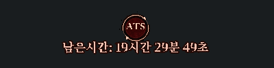

# ATS HUD V8 — 영상 비교 후 표시 개선

V7 사용자 영상과 참고 영상을 비교해 아이콘·글자·회전 효과를 다듬은 클라이언트 UI 버전입니다.



위 화면은 같은 렌더러를 실행한 **Wine64 미리보기**입니다. 글꼴은 Noto Serif CJK KR 대체를 사용했으며 실제 Windows 게임 화면을 캡처한 것은 아닙니다.

## V7을 적용한 상태라면

1. 게임을 완전히 종료합니다.
2. 기존 dinput.dll을 백업합니다.
3. 이 ZIP의 `dinput.dll`과 `ats_bg.png`를 Mega.bin 옆에 복사합니다. 전체 소스 ZIP에서는 `client-ready/` 안에 있습니다.
4. 기존 `ats_hud.ini`는 그대로 사용할 수 있습니다. 동봉 파일은 기본 설정 예시입니다.
5. 게임을 다시 켜고 49027 아이템으로 시작합니다. 로그 버전은 `native-tile-input-v8-ats-visual-20261111`입니다.

**V7 서버를 이미 적용했다면 서버 재빌드·SQL 재실행은 필요 없습니다.** 서버 Java·DB·이용시간 계산·레벨/맵 제한은 V7과 바이트 단위로 동일합니다.
V6 이하 서버에서 처음 설치한다면 전체 소스 ZIP의 `ATS_V7_APPLY_KO.md`에 있는 서버/DB 적용부터 진행하세요.

## 바뀐 화면

- 두꺼운 이미지 테두리와 따로 돌던 선을 얇은 한 겹 원형 테두리로 정렬.
- ATS 글자는 고정하고, 원 위의 작은 화살표 두 개만 2초 주기로 회전.
- ATS 글자를 비트맵에서 분리해 창 크기에 맞춰 직접 그림. 작은 창에서도 문자가 번지는 현상을 줄임.
- 붉은 바탕을 작고 차분하게 조정하고 과한 금속 광택을 제거.
- 시간 문구를 밝은 살구색·굵은 서체로 변경하고 어두운 외곽선을 얇게 조정.
- 글꼴이 없는 환경을 위한 대체 글꼴 경로 추가.

`ats_bg.png`에 ATS 글자가 없는 것은 정상입니다. 배경만 담긴 파일이며, 글자와 회전 화살표는 DLL에서 그립니다. V7의 `ats.png`는 V8에서 읽지 않습니다.

## 위치·크기·글꼴

```ini
[ATS]
Enabled=1
Bottom=124
OffsetX=0
ScalePercent=100
ShowSeconds=1
FontFace=Batang
```

- `ShowSeconds=0`: 참고 영상처럼 시간·분만 표시. 초 단위 차감은 계속됩니다.
- `FontFace=Batang`: 바탕체. 없으면 맑은 고딕, 그마저 없으면 기본 서체로 대체합니다.
- `ScalePercent=90`: 전체 HUD를 90% 크기로 표시하는 예시입니다.
- 기존 V7에서 조정해 둔 Bottom/OffsetX/ScalePercent 값은 보존해도 됩니다.

## 미리보기와 확인 범위

`ATS_Preview.exe`를 dinput.dll·ats_bg.png와 같은 폴더에서 실행하면 게임 없이 볼 수 있습니다. Space는 정지/재개, Esc는 종료입니다.
미리보기 시간은 서버의 실제 잔여 시간과 무관합니다.

- Win32 PE32 DLL·미리보기 EXE 빌드 통과.
- 시간 파서·잔여시간 상태 검사와 기존 이동 코어 10,000회 ASan/UBSan 회귀 검사 통과.
- 동일 HUD 소스의 64비트 미리보기를 Wine/Xvfb에서 실행해 화면·한국어 시간 문구·회전 애니메이션 확인.
- 영상에 보이는 기존 V7 게임 HUD와 시간 차감은 사용자 제공 영상에서 확인.
- **새 V8 DLL의 실제 Windows Mega.bin 게임 내 표시/클릭 통과/해상도별 동작은 아직 확인하지 않았습니다.**
- 서버·패킷·이동 엔진은 V7과 동일하며 이번에는 서버 테스트를 새로 수행하지 않았습니다. V7 검증 기록은 `historical-v7/validation/`에 보관했습니다.

창 모드·바탕화면 합성 방식입니다. 독점 전체 화면 렌더링 후킹은 포함하지 않았습니다.
