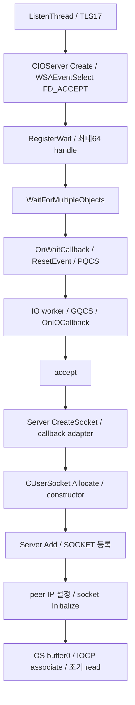
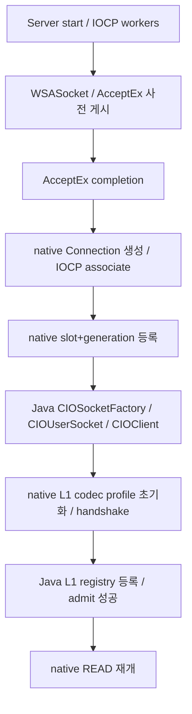

# CTransport ABI5 — 원본 바이너리/현재 구현 고정 대조

감사 기준은 `227c67bcab237c409d9741dcd1b2e091481e10e0`, 게임 DLL ABI `0x50000`입니다. 이번 작업은 **분석·분류·보고서 작성**이며 생산 Java/C++/DLL/PSS는 변경하지 않았습니다.

현재는 **L2 네트워크에서 확인한 핵심 동작을 L1·FFM에 맞춰 재구현한 서버**입니다. IOCP·풀·FIFO·파서·타이머·등록·종료의 대응 구현은 있습니다. 원본의 ListenThread/event accept, 일부 별도 색인·운영 진단·정책은 현재 구현과 다릅니다. 원본 전체와의 구조 동일성은 성립하지 않습니다.

## 이번에 고정할 결론

- **완료로 유지:** native I/O 완료,8K/16K 풀·반납,COW,FIFO/부분 송신,일반 작업 게시,wheel/block/heap,종료 hook,Server Add/Remove/Shutdown의 기본 참조 동작. 새 결함 근거 없이 다시 만들지 않습니다.
- **L1에 맞춘 적용:** L1 wire/crypto/opcode,Java session/DB 경계,64-bit generation 핸들,128배치,취소/clock,네트워크 deadline. 이를 원본 구조 그대로의 복원과 혼동하지 않습니다.
- **엄밀한 원본 네트워크 구조에서 남은 핵심 한 묶음:** `ListenThread17 + RegisterWait + WaitForMultipleObjects + OnWaitCallback→PQCS + IOCP worker에서 accept + factory/등록/초기화 순서`. 현재 AcceptEx 경로는 동작하지만 이 원본 경로는 이식하지 않았습니다. 표의 N17/N18/N22는 같은 접속 pipeline의 서로 다른 지점이며 독립적인 재작성 세 건으로 세지 않습니다.
- **나머지 차이:** OS 버퍼0 설정,CPU affinity/worker 수,2MiB 송신 제한,8192-bucket 보조 map,MAC limiter,peer별 dump와 thread 진단. 기능·정책·L2 의존성별로 구분했으며 전부 필수 결함이라는 뜻은 아닙니다.
- **아직 확정하지 못한 부분:** 전체 프로세스의 모든 exit edge,보조 map27/28의 모든 키/소비자 의미,실게임·DB·장시간 동접 검증입니다.

위 항목을 이후 비교의 기준으로 고정합니다. 행 추가·상태 변경에는 바이너리 주소 또는 현재 소스의 새 근거가 필요합니다. 표의33행은 감사 항목 수이며 전체 네트워크 함수 수나 복원율의 분모가 아닙니다. 원본 전체의 복원 퍼센트는 제시하지 않습니다.

## 입력과 확인 방법

| 대상 | SHA256 | 이번 확인 범위 |
|---|---|---|
| x64 `L2Server(10).exe` | `9940df15727ec88086cefc036d153fe18c153c9c26a5c90bafe1545de797b588` | PE/unwind 함수 범위,실제 명령 경계에서 import/direct 참조,가상함수 표,게임 listener와 생성/등록/worker 호출 경로 |
| x86 `L2Server.exe` | `8eecd317fb152b76f32a0a6a65fbf916e39d20511e203b4a0ea602fe041a22f5` | accept/listen/FD_ACCEPT/event wait 경로 교차 확인. 두 빌드 전체의 함수별1:1 대조는 아님 |
| 현재 `CTransport.dll` | `c5160c9e6d93924e6b0ec9bc52d40af93c1e03df9183a3629dd71ba9bba839f2` | 현재 src/C++와 배포된 ABI5 자료 일치 |
| 기존 L1 `CIOPacketCodec.dll` | `60bde93c2ba20057e7e307594edef69ced273b69f923535ab658769e09f0cea9` | 기존 파일 재사용; L2 crypto 이식으로 분류하지 않음 |

실행 파일을 실행하지 않고 정적으로 읽었습니다. 감사 스크립트는 입력 해시를 검사합니다. x64는 PE `.pdata`/unwind 범위와 실제 명령 경계로 xref 후보를 검증했고, 이번 출력은93개 분석 label/79개 고유 진입 주소를 포함합니다. label 수를 복원 함수 수로 해석하면 안 됩니다. `.pdata`가 없는 leaf와 x86는512-byte 안에서 도달 가능한 분기를 추적한 한정 CFG이며 범위 제한을 각 파일에 명시했습니다. 예외 handler·간접 호출·전체 실행 경로의 완전성 증명은 아닙니다.

바이너리에 남아 있는 UTF16 함수 signature와 vtable/인자/필드/호출을 함께 사용했습니다. 문자열만 발견하거나 근처 함수를 읽었다는 이유로 역할을 단정하지 않았습니다. 원본 C++ 텍스트를 추출한 결과가 아니라 관찰한 동작과 현재 재구현의 비교입니다.

## 접속 수락→생성→등록의 실제 대조

원본 x64에서 확인된 게임 listener 경로:



확인 주소: Create `0x7066dc` → RegisterWait `0x706564` → WaitThread `0x705e4c` → OnWaitCallback `0x704d1c` → OnIOCallback `0x705508` → Server::CreateSocket `0x8b0738` → callback adapter `0x8af8e8` → CUserSocket::Allocate `0xa0d07c` → constructor `0xa0ccc4` → Server::Add `0x8b0404` → IP setter slot+0xa8 → Initialize `0x545260` → initial read slot+0x68 `0x545398`.

현재 경로:



따라서 **접속 기능은 구현됐고, 접속 수락 구조는 원본과 다릅니다.** 특히 native registry에 먼저 들어간 뒤 Java 게임 owner와 native codec이 생성되는 현재 순서는 원본의 객체 구성·등록 순서와 같지 않습니다. 이 차이를 접속 기능 자체가 없는 것으로 표현하지 않습니다.

원본의 x86에서도 `0x53d740`에서 listen5·WSACreateEvent·WSAEventSelect(mask8),`0x53c7e0`에서 WaitForMultipleObjects,`0x53bed0`에서 accept 호출을 확인했습니다. x64의 이벤트 수락 방식이 단지 함수 이름 추정에서 나온 결론은 아닙니다.

## 등록 관리자에서 확인한 것

Server vtable `0xd2a5f8`의 확인된 대응:

| slot offset | 대상 | 역할 |
|---|---|---|
| `+0x48` | `0x704d1c` | OnWaitCallback |
| `+0x50` | `0x705508` | OnIOCallback/accept |
| `+0x60` | `0x8b0738` | CreateSocket |
| `+0x68` | `0x8b04fc` | Remove |
| `+0x70` | `0x8b0404` | Add |
| `+0x78` | `0x8b0954` | Shutdown |

CreateSocket의 `0x8b08df`는 factory adapter를,`0x8b08f2`는 Server의+0x70을 호출합니다. Add가 직접 호출 검색에서 NpcServer override만 보였던 것은 게임 경로가 가상 호출이기 때문입니다. **게임 접속의 Add 호출까지 이번에 연결했습니다.**

Add는 잠금 아래 socket 참조를 획득하고 tree에 SOCKET→object를 넣습니다. Remove는 같은 tree에서 찾아 참조를 반환하고 erase합니다. Shutdown은 잠금 안에서 socket 목록과 참조를 확보한 뒤 잠금 밖에서 close/release합니다. 현재 `CUserSocketManager`의 insert/find/remove/snapshot이 이 기본 수명 역할을 수행합니다.

이 Server map과 constructor가 사용하는 별도 CObjectMap은 구분합니다. `0xa0ce3e/0xa0ce49`는 사용자번호를 만들고+0x4e8에 저장하며,`0xa08138`이8192-bucket map variant26에 등록합니다. variant27/28의 Insert/Delete/ExistKey도 존재하지만 모든 소비자 의미는 아직 미확인입니다. 현재 generation handle/Java session 관리가 있다고 해서 이 모든 원본 색인 구조가 복원됐다고 표현하지 않습니다.

## 스레드 시작·종료에서 확인한 것

- WinMain 경로 `0x7309df`의 실제 로그는 Starting ListenThread입니다. `0x7309f5`에서 `0x730300`을 entry로 넘기고 `0x730a21`에서 handle을 번호17로 등록합니다.
- `0x730300`은 TLS17을 설정하고16K200개/8K300개 풀을 준비한 뒤 service entry로 갑니다. `0x72f874`는 I/O 초기화·worker 시작·각 listener 등록 후 `0x705e4c` WaitThread로 들어갑니다.
- worker는 `0x705b70`→CRT thread wrapper→`0x705b38`→TLS 설정→`0x705a4c/0x705ab0`→`0x7056ac`로 이어집니다. worker 수 함수 `0x7044c4`는 CPU 수와8을 비교하고 실제 상수8을 읽어 최댓값을 제한합니다. `0x705c4b`는 affinity를 설정합니다.
- 현재는 기본8개 std::thread worker와 각 worker의 timer이며, 별도 ListenThread17/RegisterWait/WaitThread는 없습니다. `TimerDispatchPolicy.post(17)` 분기가 존재하고 검사됐다는 사실을 이 실행 구조의 복원으로 해석하지 않습니다.
- 원본 `Server::Shutdown`의 socket snapshot/close는 확인됐고 현재도 대응합니다. 원본 전체 프로세스의 모든 UI/서비스 실패/감시/exit 경로를 끝까지 분석했다는 근거는 없습니다. 현재 native Stop의 cancel/drain/join과 Java shutdown 예산은 이미 구현·검사된 별도 종료 계약입니다.

## 송신을 다시 만들 필요가 없는 이유와 실제 차이

`0x545a18`의 signature는 `CIOSocketEx<CIOBufferEx<16384>>::__async_AsyncWrite(void *)`입니다. 원본은 +0xa0/+0xa8의 head/tail에 버퍼를 연결하고1개 WSABUF로 WSASend합니다. 완료 callback `0x545e38`은 완료 길이를 head 버퍼 길이와 비교합니다(`0x545e51`). 다르면 진단하고 반환하며, 같으면 pending을 줄이고 다음 버퍼를 게시·기존 버퍼를 반납합니다. 확인한 이 함수에는 짧은 완료의 남은 바이트를 offset으로 재게시하는 분기가 없습니다.

현재 SendChain/FIFO/반납 기능은 구현돼 있고 실제 짧은 완료를 offset으로 진행·재게시합니다. 따라서 현재 부분 송신 처리는 완료된 추가 처리로 기록합니다. 이를 원본과 동일하게 복원했다고 주장하거나, 송신이 없으니 새로 만들어야 한다고 표현하지 않습니다.

## 기존 설명에서 정정한 부분

| 이전 분석용 명칭/설명 | 실제 확인 | 적용되는 판정 |
|---|---|---|
| `0x7ad220`을 일반 게임 접속 등록 경로로 해석 | embedded signature는 `NpcServer::Add`. 게임 경로는 Server vtable+0x70에서 `0x8b0404`로 연결됨 | Npc override와 game Add를 구분 |
| `0xa0dc04` = login registry unregister | embedded signature는 `CSocketLimiter::DecUserSocketPerIP(unsigned int)` | IP 카운터 감소 |
| `0xa0ded4` = account registry unregister | embedded signature는 `CSocketLimiter::DecUserSocketPerMAC(__int64)` | MAC 카운터 감소 |
| `0xa22ae8` = worker 시작 helper | GetTickCount/QPC 값을 이용해 CRT/thread-local RNG 상태를 초기화 | worker 생성/등록 함수로 세지 않음 |
| `0x8b0674` = socket lookup 후보 | tree 삽입 helper이며 CreateSocket에서 peer-IP 자료구조에 사용됨 | 독립 공개 socket lookup의 증거가 아님 |
| `0x926e2c/0x926e54`의 guard라는 이름 | thread별 시작 시각/누적 소요 시간 계산 | mutex나 객체 수명 guard로 단정하지 않음 |

옛 disassembly label은 당시 추정의 기록입니다. 최신 역할 판단은 이번 명령·signature·호출 연결을 기준으로 합니다. 구현에 없는 함수명을 복원 완료로 계산하지 않습니다.

## 고정 대조표

분류: 핵심 동작 대응 확인 / L1·FFM 적용·정책 차이 / 원본 구조·정책 미이식 / 대조·검증 미완료 / L2 게임·독립 기능 범위 제외.

모든 항목의 자세한 바이너리 사실·현재 사실·다음 처리·전체 근거는 [JSON](https://github.com/choeyeonggeol16-sketch/1234/blob/ctransport-core-20261112/patches/ctransport_core_20261112/research/network-audit/RESTORATION_MATRIX.json)과 [CSV](https://github.com/choeyeonggeol16-sketch/1234/blob/ctransport-core-20261112/patches/ctransport_core_20261112/research/network-audit/RESTORATION_MATRIX.csv)에 있습니다. 아래 소스 링크는 SHA를 고정한 읽기 전용 감사 복제본이며 실제 배포 소스를 수정한 파일이 아닙니다.

| ID | 판정 | 대상 | 원본 주소 | 현재 구현과 차이 | 소스·명령 근거 |
|---|---|---|---|---|---|
| N01 | L1·FFM 적용/정책 차이 | IOCP dequeue와 완료 분배 | `0x7056ac`, `0x7057c9`, `0x7058d8` | 128배치와 typed Operation은 추가 설계다. 원본 dequeue 구조와 1:1 동일하지 않다. | [CTransport.cpp:559](https://github.com/choeyeonggeol16-sketch/1234/blob/ctransport-core-20261112/patches/ctransport_core_20261112/research/network-audit/source/native/CTransport.cpp#L559) · [명령](https://github.com/choeyeonggeol16-sketch/1234/blob/ctransport-core-20261112/patches/ctransport_core_20261112/research/network-audit/io_worker_body.asm.txt) |
| N02 | 핵심 동작 대응 확인 | 8K/16K slab·소유 풀 반환 | `0x6b5094`, `0x6b4fb8`, `0x45d7f8`, `0x45d67c` | adapter view 객체와 총량·외부 producer 정책은 별도다. 원본 전체 allocator ABI 동일성을 뜻하지 않는다. | [cio_core.hpp:65](https://github.com/choeyeonggeol16-sketch/1234/blob/ctransport-core-20261112/patches/ctransport_core_20261112/research/network-audit/source/native/cio_core.hpp#L65) · [명령](https://github.com/choeyeonggeol16-sketch/1234/blob/ctransport-core-20261112/patches/ctransport_core_20261112/research/scope/pool8_constructor.asm.txt) |
| N03 | 핵심 동작 대응 확인 | 공유 수신 COW·유일 버퍼 compaction | `0x45de2c` | L1의 미완성 프레임 조립 저장소·codec 대기는 별도다. | [cio_core.hpp:145](https://github.com/choeyeonggeol16-sketch/1234/blob/ctransport-core-20261112/patches/ctransport_core_20261112/research/network-audit/source/native/cio_core.hpp#L145) · [명령](https://github.com/choeyeonggeol16-sketch/1234/blob/ctransport-core-20261112/patches/ctransport_core_20261112/research/scope/read_completion_8k.asm.txt) |
| N04 | L1·FFM 적용/정책 차이 | 송신 FIFO·완료 길이·버퍼 반환 | `0x545a18`, `0x545e38`, `0x54655c` | FIFO 수명은 대응하지만 부분 완료 offset 진행/재게시를 같은 원본 동작으로 주장할 수 없다. 현재의 추가 처리다. | [cio_core.hpp:168](https://github.com/choeyeonggeol16-sketch/1234/blob/ctransport-core-20261112/patches/ctransport_core_20261112/research/network-audit/source/native/cio_core.hpp#L168) · [명령](https://github.com/choeyeonggeol16-sketch/1234/blob/ctransport-core-20261112/patches/ctransport_core_20261112/research/network-audit/enqueue_async_write_16k.asm.txt) |
| N05 | L1·FFM 적용/정책 차이 | 상위 송신 serializer와 암호화 순서 | `0x45c7ac`, `0x9ef544`, `0x9ef620` | 혼합 구현이다. encrypt+send를 하나의 새 native API로 합치는 것은 추가 설계 작업이다. | [CIOUserSocket.java:268](https://github.com/choeyeonggeol16-sketch/1234/blob/ctransport-core-20261112/patches/ctransport_core_20261112/research/network-audit/source/src/l1j/server/server/model/network/core/CIOUserSocket.java#L268) · [명령](https://github.com/choeyeonggeol16-sketch/1234/blob/ctransport-core-20261112/patches/ctransport_core_20261112/research/scope/serialized_write_callback.asm.txt) |
| N06 | 핵심 동작 대응 확인 | 일반 completion 작업 게시와 참조 | `0x704248` | 작업 인자 ABI는 FFM에 맞춘 typed Operation/token이다. | [CTransport.cpp:133](https://github.com/choeyeonggeol16-sketch/1234/blob/ctransport-core-20261112/patches/ctransport_core_20261112/research/network-audit/source/native/CTransport.cpp#L133) · [명령](https://github.com/choeyeonggeol16-sketch/1234/blob/ctransport-core-20261112/patches/ctransport_core_20261112/research/scope/object_post_completion.asm.txt) |
| N07 | 핵심 동작 대응 확인 | 50ms/200슬롯·1000-entry block·overflow heap | `0x92533c`, `0x9256d4`, `0x92611c` | 취소 인덱스·clock·메모리 총량은 별도 적용. 원본 모든 message 의미가 이식된 것은 아니다. | [timer_wheel.hpp:10](https://github.com/choeyeonggeol16-sketch/1234/blob/ctransport-core-20261112/patches/ctransport_core_20261112/research/network-audit/source/native/timer_wheel.hpp#L10) · [명령](https://github.com/choeyeonggeol16-sketch/1234/blob/ctransport-core-20261112/patches/ctransport_core_20261112/research/scope/timer_bucket_append.asm.txt) |
| N08 | L1·FFM 적용/정책 차이 | timer message/argument·취소·clock | `0x925374`, `0x926bf4` | 필드 배치 대응과 원본 message/argument 프로토콜 전체 복원은 다르다. | [timer_wheel.hpp:115](https://github.com/choeyeonggeol16-sketch/1234/blob/ctransport-core-20261112/patches/ctransport_core_20261112/research/network-audit/source/native/timer_wheel.hpp#L115) · [명령](https://github.com/choeyeonggeol16-sketch/1234/blob/ctransport-core-20261112/patches/ctransport_core_20261112/research/scope/timer_bucket_execute.asm.txt) |
| N09 | 핵심 동작 대응 확인 | 종료 시작 hook·활성 해제·linger0 | `0x45d534`, `0xa12dec` | I/O terminal/borrowed plaintext 반환 fence는 L1/FFM의 추가 경계다. | [CTransport.cpp:183](https://github.com/choeyeonggeol16-sketch/1234/blob/ctransport-core-20261112/patches/ctransport_core_20261112/research/network-audit/source/native/CTransport.cpp#L183) · [명령](https://github.com/choeyeonggeol16-sketch/1234/blob/ctransport-core-20261112/patches/ctransport_core_20261112/research/scope/socket_close.asm.txt) |
| N10 | 핵심 동작 대응 확인 | Server::Add / Remove의 잠금·참조 | `0x8b0404`, `0x8b04fc`, `Server vtable +0x70/+0x68` | 현재 key는 slot+generation이고 원본 key는 SOCKET이다. 원본 STL 내부 배치를 복사하지 않았다. | [user_registry.hpp:28](https://github.com/choeyeonggeol16-sketch/1234/blob/ctransport-core-20261112/patches/ctransport_core_20261112/research/network-audit/source/native/user_registry.hpp#L28) · [명령](https://github.com/choeyeonggeol16-sketch/1234/blob/ctransport-core-20261112/patches/ctransport_core_20261112/research/network-audit/vtable_Server_14.asm.txt) |
| N11 | 핵심 동작 대응 확인 | Server::Shutdown snapshot의 참조 수명 | `0x8b0954`, `Server vtable +0x78` | 전체 L2 프로세스 종료와 native Server.stop은 다른 범위다. | [user_registry.hpp:68](https://github.com/choeyeonggeol16-sketch/1234/blob/ctransport-core-20261112/patches/ctransport_core_20261112/research/network-audit/source/native/user_registry.hpp#L68) · [명령](https://github.com/choeyeonggeol16-sketch/1234/blob/ctransport-core-20261112/patches/ctransport_core_20261112/research/network-audit/vtable_Server_15.asm.txt) |
| N12 | L1·FFM 적용/정책 차이 | 수신 parser·opcode 분배 | `0xa0372c` | L2 최대0x4000·opcode·handler bool 대신 L1 empty2 또는 wire10..65535 및 기존 handler 의미. | [user_socket.hpp:15](https://github.com/choeyeonggeol16-sketch/1234/blob/ctransport-core-20261112/patches/ctransport_core_20261112/research/network-audit/source/native/user_socket.hpp#L15) · [명령](https://github.com/choeyeonggeol16-sketch/1234/blob/ctransport-core-20261112/patches/ctransport_core_20261112/research/user-socket/user_socket_parser.asm.txt) |
| N13 | L1·FFM 적용/정책 차이 | 코덱 직접 연결 | `0xa0372c`, `0x9ef384` | L2 암호 복원 결과가 아니다. 기존 L1 DLL을 재사용한 호환 연결이다. | [l1_codec.hpp:13](https://github.com/choeyeonggeol16-sketch/1234/blob/ctransport-core-20261112/patches/ctransport_core_20261112/research/network-audit/source/native/l1_codec.hpp#L13) · [명령](https://github.com/choeyeonggeol16-sketch/1234/blob/ctransport-core-20261112/patches/ctransport_core_20261112/research/user-socket/user_socket_parser.asm.txt) |
| N14 | L1·FFM 적용/정책 차이 | packet lease·세션 owner·L1 deferred cleanup | `0xa12674`, `0xa123e8` | L2 월드 객체/지연 값 대신 L1 계정·캐릭터·DB 경계를 유지한다. | [CTransport.cpp:387](https://github.com/choeyeonggeol16-sketch/1234/blob/ctransport-core-20261112/patches/ctransport_core_20261112/research/network-audit/source/native/CTransport.cpp#L387) · [명령](https://github.com/choeyeonggeol16-sketch/1234/blob/ctransport-core-20261112/patches/ctransport_core_20261112/research/user-socket/deferred_user_close.asm.txt) |
| N15 | L1·FFM 적용/정책 차이 | native 핸들·세대·retiring 조회 | `0x90e548`, `0xa12dec` | generation 핸들은 현재 FFM 수명/ABA 방지를 위해 추가한 설계다. | [user_registry.hpp:34](https://github.com/choeyeonggeol16-sketch/1234/blob/ctransport-core-20261112/patches/ctransport_core_20261112/research/network-audit/source/native/user_registry.hpp#L34) · [명령](https://github.com/choeyeonggeol16-sketch/1234/blob/ctransport-core-20261112/patches/ctransport_core_20261112/research/network-audit/socket_base_ctor.asm.txt) |
| N16 | 원본 구조·정책 미이식 | 8,192-bucket 사용자번호 CObjectMap | `0xa0ce3e`, `0xa0ce49`, `0xa08138` | 원본의 별도 8192-bucket 사용자번호 map은 그대로 이식하지 않았다. 원본 Server SOCKET map과 다른 계층이다. | [user_registry.hpp:10](https://github.com/choeyeonggeol16-sketch/1234/blob/ctransport-core-20261112/patches/ctransport_core_20261112/research/network-audit/source/native/user_registry.hpp#L10) · [명령](https://github.com/choeyeonggeol16-sketch/1234/blob/ctransport-core-20261112/patches/ctransport_core_20261112/research/network-audit/user_ctor.asm.txt) |
| N17 | 원본 구조·정책 미이식 | FD_ACCEPT→RegisterWait→IOCP 접속 수락 | `0x7066dc`, `0x706564`, `0x705e4c`, `0x704d1c`, `0x705508` | 현재는 원본의 event wait registry/OnWaitCallback/accept 구조를 사용하지 않는다. | [CTransport.cpp:610](https://github.com/choeyeonggeol16-sketch/1234/blob/ctransport-core-20261112/patches/ctransport_core_20261112/research/network-audit/source/native/CTransport.cpp#L610) · [명령](https://github.com/choeyeonggeol16-sketch/1234/blob/ctransport-core-20261112/patches/ctransport_core_20261112/research/network-audit/api_WSAEventSelect_7066dc.asm.txt) |
| N18 | L1·FFM 적용/정책 차이 | factory→생성→등록→I/O 초기화 순서 | `0x8af9cc`, `0x8b0738`, `0xa0d07c`, `0xa0ccc4`, `0x545260` | 기능은 대응하지만 객체 분할과 초기화 순서는 원본 그대로가 아니다. | [CTransport.cpp:645](https://github.com/choeyeonggeol16-sketch/1234/blob/ctransport-core-20261112/patches/ctransport_core_20261112/research/network-audit/source/native/CTransport.cpp#L645) · [명령](https://github.com/choeyeonggeol16-sketch/1234/blob/ctransport-core-20261112/patches/ctransport_core_20261112/research/network-audit/vtable_Server_12.asm.txt) |
| N19 | 원본 구조·정책 미이식 | SO_RCVBUF/SO_SNDBUF=0 및 listen 정책 | `0x5452eb`, `0x545315`, `0x7067e2` | 원본 정책 미이식이다. 수신/송신 엔진 부재를 뜻하지 않는다. | [CTransport.cpp:644](https://github.com/choeyeonggeol16-sketch/1234/blob/ctransport-core-20261112/patches/ctransport_core_20261112/research/network-audit/source/native/CTransport.cpp#L644) · [명령](https://github.com/choeyeonggeol16-sketch/1234/blob/ctransport-core-20261112/patches/ctransport_core_20261112/research/network-audit/socket_init_io.asm.txt) |
| N20 | 핵심 동작 대응 확인 | IO worker 번호/TLS/owner 식별 | `0x705b38`, `0x9250f8`, `0x925118` | 원본의 전역 thread handle 표·진단 전체는 별도다. | [CTransport.cpp:561](https://github.com/choeyeonggeol16-sketch/1234/blob/ctransport-core-20261112/patches/ctransport_core_20261112/research/network-audit/source/native/CTransport.cpp#L561) · [명령](https://github.com/choeyeonggeol16-sketch/1234/blob/ctransport-core-20261112/patches/ctransport_core_20261112/research/network-audit/worker_entry.asm.txt) |
| N21 | 원본 구조·정책 미이식 | CPU 수 기반 worker 수·affinity | `0x7044c4`, `0x705c4b` | 원본 정책과 다르다. | [Server.java:33](https://github.com/choeyeonggeol16-sketch/1234/blob/ctransport-core-20261112/patches/ctransport_core_20261112/research/network-audit/source/src/l1j/server/Server.java#L33) · [명령](https://github.com/choeyeonggeol16-sketch/1234/blob/ctransport-core-20261112/patches/ctransport_core_20261112/research/network-audit/worker_count.asm.txt) |
| N22 | 원본 구조·정책 미이식 | ListenThread owner17의 실제 실행 구조 | `0x7309df`, `0x730300`, `0x72f874`, `0x705e4c` | 17번 timer repost 분기는 있지만 기본 실행에서 owner17 thread를 생성하지 않는다. 분기 테스트 통과는 원본 thread topology 복원 증거가 아니다. | [CTransport.cpp:559](https://github.com/choeyeonggeol16-sketch/1234/blob/ctransport-core-20261112/patches/ctransport_core_20261112/research/network-audit/source/native/CTransport.cpp#L559) · [명령](https://github.com/choeyeonggeol16-sketch/1234/blob/ctransport-core-20261112/patches/ctransport_core_20261112/research/network-audit/caller_thread_rng_seed_init_730408.asm.txt) |
| N23 | L1·FFM 적용/정책 차이 | IP별 접속 제한·반환 | `0xa0dc04` | 원본 limiter 구조/정책 전체를 이식한 것은 아니며 이전 login registry unregister라는 이름은 오분류였다. | [NetworkClientCounter.java:45](https://github.com/choeyeonggeol16-sketch/1234/blob/ctransport-core-20261112/patches/ctransport_core_20261112/research/network-audit/source/src/l1j/server/server/model/network/client/manager/NetworkClientCounter.java#L45) · [명령](https://github.com/choeyeonggeol16-sketch/1234/blob/ctransport-core-20261112/patches/ctransport_core_20261112/research/network-audit/ip_socket_limiter_decrement.asm.txt) |
| N24 | 원본 구조·정책 미이식 | MAC별 소켓 limiter | `0xa0ded4` | 기존 account registry unregister라는 이름은 잘못됐다. L1 클라이언트의 식별 정보 전달 경로도 따로 확인해야 한다. | [CIOSocketFactory.java:44](https://github.com/choeyeonggeol16-sketch/1234/blob/ctransport-core-20261112/patches/ctransport_core_20261112/research/network-audit/source/src/l1j/server/server/model/network/core/CIOSocketFactory.java#L44) · [명령](https://github.com/choeyeonggeol16-sketch/1234/blob/ctransport-core-20261112/patches/ctransport_core_20261112/research/network-audit/mac_socket_limiter_decrement.asm.txt) |
| N25 | 원본 구조·정책 미이식 | 원본 2MiB pending write 허용 정책 | `0x9ef5ca`, `0x9ef620` | 원본 상수를 복사하지 않은 정책 차이. FIFO·부분 송신 구현 완료와 구분한다. | [CIOUserSocket.java:557](https://github.com/choeyeonggeol16-sketch/1234/blob/ctransport-core-20261112/patches/ctransport_core_20261112/research/network-audit/source/src/l1j/server/server/model/network/core/CIOUserSocket.java#L557) · [명령](https://github.com/choeyeonggeol16-sketch/1234/blob/ctransport-core-20261112/patches/ctransport_core_20261112/research/network-audit/user_write_validity.asm.txt) |
| N26 | 원본 구조·정책 미이식 | Server::ReportSocket 전체 peer 진단 | `0x8b0bac`, `0x72e25d` | 운영 진단 기능 미이식. 네트워크 전송 결함은 아니다. | [CTransport.cpp:863](https://github.com/choeyeonggeol16-sketch/1234/blob/ctransport-core-20261112/patches/ctransport_core_20261112/research/network-audit/source/native/CTransport.cpp#L863) · [명령](https://github.com/choeyeonggeol16-sketch/1234/blob/ctransport-core-20261112/patches/ctransport_core_20261112/research/network-audit/manager_snapshot_b.asm.txt) |
| N27 | 원본 구조·정책 미이식 | 원본 thread별 I/O 시간/lock stack 진단 | `0x926e2c`, `0x926e54`, `0x705850`, `0x705924` | 0x926e2c/54는 실제로 시간 측정이다. 이름만으로 전역 mutex라고 해석하면 안 된다. | [CTransport.cpp:878](https://github.com/choeyeonggeol16-sketch/1234/blob/ctransport-core-20261112/patches/ctransport_core_20261112/research/network-audit/source/native/CTransport.cpp#L878) · [명령](https://github.com/choeyeonggeol16-sketch/1234/blob/ctransport-core-20261112/patches/ctransport_core_20261112/research/network-audit/callback_timing_enter.asm.txt) |
| N28 | L1·FFM 적용/정책 차이 | native 네트워크 deadline | `0xa0d164`, `0x925374` | 원본 CUserSocket::TimerExpired 전체 복원과 같지 않다. 네트워크 timer 연결은 이미 완료했다. | [CTransport.cpp:418](https://github.com/choeyeonggeol16-sketch/1234/blob/ctransport-core-20261112/patches/ctransport_core_20261112/research/network-audit/source/native/CTransport.cpp#L418) · [명령](https://github.com/choeyeonggeol16-sketch/1234/blob/ctransport-core-20261112/patches/ctransport_core_20261112/research/network-audit/user_timer.asm.txt) |
| N29 | 대조/검증 미완료 | 전체 프로세스의 모든 정상/오류 종료 경로 | `0x72f874`, `0x73029c`, `0x72d880` | 현재 stop은 구현/검사됐다. 원본 프로세스의 모든 UI·watchdog·서비스 실패 exit edge를 소진한 것은 아니다. | [CTransport.cpp:727](https://github.com/choeyeonggeol16-sketch/1234/blob/ctransport-core-20261112/patches/ctransport_core_20261112/research/network-audit/source/native/CTransport.cpp#L727) · [명령](https://github.com/choeyeonggeol16-sketch/1234/blob/ctransport-core-20261112/patches/ctransport_core_20261112/research/network-audit/service_main.asm.txt) |
| N30 | 대조/검증 미완료 | CObjectMap variant27/28의 모든 소비자 의미 | `0xa08498`, `0x97ec10`, `0xa08660`, `0x8951bc` | variant27/28의 모든 키 의미와 호출자를 이번에 완전히 추적하지 않았다. 이름만으로 로그인/계정 map이라 단정하지 않는다. | [CIOClient.java:39](https://github.com/choeyeonggeol16-sketch/1234/blob/ctransport-core-20261112/patches/ctransport_core_20261112/research/network-audit/source/src/l1j/server/server/model/network/core/CIOClient.java#L39) · [명령](https://github.com/choeyeonggeol16-sketch/1234/blob/ctransport-core-20261112/patches/ctransport_core_20261112/research/network-audit/user-object-maps.json) |
| N31 | L2 게임/독립 기능 범위 제외 | L2 게임 opcode·월드·서비스 초기화 | `0x72f874`, `0xa0d164` | L2 game engine 및 외부 서버 topology 전체는 이식 대상과 구분해야 한다. | [CUserSocketDispatch.java:10](https://github.com/choeyeonggeol16-sketch/1234/blob/ctransport-core-20261112/patches/ctransport_core_20261112/research/network-audit/source/src/l1j/server/server/model/network/core/CUserSocketDispatch.java#L10) · [명령](https://github.com/choeyeonggeol16-sketch/1234/blob/ctransport-core-20261112/patches/ctransport_core_20261112/research/network-audit/service_main.asm.txt) |
| N32 | 대조/검증 미완료 | 실게임·운영 DB·장시간 동접 검증 | 범위 구분 | 실클라이언트·DB·동접 부하는 미검증. 복원 구조 누락과 다른 검증 항목이다. | [CTransport.cpp:74](https://github.com/choeyeonggeol16-sketch/1234/blob/ctransport-core-20261112/patches/ctransport_core_20261112/research/network-audit/source/native/CTransport.cpp#L74) · [명령](https://github.com/choeyeonggeol16-sketch/1234/blob/ctransport-core-20261112/patches/ctransport_core_20261112/research/../WINDOWS_VERIFICATION.json) |
| N33 | L2 게임/독립 기능 범위 제외 | 독립 PSS 보존 | 범위 구분 | 원본 L2 네트워크와 합치지 않는다. | [Server.java:56](https://github.com/choeyeonggeol16-sketch/1234/blob/ctransport-core-20261112/patches/ctransport_core_20261112/research/network-audit/source/src/l1j/server/Server.java#L56) · [명령](https://github.com/choeyeonggeol16-sketch/1234/blob/ctransport-core-20261112/patches/ctransport_core_20261112/research/../logs/abi5-pss-preservation.log) |

## 다음 작업의 경계

원본 구조를 더 맞추려면 먼저 **N17/N18/N22의 접속 수락 pipeline 한 묶음**을 대상으로 삼아야 합니다. 이벤트 기다림·게시·수락·객체 생성/등록·I/O 초기화가 서로 연결되므로 따로 끝났다고 반복 집계하지 않습니다. 이번 요청에서는 수정하지 않았습니다.

N19/N21/N25는 버퍼·스레드·송신 제한 정책 차이, N26/N27은 운영 진단 차이입니다. N16/N24는 L1 identity/클라이언트 식별 정보와의 대응을 먼저 결정해야 합니다. N29/N30은 미확인입니다. 이 모두를 곧바로 필수 결함이나 다음 복원 작업으로 나열하지 않습니다.

완료된 FIFO·부분 송신·접속 등록·수신 parser·codec 연결·기본 timer를 반복해서 미구현으로 제시하지 않습니다. 앞으로는 이 표의 ID를 기준으로 변경하고, 새 근거가 없으면 완료 상태를 유지합니다. PSS는 기존 지시대로 독립 활성화를 유지합니다.

## 검증 기록과 한계

이번에 실행한 것은 입력 두 PE의 SHA 확인,원본 명령·가상함수 표·xref 재현,현재 코드/DLL의 기존 배포본 일치,표의 모든 링크/파일 경로·SHA 확인입니다. 네트워크 코드는 바꾸지 않았으므로 같은 기능 테스트를 다시 돌리지 않았습니다.

이 코드/DLL의 Windows 기존 통과 기록은 [run43309668114](https://github.com/choeyeonggeol16-sketch/1234/actions/runs/43309668114), 검사 commit `9c79d8a9507606d451adc11c33366c90a2e76035`입니다. 이는 DLL/FFM/L1 codec/생산 socket 수명/정책/독립 PSS 검사이며 게임/계정/actor/scheduler/handler/filter에는 fixture를 사용합니다. 실게임·운영 DB·장시간 동접·비교 성능을 증명하지 않습니다.

현재 전체 src SHA256은 `8492da4473b92bf9c8f310e8c6e37d1e4e2a72a8ff414a67f7d69acf2491466a`이며 이번 감사로 변경하지 않았습니다. 두 입력 EXE는 보고서 묶음에 재업로드하지 않았습니다.

재현: 기존 Core 소스 루트에 감사 스크립트를 두고 pefile/capstone이 있는 Python으로 실행합니다.

```bash
python research/audit_network_abi5.py --x64 '/path/L2Server(10).exe' --x86 '/path/L2Server.exe' --out research/network-audit
python research/build_network_audit_matrix.py
```

`inputs.json`, `functions.json`, `vtables.json`, `game-manager-xrefs.json`, `user-object-maps.json`, `x86-crosscheck.json`, 각 `.asm.txt`, `source-snapshot.json`, 대조표와 검증 기록을 함께 제공합니다.
