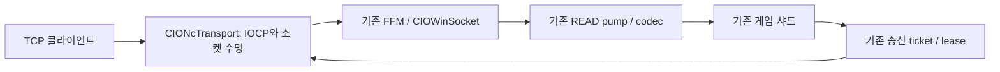

# NC I/O 코어 동작 복원 및 선택형 네이티브 구현

두 제공 EXE를 RTTI/vtable/IOCP/수신·송신 명령까지 추적하고, 확인한 객체 수명·버퍼·FIFO·완료 디스패치 계약을 **새 C++ 전송 엔진으로 구현**했습니다. 실행 가능한 Windows x64 `CIONcTransport.dll`, 빌드 가능한 소스, 기존 RKern FFM 연결, Windows loopback self-test EXE를 제공합니다. NC 원본 C++ 전체 복구 또는 EXE의 함수 바이트를 추출한 결과물이 아닙니다.

**선택형 재구현 실험본입니다. Windows에서 실제 DLL/Java FFM/게임/부하를 실행한 결과는 아직 없습니다.** 기본 HP-Socket 전송과 기존 게임 소스는 유지하며 `-Drkern.cio.transport=nc`로 명시적으로 새 코어를 선택합니다.

## 바이너리에서 확인한 동작과 실제 반영

| 항목 | EXE에서 확인한 근거 | 이번 구현 |
|---|---|---|
| completion-key 객체의 virtual dispatch | x86 GQCS0x53cb6f→vtable+0x30, x64 GQCS0x7057c9→vtable+0x50 | CIOObject virtual completed와 GQCS worker |
| I/O 제출 전 참조 확보·오류/완료 후 해제 | x64 retain0x7d6d50, socket callback0x45f028의 read/write 구분·release, x86 release0x53aa90 | atomic retain/release, kernel/synthetic 요청당 I/O hold1개 |
| 8KB 수신·송신 버퍼 | 양쪽 WSARecv 앞0x2000 공간 계산, x64 버퍼payload+0x10/길이+0x2010 | CIOBuffer8192, 재사용 pool |
| 활성 송신과 대기 tail 분리 | x64 Write0x45e480/WriteCallback0x45e8a0 | 활성 head 불변, 대기 tail만 합치고 FIFO 처리 |
| 읽기 데이터 수명 보존 | x64 Read0x45e138은 공유 버퍼면 남은 데이터를 새 버퍼에 복사 | callback 반환 전 read buffer 재사용 금지. 남은 프레임은 기존 Java/codec가 소유 |
| 정상0/IO_PENDING997/즉시 오류 | WSARecv0x45e35b, WSASend0x45e6a7 | 동기 성공에도 완료를 기다림. 즉시 오류는 I/O hold를 즉시 되돌리고 종료 |

x86 CIOSocket vtable0x61d72c, x64 8192-byte CIOSocketEx vtable0xb54c18까지 복원했습니다. x64에는16384-byte 변형0xbbe878도 있습니다. 두 파일의 pointer폭/슬롯/구조체 오프셋은 달라 그대로 재사용하지 않았습니다. 상세 명령·필드·해석은 [동작 복원 기록](../patches/rkern_nc_iocp_port_20261112/research/NC_IO_CORE_RECOVERED.md)에 있습니다.

## 새 전송 코어

native/nc_core.hpp156줄과 CIONcTransport.cpp495줄이 참조 수명·8KB pool/FIFO·IOCP·AcceptEx·주소·종료·26개 호환 C API와 ABI version을 구현합니다. C++17, Windows x64용입니다. 새 DLL은 HP-Socket export/라이브러리에 의존하지 않으며 실제 CreateIoCompletionPort/GQCS/PostQCS/WSARecv/WSASend를 import합니다. DLL과 self-test는 Zig0.14.1로 cross-compile했습니다.

Java 변경은 기존 CIOWinServer1개와 추가 CIOTransportConfig1개입니다. 기존 FFM callback, READ pump, codec, 샤드, 송신 ticket/lease, 서버 shutdown deadline은 유지합니다. 선택한 DLL의 해시와 새 엔진의 CIONC_Version0x10000을 검사합니다. 알 수 없는 선택값은 시작을 거절합니다.

## 현재 계층에 맞춘 변경과 이식하지 않은 부분

- 원본 WriteCallback의 완료 길이 불일치 로그 정책은 그대로 복제하지 않았습니다. 부분 송신은 offset을 갱신하고 나머지를 보내며,0/초과 완료는 종료합니다.
- 수신은 callback이 사용하는 native 배열의 수명을 보장합니다. NC의 shared-buffer raw layout/COW 코드를 한 겹 더 복제하지 않고 기존 Java/codec의 미완성 프레임 소유권과 연결했습니다.
- 신규 AcceptEx admission,opaque64-bit ID,64개 registry bucket,4MiB/연결 queue 상한,65536개 전역8KB block 상한,callback을 잠금 밖에서 실행하는 방식은 새 어댑터 구현입니다. NC 원본 상수라고 주장하지 않습니다. 전역 pool은 지연 할당이며 최댓값은512MiB, 별도로 연결 read 배열·Java/codec 메모리가 존재합니다.
- 새 worker는 **GQCS 단일 완료 방식**입니다. 기존 HP-Socket의128개 배치 완료와 다르며 성능 우위를 주장하지 않습니다.
- 게임 패킷/인증/암호화,NC 타이머의 부대 처리,전체 게임 memory manager는 이식하지 않았습니다. 기존 CIOPacketCodec.dll·Java 샤드/타이머·DB를 사용합니다.16KB 변형도 별도 채택하지 않았습니다.

## 검증 결과

| 검사 | 결과 / 실제 범위 |
|---|---|
| Windows x64 DLL/self-test 빌드 | 성공.실제 Windows 실행 아님 |
| PE64/27개 export/실IOCP import/Java hash pin | 통과.HP-Socket DLL 의존 없음 |
| ASan/UBSan | 실제 생산 C++ 엔진을 Windows API fixture와 실행,오류 보고 없음 |
| ThreadSanitizer | 동일 생산 C++ 엔진의 다중 worker/종료 경합 fixture 검사 통과 |
| 송신/수신 |17,000바이트 echo·37바이트 부분 완료,8개 WSABUF56,000바이트·호출자 버퍼 즉시 재사용 검사 통과 |
| 수명/종료 | 콜백 중 pause/resume·disconnect,posted read+held write 취소,즉시 오류,accept 거절,worker 자기 join 거절 통과 |
| 경합 반복 |120연결/600회 병렬 반복 close 및 accept 취소·worker 정리 통과 |
| Java 전체/기존 회귀 |1,697Java 전체 타입 컴파일 성공,오류0·기존 removal 경고5.마법/물리/HPMP/H2저장·잠금/맨손·속성/아인/명중 회귀 통과 |
| 선택 기능 | 기존 기본값 유지,명시적 nc 선택,잘못된 선택 거절,실DLL 해시 확인 통과 |
| 패키지 | 전체 src CRC/바이트/해시 및 직전 src에 diff 적용 후 전체 일치 |

**Windows 커널 IOCP·실 DLL의 FFM upcall·실제 게임 클라이언트·운영 DB·부하/장시간 soak는 미검증**입니다. sanitizer 통과를 운영 안정성 보증으로 표현하지 않습니다. 실제 Windows DLL loopback 테스트용 EXE는 제공하지만 이 환경에서 실행하지 못했습니다. 기존 기본 엔진을 자동 교체하지 않은 이유입니다.

## 적용 및 되돌리기

1. 아래 전체 src ZIP으로 기존 프로젝트를 재빌드합니다. UTF-8/Java21 preview와 기존 라이브러리/설정 유지.
2. 네이티브 묶음 build/CIONcTransport.dll을 서버 작업 폴더에 복사합니다. 기존 CIOPacketCodec.dll은 필요하며 원래 CIOWinTransport.dll도 보관합니다.
3. 실제 Windows에서 build/CIONcTransport_SelfTest.exe를 실행해 loopback을 확인할 수 있습니다. 이는 전체 서버·FFM 검증을 대체하지 않습니다.
4. 기존 Java 실행 옵션에 `-Drkern.cio.transport=nc`를 추가합니다. `--enable-preview --enable-native-access=ALL-UNNAMED` 유지.
5. 원래 엔진은 옵션을 제거하거나 `-Drkern.cio.transport=hpsocket`으로 선택합니다. 동일 Java 소스로 선택 가능.

새 SQL 없음.기존 HPMP SQL은 이전 조건 그대로이며 이미 적용했다면 추가 실행하지 않습니다. EXE 원본/사용자 제공 DLL은 새 묶음에 포함하지 않았고,이번에 만든 DLL과 재구현 소스만 포함합니다.

- [이전 수정 포함 전체 src ZIP](../downloads/RKern_Aden_NC_IOCP_PORT_FULL_SRC_20261112.zip)
- [새 네이티브 코어·DLL·self-test·소스 묶음](../downloads/RKern_NC_IOCP_NATIVE_CORE_20261112.zip)
- [적용·빌드·검사 안내](../patches/rkern_nc_iocp_port_20261112/README.md)

기준 전체 src: e29cae4f67e07ad40d3c38afff4d00775bec88ea. 별도 브랜치 rkern-nc-iocp-port-20261112에 게시하며 기존 stable 전송 브랜치는 변경하지 않습니다.
