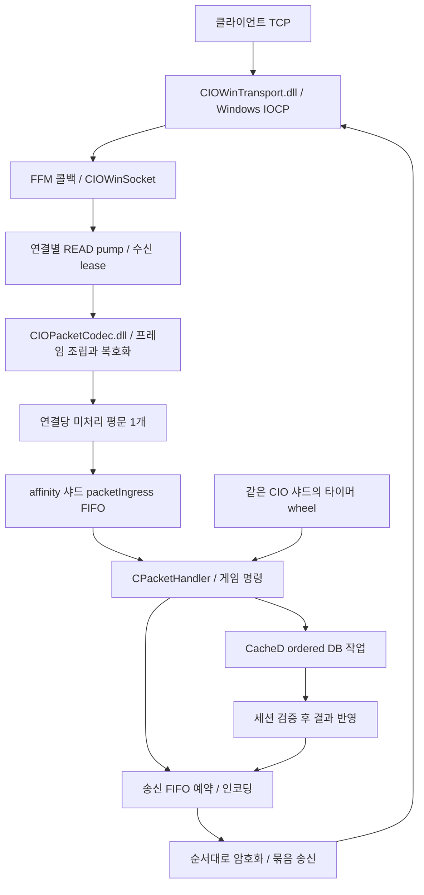

# aden.zip 네트워크 코어 검토 보고서

작성일: 2026-11-11 · 대상: 사용자가 올린 `aden.zip` · 범위: 개선점 검토와 실행 제안

## 1. 먼저 결론

**네트워크 코어에는 상당한 개발이 들어가 있다.** Windows IOCP, Java 21 FFM, 네이티브 프레임/암복호화, 연결별 송신 순서 보장, 재사용 버퍼 풀, 샤드별 패킷 실행, 송신 압력에 따른 읽기 제어를 확인했다. 현재 구조를 유지하면서 **세션 종료의 직렬화, 종료 시간 제한, 수신 버퍼 정확성, 실제로 동작하는 설정·계측**부터 보강하는 것을 권한다.

다만 구현 복잡도가 높고 Java와 DLL 사이의 계약에 많이 의존한다. 제공된 자료만으로 실서버 동접 한계, p99 지연, IOCP 처리량, DLL 내부의 메모리 안전성을 확정할 수는 없다.

핵심 결과:

- 실제 Java 클래스를 이용한 로컬 검사에서 **수신 stash 데이터 손상 조건, `awaitTermination()`의 즉시 반환, 연결 테이블 tombstone 누적**을 재현했다.
- **패킷 실행과 로그아웃 정리의 경쟁**, **패킷 큐의 종료 시점 경쟁**은 코드상 가능한 실행 순서를 확인했다. 실제 게임 데이터 손상이나 운영 장애를 재현한 것은 아니다.
- 설정된 ingress 용량과 실제 패킷 큐 용량이 다르고, 접속 분산용 pressure 값이 현재 코드에서는 항상 0이 되는 문제를 확인했다.
- 네이티브 DLL 두 개의 원본 C/C++ 소스와 빌드 자료가 없어서, 핵심 네이티브 경로의 검증은 남아 있다.

## 2. 검토 범위와 증거 수준

`aden.zip`의 최상위에는 `src.zip`, `CIOWinTransport.dll`, `CIOPacketCodec.dll`이 있다. 내부 소스는 파일 1,695개, Java 1,694개다. `model/network` 아래 Java는 317개, 약 72,732줄이다. 목록 전체를 확인하고 전송·프레이밍·실행·송신·종료의 핵심 경로와 대표 세션/DB 처리 호출을 집중 검토했다. 모든 게임 기능을 전수 검증한 보고서는 아니다.

네트워크 핵심 Java는 `CIOUserSocket` 3,662줄, `CIOThreadCallback` 3,072줄, `CIOWinServer` 417줄, `CIOWinSocket` 254줄이다.

포함되지 않은 자료: DLL의 C/C++ 소스, 원 프로젝트 빌드 파일/의존 JAR, 운영 설정 파일, DB, 운영 프로파일과 실행 로그. 따라서 전체 서버 연결 빌드·실제 Windows 클라이언트 접속·동접 부하 검사는 수행하지 않았다. Windows DLL을 실행하지 않고 PE 형식과 export를 확인했다.

| 증거 표시 | 의미 |
|---|---|
| 로컬 재현 | 제공된 실제 Java 클래스를 컴파일해 해당 동작 확인. DLL·게임 등은 아래에 명시한 가짜 구현으로 대체 |
| 정적 확인 | 소스의 값/호출/분기와 관련 호출자를 직접 추적 |
| 경합 위험 | 가능한 스레드 실행 순서가 존재하지만 실게임에서 발생률·결과는 미측정 |
| 개선 제안 | 계측/검증 후 적용할 설계·성능 제안. 현재 병목이라는 뜻은 아님 |

이 보고서의 P1은 우선 처리할 정합성·운영 문제, P2는 다음 순서의 안정성·유지보수 문제다. CVSS 점수나 보안 취약점 등급은 아니다.

## 3. 현재 네트워크 흐름



주의할 소유권:

| 구간 | 현재 실행/소유 방식 |
|---|---|
| accept와 native 완료 콜백 | 네이티브 IOCP worker. `Server.java:33`에서 worker 수 8로 지정 |
| READ pump | 연결별 실행 토큰으로 직렬화. IOCP 쪽에서도, 샤드의 패킷 완료 뒤 `kickRead()`에서도 진행 가능 |
| 게임 패킷 | 연결의 affinity 샤드. 평문 direct buffer를 처리 완료까지 보유 |
| 송신 | 여러 producer가 FIFO ticket을 예약하고 연결별 serializer가 순서대로 처리 |
| DB | 여러 핸들러가 이미 CacheD ordered job을 사용. 검색에 JDBC 호출이 있다고 곧바로 IOCP 동기 DB 작업인 것은 아님 |
| 로그아웃 | `CIOClient.close()`가 일반 InstantThread 풀로 `pc.logout()`을 넘김. 기존 게임 실행 경로와의 종료 장벽 검토가 필요 |

### 유지할 만한 구현

1. **연결당 평문 하나만 인계**: `CIOUserSocket.java:2735–2768`. native `plaintext()` 재사용 버퍼를 다음 프레임이 덮어쓰기 전에 처리 완료를 기다린다.
2. **인코딩 전 송신 FIFO 위치 예약**: 같은 파일 `1835–1972`. 인코딩이 늦게 끝나도 앞선 송신 순서를 보존하려는 설계다.
3. **wire 순서의 패킷별 암호화**: `2453–2476`, `3352–3385`. 묶음 송신에서도 rolling key를 패킷 단위로 진행한다.
4. **상한이 있는 버퍼 풀과 읽기 제어**: `CIOBufferPool.java:23–55`, `CIOUserSocket.java:526–601`. 무제한 큐 대신 송신 backlog를 제한하고 상·하한으로 READ를 제어한다.
5. **핸들러 동안 송신 토큰을 풀어주는 처리**: `CIOUserSocket.java:3025–3045`. 게임 처리 지연이 다른 송신 producer의 진행까지 막는 문제를 줄이려는 구현이다.
6. **기존 비동기 DB 결과 검증**: 예를 들어 `CS_CommonClick.java:98–125`, `CS_AuthLogin.java:298–334`는 DB 작업과 세션 결과 반영을 나누고 있다. 이 방식을 개선의 기반으로 삼는 편이 낫다.

## 4. 개선 우선순위

아래의 `.../core`, `.../thread`, `.../utill`은 `src/l1j/server/server/model/network/` 아래 경로를 줄인 표기다.

| ID | 우선순위 | 개선 대상 | 증거 | 권장 조치 |
|---|---|---|---|---|
| N01 | P1 | 실행 중 패킷과 로그아웃 최종 정리가 같은 종료 장벽을 쓰지 않음 | 정적 확인 / 경합 위험 | 연결 종료·게임 작업 종료·PC 정리를 단계별로 직렬화 |
| N02 | P1 | 종료 시간 제한이 실제 대기를 제한하지 못함 | API 동작 로컬 재현 + 무제한 대기 정적 확인 | 종료 전체 deadline 전달, 상태와 기다림 API 분리 |
| N03 | P2 | stash를 일부 읽은 후 추가 수신 시 남은 데이터의 위치가 틀어짐 | 실제 `CIOWinSocket`으로 로컬 재현 | 오프셋 유지 또는 재배치 후 0으로 초기화 |
| N04 | P2 | 설정 용량과 실제 큐 용량 불일치, pressure 항상 0 | 정적 확인 | 실제 큐에 설정 연결, 실제 backlog로 분산 지표 계산 |
| N05 | P2 | 연결 테이블의 tombstone 누적 후 없는 ID 검색 비용 증가 | 실제 registry 메서드로 로컬 재현 | 동시성 안전한 정리·교체 전략과 probe 계측 |
| N06 | P2 | 패킷 offer와 shard 종료가 같은 admission 경계를 쓰지 않음 | 정적 확인 / 경합 위험 | 종료와 offer를 직렬화하고 남은 작업의 취소 계약 정의 |
| N07 | P2 | native codec 버전 확인과 재현 가능한 네이티브 빌드 자료 부족 | export·소스 정적 확인 | ABI 버전 검사, DLL 소스/빌드/검증 자료 확보 |

### N01. 실행 중 패킷과 로그아웃 최종 정리의 경계

**근거**

- `src/l1j/server/server/model/network/core/CIOUserSocket.java:2754–2768`: 샤드가 `executeNativePacket()`으로 게임 핸들러를 실행하고 `finally`에서 `_nativeGamePending`을 해제한다.
- 같은 파일 `3572–3579`: close 완료 확인은 READ/SEND/serializer 상태를 확인하지만 `_nativeGamePending`이나 이미 시작한 게임 핸들러 종료를 기다리는 조건은 없다.
- `.../core/CIOSocketFactory.java:149–155`: transport close 완료 시 client disconnect를 호출한다.
- `.../core/CIOClient.java:125–179`: 일반 ThreadPool로 `pc.logout()`을 제출하고, 제출 실패 시 호출자에서 직접 로그아웃한다.
- `src/l1j/server/server/model/Instance/L1PcInstance.java:2572–2610`: 로그아웃 최종 단계가 월드 제거, 인벤토리 비우기, 연결 해제, dispose를 수행한다.

**문제가 될 수 있는 순서**

샤드에서 패킷 핸들러가 PC/인벤토리를 사용하기 시작함 → 다른 스레드에서 transport close → close 완료 콜백 → InstantThread의 logout이 같은 PC를 정리함 → 먼저 시작한 핸들러가 계속 실행함. 핸들러 진입 때 연결 상태를 검사하는 것만으로는 이미 실행 중인 핸들러와의 경쟁을 막지 못한다.

이 순서는 코드상 가능하다. 실제 아이템 중복·손실이나 native use-after-free를 재현했다는 뜻은 아니다. 특히 codec 평문은 Java direct ByteBuffer이므로, 여기서 native 메모리 해제 오류를 단정하지 않는다.

**개선 방법**

`입력 중단 → 새 게임 작업 접수 중단 → 이미 시작한 패킷/actor 작업 종료 확인 → 기존 PC 실행 직렬화 경로에서 최종 teardown → DB 저장 작업/자원 반환 완료`의 단계를 명시한다. 네트워크 자원 반환과 게임 세션 정리를 별도 상태로 관리한다.

`_nativeGamePending` 조건 하나만 추가하면 취소된 큐 작업 때문에 종료가 영원히 기다릴 수 있다. N06의 취소·완료 계약과 함께 설계해야 한다. 정상 경로는 기존 샤드/actor 직렬화 장치를 사용하고, 장애 fallback에서도 게임 상태를 임의의 외부 스레드에서 동시에 정리하지 않도록 한다.

**검증**: 아이템 사용/거래/텔레포트 핸들러 중간에 latch를 걸고 원격 close·관리자 kick·일반 풀 포화를 각각 발생시킨다. 같은 세션의 최종 teardown은 한 번만 수행하고 진행 중 작업과 겹치지 않아야 한다.

### N02. 종료 시간 제한과 await API

**근거**

- `src/l1j/server/Server.java:93–110`: accept 중단을 성공할 때까지 반복 대기한다.
- 같은 파일 `119–125`: `listener.close()`가 끝난 다음에야 30초 `awaitTermination()`을 호출한다.
- `.../core/CIOWinServer.java:373–397`: 진행 중 native downcall 수가 0이 될 때까지 전체 시간 제한 없이 대기하고, 이후 동기 native Stop을 호출한다.
- `.../core/CIOServer.java:134–137`: `awaitTermination(timeout, unit)`은 timeout을 대기에 사용하지 않고 즉시 상태를 반환한다.

**로컬 재현**: 원본 `CIOServer`의 메서드에 가짜 native lifecycle을 연결했다. native 종료를 약 150ms 뒤로 예약하고 `awaitTermination(1, SECONDS)`를 호출했지만 **약 0ms에 false를 반환**했다. 실제 Windows Stop의 무한 정지를 재현한 검사는 아니다.

**영향**: 운영자가 생각하는 30초 제한이 shutdown 전체를 보호하지 않는다. native 호출/중단이 멈추면 서버 저장·정리도 지연될 수 있다. 비동기 close로 확장하면 현재 await 메서드는 대기 계약을 만족하지 못한다.

**개선 방법**

최상위 종료 함수에서 단일 `System.nanoTime()` deadline을 만들고 accept 중단, downcall drain, native Stop/Wait, 세션 정리, shard 종료에 남은 시간을 전달한다. `isTerminated()`와 실제로 기다리는 `awaitTermination()`을 구분하고 latch/condition 또는 native wait 계약으로 구현한다.

시간이 초과했을 때 진행 중 FFM 호출이 사용하는 arena/server를 강제로 해제하면 안 된다. 해당 단계·남은 호출 수·연결 수를 보고하고 자원을 보존한 채 종료 실패를 상위에 전달한다. Native Stop 자체가 무제한 블록한다면 Java의 사후 await 추가로 해결되지 않으므로 DLL API도 함께 바꿔야 한다.

### N03. 수신 stash 재배치 오류

**근거**: `src/l1j/server/server/model/network/core/CIOWinSocket.java:79–94`, `112–118`.

현재 코드는 stash 앞부분을 일부 읽어서 `stashStart > 0`이 되어도, 뒤쪽 공간이 충분하면 `arraycopy`를 하지 않는다. 그런데 바로 뒤에서 `stashStart=0`, `stashEnd=pending`으로 바꾼다. 실제 남은 바이트가 이전 오프셋에 있는 채로 논리 시작 위치만 0이 된다.

**실제 클래스 재현 순서**

1. 3,000바이트씩 두 번 stash에 쌓는다. 총 6,000바이트, backing array 8,192바이트.
2. 4,096바이트를 읽는다. 남은 데이터는 실제 인덱스 4,096–5,999에 있다.
3. 아직 readOwner가 없는 구간에 이미 진행 중이던 추가 수신 1,000바이트가 도착했다고 가정한다.
4. 새 데이터가 들어갈 뒤 공간은 충분하다. 재배치는 생략되지만 시작 인덱스를 0으로 바꾼다.
5. 이후 2,904바이트를 읽으면 원본과 달라진다.

로컬 결과의 첫 8바이트:

```text
기대: [110, 99, 116, 73, 90, 47, 32, 53]
실제: [0, 13, 26, 39, 52, 65, 78, 91]
```

native pause와 game owner는 가짜 구현으로 대체했고 실제 `CIOWinSocket`을 사용했다. **실제 DLL이 pause 뒤 이런 in-flight 콜백 순서를 허용하는지는 DLL 원본 또는 Windows 재현으로 확인해야 한다.** 따라서 현재 서버의 끊김 원인이라고 단정할 수는 없다. Java adapter가 해당 입력 순서를 올바르게 처리하지 못한다는 점은 재현됐다.

**최소 수정안**: 기존 `else if (stashStart > 0 && 남은뒤공간부족)` 조건을 `else if (stashStart > 0)`으로 바꿔, 시작을 0으로 바꾸기 전에 항상 잔여 데이터를 앞으로 복사한다. 또는 뒤 공간이 충분하면 기존 start/end를 유지한 채 실제 end에 추가한다.

검사용 임시 복사본에 첫 번째 수정안을 적용한 뒤 같은 입력을 넣어 2,904바이트 전체가 원본과 같음을 확인했다. 원본 서버 소스에는 적용하지 않았다.

### N04. 실제 ingress 큐와 설정·분산 지표 불일치

**근거**

- `.../utill/ConnectionConfig.java:108–118`: `DisruptorRingSize` 등의 값을 읽는다.
- `.../thread/CIOThreadCallback.java:486–527`: 설정 용량을 정규화해 bind하고 기록한다.
- 같은 파일 `1257–1262`: bind는 `inboundLimit` 값만 저장한다.
- 같은 파일 `1177–1180`: 실제 패킷 큐는 **고정 8,192칸 ArrayBlockingQueue**, 실행 burst는 **고정 64개**다.
- 같은 파일 `601–603`, `1959`: `networkIngressPressure()`가 사용하는 `lastBacklogMask`는 이 코드에서 0으로만 설정된다.
- `.../core/CIOSocketFactory.java:134–141`: 이 pressure를 접속 샤드 선택 점수에 더한다.

따라서 설정에서 큐 용량을 바꿔도 현재 native packetIngress의 실제 capacity가 바뀌지 않는다. 접속 분산의 pressure 항목도 현재는 효과가 없고 liveByShard 기반 점수만 남는다. 실제 설정 파일은 없어서 사용자가 어떤 값을 운용 중인지는 확인하지 못했다.

**개선 방법**

실제로 사용하는 ingress의 capacity/burst를 구성 단계에서 명시적으로 설정한다. 사용하지 않는 과거 설정은 제거하거나 시작 시 미적용 안내를 출력한다. 시작 로그에 **실제 큐 크기·샤드 수·burst·IOCP worker 수**를 기록한다. 압력은 owner가 갱신하는 backlog/최고 대기시간/최근 처리시간의 스냅샷으로 계산하고 접속 분산에 연결한다. 매 accept마다 모든 큐 내부 락을 잡는 방식은 피하고 샘플링된 값을 이용한다.

### N05. 연결 레지스트리 tombstone 정리

**근거**: `.../core/CIOWinServer.java:173–199`.

등록은 null 또는 tombstone을 재사용하지만, 삭제는 tombstone을 남기며 정리/재구축은 없다. 없는 ID를 검색할 때는 null을 만날 때까지 또는 배열 전체를 검색할 때까지 진행한다.

**로컬 재현**: 실제 클래스의 `register/find/forget`을 사용해 1,024칸 테이블에서 한 번에 연결 하나만 등록·삭제했다. 순차 ID **57,589회** 뒤 live 연결이 0개인데 null 칸도 0개가 됐다. 이후 없는 ID 검색은 원본 loop상 1,024칸 전체를 확인해야 한다.

이 검사는 생성자를 우회한 테이블 동작 검사다. **기존 연결의 정상 hit 검색이 항상 느려진다는 뜻도 아니고, 실서버 성능 하락률을 측정한 것도 아니다.** 영향이 커지는 대상은 장기 churn 뒤의 없는 ID/늦은 콜백 검색이다.

**개선 방법**

우선 hit/miss별 probe 횟수와 tombstone 비율을 계측한다. 구조를 유지한다면 reader와 충돌하지 않는 테이블 교체/정리 epoch가 필요하다. IOCP callback이 동시에 읽는 배열에 단순히 tombstone을 null로 바꾸면 검색 체인을 끊을 수 있다. 대안으로 ConcurrentHashMap 또는 세대가 포함된 native ID-index 테이블을 실제 부하와 churn으로 비교한다.

### N06. 패킷 접수와 shard 종료의 경쟁

**근거**: `.../thread/CIOThreadCallback.java:365–372`, `1988–1996`, `3055–3068`.

`enqueuePacketImmediate()`는 `owner.running`을 검사한 뒤 별도로 `packetIngress.offer()`를 수행한다. 종료는 `synchronized(owner)` 안에서 running을 false로 바꾸지만 offer 쪽은 같은 경계를 쓰지 않는다.

가능한 순서: producer가 running=true를 읽음 → shutdown이 false로 바꿈 → owner loop 종료 → producer가 offer 성공을 반환. 또한 최종 정리는 wheel과 states를 정리하지만 packetIngress의 남은 Runnable을 취소·해제하는 경로는 없다.

기본 `GameServer.shutdown()`은 `GameServer.java:494–495`에서 network를 먼저 닫고 `533`에서 shard를 종료한다. 이 순서가 실제 종료에서 위험을 줄인다. 따라서 정상 종료마다 유실이 발생한다고 단정하지 않는다. 다만 접수 성공의 의미와 API 자체의 종료 계약은 불완전하다.

**개선 방법**

짧은 admission 구간과 stop 전이를 같은 경계로 묶는다. 큐 항목에 실행/취소 시 한 번만 끝나는 completion 계약을 두어 pending native buffer 상태를 반환하게 한다. 종료 시 접수된 항목을 drain할지 cancel할지 정하고 명시적으로 처리한다. N01의 close 장벽과 함께 테스트한다.

### N07. 네이티브 버전·계약 확인과 원본 빌드 자료

**근거**

- `.../core/CIOPacketCodec.java:26–47`: native 함수들을 바인딩하지만 버전 검사 함수는 호출하지 않는다.
- 첨부 `CIOPacketCodec.dll`에는 **`CIOPC_Version` export가 존재**한다.
- `.../core/CIOWinServer.java:90–105`: 파일과 필요한 export의 존재는 확인하지만 custom batch/pause/수명 계약을 검증하는 ABI handshake는 없다.
- 첨부 소스에는 C/C++ 파일이 없다. `CIOPacketCodec.java:18`에서 언급한 `native/CIOPacketCodec.cpp`도 없다.

Java 주석은 native Send가 입력을 복사하고 native Stop이 worker들을 동기적으로 join한다고 가정한다. 이 계약은 FFM pointer·descriptor·lease 수명의 핵심이다. 바이너리 export가 있다는 사실만으로 그 의미까지 확인되지는 않는다.

**개선 방법**

`CIOPC_Version`을 시작 시 읽어 허용 ABI 범위를 확인하고, transport에도 명시적 ABI/feature bit를 둔다. 네이티브 원본·수정 diff·컴파일러/옵션·헤더·빌드 스크립트·테스트 벡터를 함께 버전 관리한다. 압축/잘못된 길이/부분 프레임/rolling key 진행/동시 close 테스트와 Windows 전용 CI가 필요하다. 여기서 제시한 검토만으로 DLL 내부가 안전하다고 판단해서는 안 된다.

## 5. 성능 개선은 아래 계측부터

### A. 샤드 대기시간과 타이머 지연

샤드 loop는 같은 스레드에서 먼저 wheel을 진행하고 이후 최대 64개 패킷을 실행한다(`CIOThreadCallback.java:1934–1958`). 개수 상한은 있지만 실행시간 예산은 없다. 10ms짜리 핸들러 64개가 이어진다면 패킷 구간만 약 640ms가 될 수 있다는 **산술 예시**이며, 실제 측정 결과는 아니다.

이미 10ms 이상 opcode 수와 최장 시간이 기록된다(`CIOUserSocket.java:3012–3021`). 여기에 다음을 더하면 병목을 구분하기 쉽다.

| 지표 | 목적 |
|---|---|
| shard별 queue 대기 p50/p95/p99, oldest age | 실제 패킷 처리 대기 확인 |
| opcode별 실행 p95/p99와 10ms 초과 수 | 느린 게임 처리의 종류 구분 |
| wheel due 대비 실행 지연 p99/최대 | 네트워크 트래픽이 게임 타이머에 미치는 영향 확인 |
| READ pause 시간/재개 수, backlog bytes/frames | 느린 클라이언트와 서버 실행 지연 구분 |
| SEND rejection reason별 증가율 | pool·로컬 슬롯·serializer·wire 상한 중 어디가 먼저 막히는지 확인 |
| close reason별 수, native callback error/FFM 호출 지연 | 운영 중 끊김 원인 분류 |

계측에서 필요성이 보이면 패킷 개수 상한과 함께 짧은 시간 예산을 적용한다. 단일 핸들러 자체가 오래 걸리는 경우에는 시간 예산으로 중간 선점할 수 없으므로 해당 작업을 CacheD/기존 worker와 검증된 결과 반영 경로로 분리한다. 이미 비동기화된 DB 처리를 다시 옮기는 중복 작업은 하지 않는다.

### B. 전체 메모리 예산

버퍼 풀의 상한은 잘 잡혀 있지만 `maxDirectBytes()`는 풀만 센다. 연결별 codec plaintext direct buffer, native codec 내부 큐, transport 내부 복사본, Java ticket 배열/객체는 별도다.

`Server.java:66–80`, `CIOBufferPool.java:14–16,23–32,69–73` 기준으로 계산한 **풀 상한 예시**:

| MaximumOnlineUsers 가정 | native 연결 capacity | 풀 direct 메모리 상한 |
|---:|---:|---:|
| 1,000 | 1,256 | 약 131.41 MiB |
| 10,000 | 11,250 | 약 795.07 MiB |

이는 지연 할당되는 **최대치 계산**이다. 실제 사용량·권장 동접·현재 운영값이 아니다. codec과 DLL 메모리도 포함하지 않는다. Windows process Private Bytes, JVM direct-buffer 지표, native 미반환 handle/bytes, pool 사용량을 함께 수집하고 접속 허용량·송신 lease 수·JVM direct memory 한도를 하나의 예산으로 검증한다.

### C. 최적화 경로를 측정 가능한 단위로 관리

`CIOUserSocket.java:296–355`에 owner fusion, inline completion, staged write 선택 등의 경로가 켜져 있다. 분기 자체를 나쁘다고 볼 수는 없지만 조합별 검증 비용이 높다. 일반 Java 프레이밍 경로는 native codec이 필수인 현재 게임 경로와 구분해 문서화한다.

기능별 상태 전이표와 최소 회귀 검사를 만들고, 성능 개선 전후에 같은 offered load·패킷 분포·warmup·측정 시간을 사용한다. 비교 항목은 처리량, application 왕복 p99, CPU/요청, allocation/요청, timer 지연, SEND 거부/연결 종료 수다. IOCP WRITE 완료 수만으로 클라이언트가 실제로 받은 처리량을 주장하지 않는다.

## 6. 실행 순서 제안

1. **N01과 N02의 종료 계약 설계**: 세션·transport·actor·DB 완료를 구분하고 장벽/시간 제한을 정의한다. 부하 개선 전에 안정성 기준을 만든다.
2. **N03의 작은 정확성 수정**: 재현 검사를 고정하고 stash 재배치 조건을 고친다. Windows에서 pause/in-flight 콜백 순서도 확인한다.
3. **N06의 접수·취소 계약 정리**: 종료 후 접수 성공과 미완료 packet lease를 없앤다. N01과 통합해 close 경합을 검사한다.
4. **N04와 계측 연결**: 설정이 실제 큐를 구성하게 하고, pressure·대기시간·타이머 지연·close reason을 관찰 가능하게 만든다.
5. **N05의 테이블 정리/교체 검토**: 연결 churn과 miss callback에서 확인된 비용을 기준으로 결정한다.
6. **N07의 네이티브 빌드·ABI 검증 확보**: 실제 Windows 검증과 다음 성능 변경을 위한 필수 자료로 관리한다.
7. **측정된 병목 하나씩 개선**: native downcall·gather descriptor 생성·codec monitor·queue lock 등은 프로파일에서 비중을 확인한 뒤 선택한다.

실제 수정 PR은 상태 전이 변경과 성능 변경을 나눠 검토하고, SEND 순서/암호 키 진행/lease 1회 반환 검사를 공통으로 통과하게 한다.

## 7. Windows에서 추가로 확인할 항목

다음은 **권장 검증 계획이며 수행 결과가 아니다.**

| 시나리오 | 확인할 결과 |
|---|---|
| 헤더 1바이트 분할, payload 분할, 여러 패킷 합쳐 수신 | 원래 바이트·패킷 순서·키 진행 보존 |
| 잘못된 길이·빈 패킷·최대 허용 프레임 | 정책에 맞는 거부, 과도한 할당/반복 없음 |
| READ pause 직후 이미 진행 중인 수신 완료 | N03 재현 여부와 바이트 보존 |
| send downcall 반환 전 inline/foreign 완료 | 중복 반환·buffer 재사용·FIFO 역전 없음 |
| 인코딩이 늦은 앞 ticket과 빠른 뒤 ticket | wire 순서·암호화 순서 유지 |
| 게임 핸들러 실행 중 remote close/kick/풀 포화 | final teardown 1회, 게임 처리와 정리의 중첩 없음 |
| queue full과 shutdown 동시 실행 | 성공한 admission이 실행 또는 취소로 정확히 한 번 끝남 |
| 느린 reader와 많은 broadcast | 상한 준수, READ 재개, 다른 세션 timer 지연 관찰 |
| 반복 connect/disconnect와 늦은 callback | registry probe/handle/메모리가 계속 증가하지 않음 |
| 네이티브 SEND/STOP 지연 주입 | 정한 전체 deadline 안에 성공 또는 진단 가능한 실패 |

## 8. 이번에 실제로 수행한 검사

| 검사 | 결과 | 한계 |
|---|---|---|
| 원본 CIOWinSocket stash 입력 순서 | 데이터 손상 재현 | pause/send·game owner는 가짜 구현. 실제 DLL 순서 미확인 |
| 제안한 stash 수정의 임시 복사본 | 같은 2,904바이트가 모두 보존됨 | 서버 소스에 적용한 수정본이 아님 |
| 원본 CIOWinServer registry | tombstone으로 null sentinel 소진 재현 | 생성자 우회. 실제 접속/IOCP 성능 검사가 아님 |
| 원본 CIOServer awaitTermination | 대기 없이 false 반환 재현 | native lifecycle 가짜 구현 |
| DLL PE/export | 둘 다 Windows x64. codec 버전 export 및 transport patch export 존재 | DLL 미실행·내부 구현 미검증 |

실행 환경: Linux, OpenJDK 21.0.13. FFM을 사용하는 검사에는 `--enable-preview --enable-native-access=ALL-UNNAMED`를 사용했다. 전체 서버 dependency/type build, 실제 MySQL, Windows 실게임, 부하 검사는 수행하지 않았다.

재현 스크립트와 로그는 이 보고서의 `probes/`, `logs/`에 있다. 실행 방법은 [PROBES_KO.md](PROBES_KO.md)에 정리했다. 업로드된 원본 Java와 DLL은 보고서 묶음에 넣지 않았다.

## 9. 원본 식별

```text
aden.zip
SHA256 9c966670af5ae7f624d7b612dd185600d12d6b214ef88ac2dbbcab6438b69b33

CIOWinTransport.dll
SHA256 9d8106886be0e26d14bd8eb7093714ae3b44d655ccae869ffc98148db8807ecc

CIOPacketCodec.dll
SHA256 60bde93c2ba20057e7e307594edef69ced273b69f923535ab658769e09f0cea9
```

문서 내 경로와 줄 번호는 이 `aden.zip` 안 `src.zip`을 추출한 원본 기준이다.
